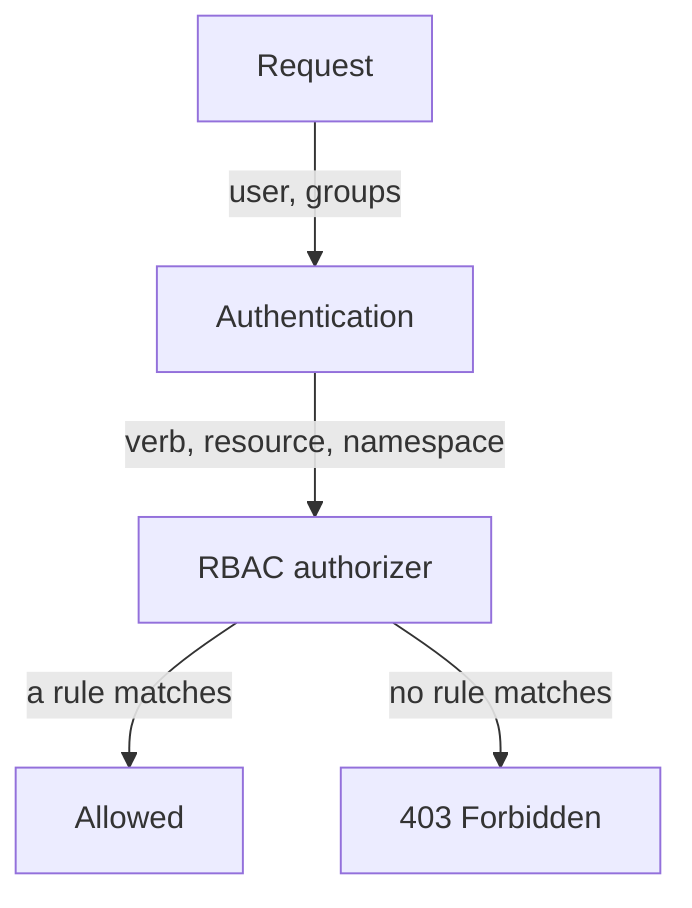

# Roles, Bindings And Scope

Every request to the Kubernetes API server carries an identity and an action. The API server must decide whether to allow it, and with no rule that matches, the answer is no. This part shows the objects that hold those rules and how to build the smallest rule that still lets a workload do its job. You will give the `shuttle` ServiceAccount read access to ConfigMaps in one namespace and prove, with commands, where that access stops.

## What the authorizer decides

The API server runs authorization after it has authenticated the caller. Authentication answers "who is this?". Authorization answers "may this identity do this action?". The `--authorization-mode` flag of `kube-apiserver` lists the authorization modules. A cluster created with `kubeadm` uses `Node,RBAC`: the Node authorizer handles requests from kubelets, and the RBAC authorizer handles everything else. If no module allows a request, the API server answers `403 Forbidden`.

Role Based Access Control (RBAC) describes each request by a set of attributes: the user name, the groups of the user, the verb, the API group, the resource, the resource name and the namespace. The RBAC authorizer then looks for at least one rule, in any binding that applies to the user or one of its groups, that matches all of those attributes. One match is enough to allow the request.



The diagram shows that RBAC either finds a matching rule and allows the request, or finds none and the API server rejects it.

## The four RBAC objects

RBAC uses four resource kinds in the API group `rbac.authorization.k8s.io`. Two of them define permissions and two of them attach those permissions to identities.

| Kind | Scope | What it does |
| --- | --- | --- |
| `Role` | One namespace | Lists rules that apply inside its own namespace |
| `ClusterRole` | Whole cluster | Lists rules for namespaced resources in any namespace, for cluster-scoped resources such as nodes, or for non-resource URLs |
| `RoleBinding` | One namespace | Gives the rules of a Role or a ClusterRole to subjects, inside the namespace of the binding only |
| `ClusterRoleBinding` | Whole cluster | Gives the rules of a ClusterRole to subjects in every namespace and for cluster-scoped resources |

A **subject** is the identity that receives a grant. Its kind is `User`, `Group` or `ServiceAccount`. A ServiceAccount is a namespaced identity for a workload. Its user name inside the API server is `system:serviceaccount:<namespace>:<name>`, so the ServiceAccount `shuttle` in `starfleet` is `system:serviceaccount:starfleet:shuttle`. This is the name you give to `--as` when you test it.

A Role or ClusterRole holds a list of `rules`. Each rule has these fields:

- `apiGroups` lists the API groups. The core group, which holds Pods, Services, ConfigMaps and Secrets, is written as the empty string `''`. Deployments are in `apps`.
- `resources` lists the resource types, such as `pods` or `configmaps`. A subresource is written with a slash, for example `pods/log` or `pods/exec`.
- `verbs` lists the allowed actions: `get`, `list`, `watch`, `create`, `update`, `patch`, `delete` and `deletecollection`.
- `resourceNames` optionally limits the rule to objects with these names.

A rule matches only when the request matches all of its fields. A rule for `pods` in the core group does not cover Deployments, and a rule for `get` does not cover `list`.

## Check the starting state

Look at the identity before you change anything. The first command shows that the ServiceAccount exists. The second asks the API server whether the ServiceAccount may list ConfigMaps in `outpost`. `kubectl auth can-i` sends a `SubjectAccessReview` request to the API server, which runs the same authorization that a real request would run. The `--as` flag makes `kubectl` act as another identity. Your `cluster-admin` role is allowed to do this.

<!-- astrona:playground:renew -->

```sh
kubectl -n starfleet get serviceaccount shuttle
kubectl auth can-i list configmaps -n outpost --as=system:serviceaccount:starfleet:shuttle
```

The first command lists the ServiceAccount. The second command prints `no`, because no Role or binding gives `shuttle` anything. It also exits with status `1`, which is how a script can detect a denied action. A `yes` answer exits with status `0`.

## Build a namespaced grant

The `shuttle` workload must read ConfigMaps in `outpost` and nothing else. That needs two objects: a Role in `outpost` with the rule, and a RoleBinding in `outpost` that gives the Role to the ServiceAccount.

Save this as `role-configmap-reader.yaml`:

```yaml
apiVersion: rbac.authorization.k8s.io/v1
kind: Role
metadata:
  name: configmap-reader
  namespace: outpost
rules:
  - apiGroups: [""]
    resources: ["configmaps"]
    verbs: ["get", "list"]
---
apiVersion: rbac.authorization.k8s.io/v1
kind: RoleBinding
metadata:
  name: shuttle-configmap-reader
  namespace: outpost
roleRef:
  apiGroup: rbac.authorization.k8s.io
  kind: Role
  name: configmap-reader
subjects:
  - kind: ServiceAccount
    name: shuttle
    namespace: starfleet
```

The binding lives in `outpost`, so the grant applies in `outpost`. The subject names the ServiceAccount together with its own namespace, `starfleet`. A ServiceAccount subject without a namespace is invalid, and a wrong namespace names a different identity that does not exist. The `roleRef` names the Role. It cannot be changed after the binding exists: to point a binding at another role you delete it and create it again.

Apply it:

```sh
kubectl apply -f role-configmap-reader.yaml
```

Then check the result. Each command asks the authorizer one question:

```sh
kubectl auth can-i list configmaps -n outpost --as=system:serviceaccount:starfleet:shuttle
kubectl auth can-i delete configmaps -n outpost --as=system:serviceaccount:starfleet:shuttle
kubectl auth can-i list configmaps -n starfleet --as=system:serviceaccount:starfleet:shuttle
kubectl auth can-i list secrets -n outpost --as=system:serviceaccount:starfleet:shuttle
```

The first command prints `yes`. The other three print `no`: the Role does not include `delete`, the binding does not reach the `starfleet` namespace, and the rule does not include Secrets. Each answer shows a different limit of the grant: the verb, the namespace and the resource.

## The imperative form

On the exam you often create these objects with `kubectl` instead of a file. The `--dry-run=client -o yaml` flags make `kubectl` print the object it would create without sending it to the API server, so you can read it or save it.

> [!TIP]
> Let `kubectl` write the first draft of an RBAC object. `kubectl create role configmap-reader --verb=get,list --resource=configmaps -n outpost --dry-run=client -o yaml` prints a Role. `kubectl create rolebinding shuttle-configmap-reader --role=configmap-reader --serviceaccount=starfleet:shuttle -n outpost --dry-run=client -o yaml` prints the matching binding. Remove `--dry-run=client -o yaml` to create the object directly.

You can now build a Role and a RoleBinding, and you can prove with `kubectl auth can-i` that the grant stops at its verb, resource and namespace. The next question is what changes when the permissions come from a ClusterRole, and what stops an identity from handing out more than it has.

## Common pitfalls

> [!WARNING]
> - **Leaving out the namespace of a ServiceAccount subject.** The binding is rejected or names a different identity. Write `name` and `namespace` together.
> - **Putting the binding in the wrong namespace.** The grant applies in the namespace of the RoleBinding, not in the namespace of the ServiceAccount.
> - **Writing `apiGroups: ["core"]`.** The core group is the empty string `""`.
> - **Testing with your own identity.** `kubectl auth can-i` without `--as` answers for you, and you are `cluster-admin`, so every answer is `yes`.
> - **Trying to edit `roleRef`.** It is immutable. Delete the binding and create it again.
