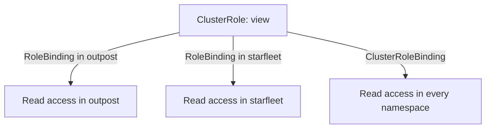

# ClusterRoles, Reuse And Escalation Prevention

A permission set that many namespaces need should not be copied into a Role in each one. Kubernetes lets you define it once as a ClusterRole and bind it where it is needed. This part shows how the binding type decides the reach of a ClusterRole, which built-in ClusterRoles exist, and which check stops an identity from creating a grant larger than its own permissions.

## A ClusterRole is a definition, the binding is the reach

A ClusterRole is a list of rules that is not tied to a namespace. What it grants depends only on the binding that uses it. A RoleBinding that references a ClusterRole gives those rules inside the namespace of the RoleBinding and nowhere else. A ClusterRoleBinding that references the same ClusterRole gives them in every namespace, and it is the only way to grant cluster-scoped resources such as nodes or namespaces.



The diagram shows one ClusterRole producing three different reaches, which depend only on the binding.

A ClusterRole is also required for rules that a Role cannot hold: cluster-scoped resources and non-resource URLs such as `/healthz`.

## The built-in ClusterRoles

Kubernetes creates a set of ClusterRoles when the API server starts. Four of them are meant for users and are used with a RoleBinding to give a person or workload a standard level of access in a namespace:

- `view` allows read-only access to most namespaced objects. It does not include Secrets and it does not include Roles or RoleBindings.
- `edit` allows read and write access to most objects, including Secrets, and allows a workload to run as any ServiceAccount of the namespace. It does not allow changing Roles or RoleBindings.
- `admin` allows what `edit` allows plus managing Roles and RoleBindings inside the namespace.
- `cluster-admin` allows every action on every resource. Bound with a ClusterRoleBinding, it gives full control of the cluster.

Names that start with `system:` belong to Kubernetes components. The API server re-creates the built-in ClusterRoles and their bindings at startup, so edits to them can be overwritten.

Look at the built-in roles in the playground. The first command lists the four roles. The second prints the rules of `view` as a table of resources and verbs:

<!-- astrona:playground:renew -->

```sh
kubectl get clusterrole view edit admin cluster-admin
kubectl describe clusterrole view
```

In the table from `describe`, find the resources the role covers. You will see many resources such as `pods`, `services` and `configmaps`, each with the verbs `get`, `list` and `watch`. You will not find `secrets`. That absence is deliberate: reading a Secret exposes credentials.

## Bind a ClusterRole inside one namespace

The `shuttle` ServiceAccount now needs to read Pods in `outpost`. Reusing `view` is shorter than writing a Role, but `view` is broader than the need: it also reads Services, ConfigMaps and more. Binding it is a trade-off between less YAML and more access. For this exercise the namespace boundary is the safeguard.

Save this as `rolebinding-shuttle-view.yaml`:

```yaml
apiVersion: rbac.authorization.k8s.io/v1
kind: RoleBinding
metadata:
  name: shuttle-view
  namespace: outpost
roleRef:
  apiGroup: rbac.authorization.k8s.io
  kind: ClusterRole
  name: view
subjects:
  - kind: ServiceAccount
    name: shuttle
    namespace: starfleet
```

Apply it:

```sh
kubectl apply -f rolebinding-shuttle-view.yaml
```

Then check the result:

```sh
kubectl auth can-i list pods -n outpost --as=system:serviceaccount:starfleet:shuttle
kubectl auth can-i get secrets -n outpost --as=system:serviceaccount:starfleet:shuttle
kubectl auth can-i list pods -n starfleet --as=system:serviceaccount:starfleet:shuttle
```

The first command prints `yes`. The second prints `no`, because `view` has no rule for Secrets. The third prints `no`, because the RoleBinding exists only in `outpost`, although it references a cluster-wide definition.

## Escalation prevention

RBAC would be easy to defeat if any identity that may create Roles could write a Role with any permission and bind it to itself. The API server blocks this. A user can create or update a Role or ClusterRole only if the user already holds every permission in it, in the same scope, or holds the special verb `escalate` on roles. A user can create a RoleBinding only if the user holds all permissions of the referenced role, or holds the verb `bind` on that role. The check is made by the API server when it stores the object, not by the RBAC authorizer's normal allow decision.

Show it with `shuttle`. First give it the right to manage Roles and RoleBindings in `outpost`. Save this as `role-role-manager.yaml`:

```yaml
apiVersion: rbac.authorization.k8s.io/v1
kind: Role
metadata:
  name: role-manager
  namespace: outpost
rules:
  - apiGroups: ["rbac.authorization.k8s.io"]
    resources: ["roles", "rolebindings"]
    verbs: ["create", "get", "list"]
---
apiVersion: rbac.authorization.k8s.io/v1
kind: RoleBinding
metadata:
  name: shuttle-role-manager
  namespace: outpost
roleRef:
  apiGroup: rbac.authorization.k8s.io
  kind: Role
  name: role-manager
subjects:
  - kind: ServiceAccount
    name: shuttle
    namespace: starfleet
```

Apply it:

```sh
kubectl apply -f role-role-manager.yaml
```

Then try to create two Roles as `shuttle`. The first one asks for a permission that `shuttle` holds through the earlier `configmap-reader` grant. The second one asks for Secrets, which `shuttle` does not hold:

```sh
kubectl create role copy-reader --verb=get --resource=configmaps -n outpost --as=system:serviceaccount:starfleet:shuttle
kubectl create role secret-reader --verb=get --resource=secrets -n outpost --as=system:serviceaccount:starfleet:shuttle
```

The first command succeeds and prints that the Role was created. The second fails with a `Forbidden` error that says the user is attempting to grant RBAC permissions not currently held. The ServiceAccount may create Roles, but only Roles that stay inside what it already has. Two verbs bypass this check on purpose: `escalate` lets an identity write larger Roles, and `bind` lets it create bindings to roles it does not hold. Both are therefore as dangerous as the permissions they unlock.

You now know that the binding decides the reach of a ClusterRole, that `view` leaves out Secrets, and that the API server stops an identity from granting more than it holds. What the checks do not do is cancel a grant that exists somewhere else, which is the subject of the next part.

## Common pitfalls

> [!WARNING]
> - **Thinking a RoleBinding to a ClusterRole is cluster-wide.** It applies only in the namespace of the RoleBinding.
> - **Binding `edit` or `admin` for convenience.** Both include Secrets, and `admin` also manages Roles and RoleBindings in the namespace.
> - **Editing a built-in `system:` role.** The API server restores it at startup.
> - **Giving `escalate`, `bind` or `impersonate` to a workload.** They remove the protection against self-granted permissions or let the holder act as another identity.
