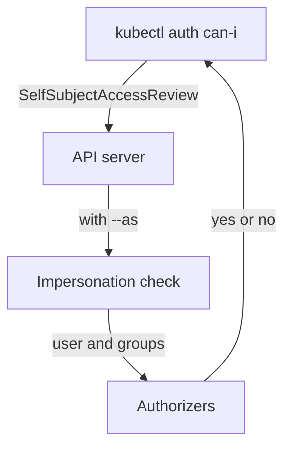

# Ask The Authorizer Precisely

An access review is a series of questions to the API server: may this identity do this action on this object? A vague question gives a vague answer. If you only ask whether `scout` can read ConfigMaps, you miss that it can also read Secrets, run commands in Pods and touch every namespace. This part shows how to ask exact questions with `kubectl auth can-i`, and what the answers mean and do not mean.

## What can-i sends to the API server

`kubectl auth can-i` does not guess from the RBAC objects. It sends an access review request to the API server, and the API server runs the same authorization chain that it runs for a real request. When no `--as` flag is present, `kubectl` sends a `SelfSubjectAccessReview`, which asks about the caller. The answer is `yes` or `no`, and the exit status is `0` for `yes` and `1` for `no`.

The `--as` flag makes `kubectl` impersonate another user: the API server first checks that the caller holds the verb `impersonate` for that identity, and then it handles the request as that identity. The `--as-group` flag adds a group to the impersonated identity and needs `--as` as well. Your credentials in the playground are `cluster-admin`, which includes `impersonate`, so every example below works. Because the chain is the real one, a `no` can also come from another authorizer, such as a webhook, and not only from RBAC.

Two limits matter for a review. The check looks at authorization only, so it does not run admission and cannot tell you whether a create request would pass admission policies. It also does not check that an object exists: an action on a name that does not exist still gets `yes` when a rule allows it.

## Ask about the verb and the resource

Start with the ServiceAccount `scout`. The playground gives it the built-in `edit` ClusterRole in every namespace, and the commands below show how far that reaches. The first command asks about Secrets, the second about creating bindings, and the third about nodes, which are cluster-scoped objects.

<!-- astrona:playground:renew -->

```sh
kubectl auth can-i get secrets -n outpost --as=system:serviceaccount:starfleet:scout
kubectl auth can-i create rolebindings.rbac.authorization.k8s.io -n outpost --as=system:serviceaccount:starfleet:scout
kubectl auth can-i get nodes --as=system:serviceaccount:starfleet:scout
```

The first command prints `yes`, because `edit` includes Secrets. The second prints `no`, because `edit` cannot change Roles or bindings. The third prints `no`, because the grant has no rule for nodes. A resource from a group other than the core group is written as `resource.group`, as in `rolebindings.rbac.authorization.k8s.io`.

## Ask about names, subresources and URLs

A rule can name one object, one subresource or a URL, and each of these needs its own question. A resource name is written after a slash, as in `configmaps/scout-report`. A subresource is also written after a slash, as in `pods/log` or `pods/exec`. A non-resource URL is written as a path that starts with `/`. The `--all-namespaces` flag asks whether the action is allowed in every namespace at once, which only a cluster-wide grant can give.

```sh
kubectl auth can-i update configmaps/scout-report -n outpost --as=system:serviceaccount:starfleet:scout
kubectl auth can-i create pods/exec -n outpost --as=system:serviceaccount:starfleet:scout
kubectl auth can-i list pods --all-namespaces --as=system:serviceaccount:starfleet:scout
kubectl auth can-i list pods --all-namespaces --as=system:serviceaccount:starfleet:shuttle
kubectl auth can-i get /version --as=system:serviceaccount:starfleet:shuttle
```

The first three commands print `yes` for `scout`, which shows what the cluster-wide `edit` grant means in practice: it can run commands inside Pods in every namespace. The fourth prints `no` for `shuttle`, which has no cluster-wide grant. The fifth prints `yes`, because the API server gives every authenticated identity the right to read a few version and health URLs.

## Ask as a member of a group

Many grants name a group and not a user. Kubernetes has no object for a user or a group: the name and the groups come from the authentication step, for example from a certificate or a token. To test a group grant, give any user name and the group. The group `starfleet-crew` holds the `view` ClusterRole in `outpost` through the RoleBinding `crew-view`.

```sh
kubectl auth can-i list pods -n outpost --as=jane --as-group=starfleet-crew
kubectl auth can-i list pods -n outpost --as=jane
kubectl auth whoami --as=jane --as-group=starfleet-crew
```

The first command prints `yes`. The second prints `no`, because the user name `jane` alone has no grant, which shows that the group carried the access. The third command prints the identity that the API server sees: the user name `jane` and a group list that contains `starfleet-crew` and `system:authenticated`. The list of rules for a whole identity comes from `kubectl auth can-i --list -n outpost --as=jane --as-group=starfleet-crew`, which asks the API server for the rules that apply in that namespace.



The diagram shows that the answer comes from the API server's own authorization chain, after an impersonation check when `--as` is used.

You can now ask exact questions about verbs, resources, names, subresources, URLs, groups and namespaces. A single answer still says little about the whole identity. The next question is which bindings are behind the answers, so that a broad grant can be found and changed.

## Common pitfalls

> [!WARNING]
> - **Testing without `--as`.** The answer is for your own `cluster-admin` identity and is always `yes`.
> - **Testing a group grant with only `--as-group`.** The flag needs `--as` as well.
> - **Reading `yes` as proof that the object exists.** The check does not look for the object.
> - **Testing only the allowed action.** A review needs the denied actions too: Secrets, subresources such as `pods/exec`, and other namespaces.
> - **Forgetting the group of a non-core resource.** Write `deployments.apps`, not `deployments`, when you test an action on Deployments.
