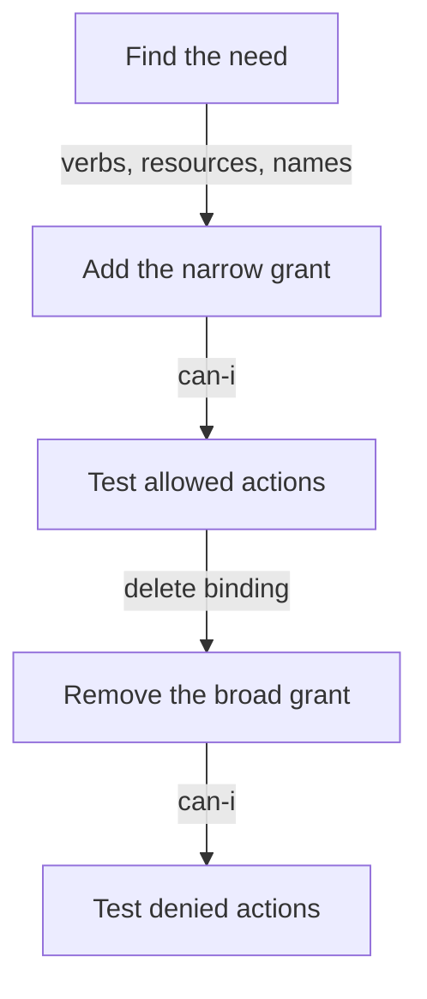

# Rewrite A Broad Grant As Least Privilege

A finding is only useful if the fix does not break the workload. Replacing a broad grant by a narrow one has a safe order: add the narrow grant first, test it, remove the broad one, and test again. This part follows that order with the group `starfleet-crew`, which holds the built-in `view` ClusterRole in `outpost` but only needs to read Pods and their logs.

## Decide what the identity needs

Least privilege starts from the work, not from the existing role. Ask what API calls the workload or the people really make: which verbs, on which resources, in which namespaces and on which named objects. The sources are the application documentation, the audit log of the API server and a trial run with the denied actions logged. A rule that you cannot trace to a need is a rule to leave out.

For the crew the need is stated: read Pods in `outpost` and read their logs. The built-in `view` role gives much more. It also reads Services, ConfigMaps, Deployments and many other objects. The first command shows one of the extra reads. The second shows the part that the crew needs.

<!-- astrona:playground:renew -->

```sh
kubectl auth can-i list services -n outpost --as=jane --as-group=starfleet-crew
kubectl auth can-i get pods/log -n outpost --as=jane --as-group=starfleet-crew
```

Both commands print `yes`. The first answer is the exposure to remove. The second answer is the access to keep.

## Add the narrow grant first

A narrow grant uses a Role in the namespace of the need. The Role lists the two resources with read verbs only. The log of a Pod is the subresource `pods/log`, which `pods` does not include, so it needs its own entry. The new binding goes in the same namespace and names the same group.

Save this as `role-crew-pod-reader.yaml`:

```yaml
apiVersion: rbac.authorization.k8s.io/v1
kind: Role
metadata:
  name: crew-pod-reader
  namespace: outpost
rules:
  - apiGroups: [""]
    resources: ["pods", "pods/log"]
    verbs: ["get", "list", "watch"]
---
apiVersion: rbac.authorization.k8s.io/v1
kind: RoleBinding
metadata:
  name: crew-pod-reader
  namespace: outpost
roleRef:
  apiGroup: rbac.authorization.k8s.io
  kind: Role
  name: crew-pod-reader
subjects:
  - kind: Group
    name: starfleet-crew
    apiGroup: rbac.authorization.k8s.io
```

Apply it:

```sh
kubectl apply -f role-crew-pod-reader.yaml
```

At this point the crew holds both grants, so nothing has been removed yet. The new grant is already testable on its own, but the old grant would hide a mistake in it. That is why the old one must go before the final test.

## Remove the broad grant and test again

Delete the RoleBinding that gives `view`. Only the binding is deleted: the built-in ClusterRole `view` stays, because other bindings may use it. Then ask the same questions as before, and add the actions that must stay denied.

```sh
kubectl -n outpost delete rolebinding crew-view
kubectl auth can-i list pods -n outpost --as=jane --as-group=starfleet-crew
kubectl auth can-i get pods/log -n outpost --as=jane --as-group=starfleet-crew
kubectl auth can-i list services -n outpost --as=jane --as-group=starfleet-crew
kubectl auth can-i list pods -n starfleet --as=jane --as-group=starfleet-crew
```

The first two answers are `yes`, so the crew keeps its work. The last two are `no`: Services are gone from the grant, and the grant does not reach another namespace. If a person on the crew reports a failure, the denied request names the missing verb and resource in its error message, and you add exactly that one rule.

## Limits of resourceNames

The field `resourceNames` limits a rule to objects with the listed names. A rule with `resources: ["configmaps"]`, `resourceNames: ["scout-report"]` and the verbs `get`, `update` and `patch` allows those verbs on that one ConfigMap and on no other. This is the narrowest rule for a workload that maintains a single object.

It has limits that you must know. A `create` request has no object name when the authorizer checks it, so `resourceNames` cannot limit `create`: a rule that has `create` and `resourceNames` never matches a create request, so `create` stays denied. A `list` or `watch` request is matched by name only when the request itself selects the object with a field selector on `metadata.name`. And `deletecollection` cannot be limited by name. If the workload must create objects, give `create` in a separate rule without names and accept the wider rule, or create the object ahead of time as an administrator.



The diagram shows the safe order: the narrow grant is added and tested before the broad one is removed, and the denied actions are tested last.

You can now replace a broad built-in role by a narrow Role without an outage, and you know where `resourceNames` stops working. The task on the next page applies the same order to the `scout` ServiceAccount and its cluster-wide `edit` grant.

## Common pitfalls

> [!WARNING]
> - **Deleting the broad binding first.** The workload or the crew has no access until the replacement exists.
> - **Deleting the built-in ClusterRole `view`.** Delete the binding, not the role. Other bindings may use the role, and the API server restores built-in roles at startup.
> - **Forgetting the subresource.** `pods` does not include `pods/log`. Name each subresource.
> - **Adding `create` to a rule with `resourceNames`.** The name cannot limit a create request.
> - **Stopping after the allowed tests.** Run the denied tests in the same namespace and in another one.
