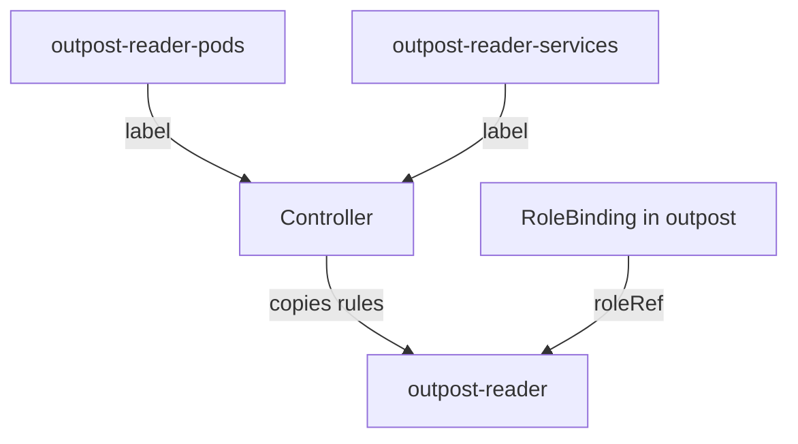

# Built-In And Aggregated ClusterRoles

Kubernetes ships ClusterRoles and bindings that exist before you create anything. A reviewer who does not know them cannot tell a normal binding from a risky one. Some of these roles also change by themselves: the rules of `view`, `edit` and `admin` grow when another role carries a certain label. This part lists the built-in bindings that matter, and then builds an aggregated ClusterRole of your own.

## Built-in roles and the groups they reach

The API server creates two kinds of default ClusterRoles. The user-facing ones, `cluster-admin`, `admin`, `edit` and `view`, are meant to be bound by administrators. The ones whose names start with `system:` belong to Kubernetes components and to basic client behavior. A few default bindings reach broad groups on purpose:

- `cluster-admin` is bound to the group `system:masters`. Any identity in that group has full control, and the API server re-creates the binding at startup, so deleting it does not remove that access. Protect the credentials that carry this group.
- `system:basic-user` is bound to `system:authenticated`. It lets every authenticated identity ask what it may do, which is what `kubectl auth can-i` uses.
- `system:discovery` is bound to `system:authenticated`. It lets a client read the API discovery information.
- `system:public-info-viewer` is bound to `system:authenticated` and `system:unauthenticated`. It allows reading the health and version URLs without credentials.

The command below prints three of these bindings. The `-o wide` output has a `GROUPS` column that shows the group of each binding.

<!-- astrona:playground:renew -->

```sh
kubectl get clusterrolebinding cluster-admin system:basic-user system:discovery -o wide
```

The `cluster-admin` row shows the group `system:masters`. The other two rows show the group `system:authenticated`. In a review, any custom binding to one of these groups is compared with what these built-in ones give, which is very little.

## How view, edit and admin grow

The roles `view`, `edit` and `admin` are aggregated ClusterRoles. An aggregated ClusterRole has an `aggregationRule` with label selectors, and its `rules` field is filled in by a controller in the control plane. The controller copies the rules of every ClusterRole that has a matching label into the aggregated role, and it overwrites any rules that someone wrote by hand. The `view` role selects the label `rbac.authorization.k8s.io/aggregate-to-view` with the value `true`.

This is how a custom resource definition gives `view` access to its own objects. The author of the definition creates a ClusterRole with read rules for the new resource and puts the label on it. No binding changes, and everyone who holds `view` can read the new objects after the controller has run. The same mechanism means that a role with such a label from an unknown source widens `view`, `edit` or `admin` for every holder.

Print the selector of `view` to see the label:

```sh
kubectl get clusterrole view -o jsonpath='{.aggregationRule.clusterRoleSelectors[0].matchLabels}'
```

The command prints the label key `rbac.authorization.k8s.io/aggregate-to-view` with the value `true`.

## Build an aggregated ClusterRole

The same mechanism builds your own roles from small parts. The parts are ClusterRoles with one label and plain rules. The aggregated role has the selector and no rules. A RoleBinding gives the aggregated role to a group in one namespace.

Save this as `clusterroles-outpost-reader.yaml`:

```yaml
apiVersion: rbac.authorization.k8s.io/v1
kind: ClusterRole
metadata:
  name: outpost-reader-pods
  labels:
    outpost.example.com/aggregate-to-outpost-reader: "true"
rules:
  - apiGroups: [""]
    resources: ["pods"]
    verbs: ["get", "list", "watch"]
---
apiVersion: rbac.authorization.k8s.io/v1
kind: ClusterRole
metadata:
  name: outpost-reader
aggregationRule:
  clusterRoleSelectors:
    - matchLabels:
        outpost.example.com/aggregate-to-outpost-reader: "true"
---
apiVersion: rbac.authorization.k8s.io/v1
kind: RoleBinding
metadata:
  name: outpost-reader
  namespace: outpost
roleRef:
  apiGroup: rbac.authorization.k8s.io
  kind: ClusterRole
  name: outpost-reader
subjects:
  - kind: Group
    name: outpost-observers
    apiGroup: rbac.authorization.k8s.io
```

Apply it:

```sh
kubectl apply -f clusterroles-outpost-reader.yaml
```

Then check the result. The controller needs a moment to fill in the rules, so repeat the first command if it prints `no`:

```sh
kubectl auth can-i list pods -n outpost --as=anyone --as-group=outpost-observers
kubectl auth can-i list services -n outpost --as=anyone --as-group=outpost-observers
```

The first command prints `yes`, and the second prints `no`. Now add a second labelled part. Save this as `clusterrole-outpost-reader-services.yaml`:

```yaml
apiVersion: rbac.authorization.k8s.io/v1
kind: ClusterRole
metadata:
  name: outpost-reader-services
  labels:
    outpost.example.com/aggregate-to-outpost-reader: "true"
rules:
  - apiGroups: [""]
    resources: ["services"]
    verbs: ["get", "list", "watch"]
```

Apply it, wait a few seconds, and ask the second question again:

```sh
kubectl apply -f clusterrole-outpost-reader-services.yaml
kubectl auth can-i list services -n outpost --as=anyone --as-group=outpost-observers
```

The answer changes to `yes` without any change to the aggregated role or the binding. Run `kubectl get clusterrole outpost-reader -o yaml` to see the `rules` that the controller wrote. If you edit them by hand, the controller overwrites your edit.



The diagram shows that the controller copies the rules of every labelled role into the aggregated role, and the binding only points at the aggregated role.

Clean up the objects of this part before you continue:

```sh
kubectl delete -f clusterrole-outpost-reader-services.yaml -f clusterroles-outpost-reader.yaml
```

You now know the default bindings to read past in a review and how a role can grow by label. The remaining risk in a role is on the rule side: a wildcard that matches more than anyone intended, which the next part removes.

## Common pitfalls

> [!WARNING]
> - **Writing `rules` in an aggregated ClusterRole.** The controller overwrites them. Put the rules in the labelled roles.
> - **Using a label that differs by one character.** The selector matches labels exactly, and a mismatched role is silently left out.
> - **Granting `edit` or `admin` as a shortcut.** Both include Secrets, and a labelled role from any source can add more to them.
> - **Deleting a default `system:` binding to tidy up.** The API server re-creates it at startup, and removing the wrong one can break a component.
> - **Adding a user to `system:masters`.** That group holds `cluster-admin` and cannot be reduced by a binding change.
