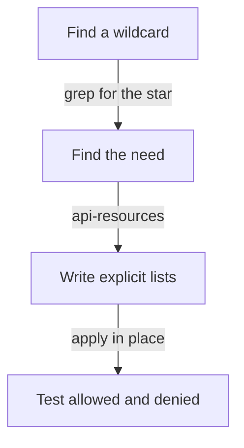

# Remove Wildcards And Narrow Rules

A wildcard in a rule is short to write and hard to review. The character `*` in `apiGroups`, `resources` or `verbs` matches everything, including things that do not exist when the rule is written. A custom resource added next year is covered by a rule written today. This part shows what a wildcard grants in practice, how to find wildcards in a cluster, and how to replace them with lists that a reviewer can read.

## What a wildcard matches

The wildcard `*` in `verbs` matches every verb, including `escalate`, `bind` and `impersonate`. In `resources` it matches every resource type and every subresource, such as `pods/exec`, `pods/log` and `serviceaccounts/token`. In `apiGroups` it matches every API group, including groups that a later installation adds. A rule with `*` in all three lists is the same as `cluster-admin` limited to the namespace of the Role.

The playground has such a Role. `crew-operator` in `outpost` is bound to the group `outpost-crew`. The first command asks whether the crew can read Secrets, and the second asks whether it can create bindings, which would let a crew member give any role of the namespace to anyone.

<!-- astrona:playground:renew -->

```sh
kubectl auth can-i get secrets -n outpost --as=jane --as-group=outpost-crew
kubectl auth can-i create rolebindings.rbac.authorization.k8s.io -n outpost --as=jane --as-group=outpost-crew
```

Both commands print `yes`. The second answer is the more serious one: the escalation check lets a user create a binding only for permissions that the user holds, and the wildcard holds all of them in `outpost`.

## Find wildcards in a cluster

A review searches the YAML of all roles for the quoted star. The command below prints every line with a star and the eight lines before it, which is enough to see the Role name and the list that holds the star. The second command does the same for ClusterRoles, which includes the built-in `cluster-admin` role and a few `system:` roles that use wildcards for good reasons.

```sh
kubectl get roles --all-namespaces -o yaml | grep -n -B8 "'\*'"
kubectl get clusterroles -o yaml | grep -c "'\*'"
```

The first command shows the rule of `crew-operator` with the Role name `crew-operator` and the namespace `outpost` above it. The second prints a count, which includes the built-in roles. A count is only a first signal. Open each hit and decide whether the wildcard is intended.

## Replace the wildcard with explicit lists

Writing the rule out starts from the need, as in any least-privilege change. Suppose the crew needs to manage ConfigMaps and only read Pods. The list of resource names comes from the cluster, so that you spell them correctly. The command below prints the namespaced resources of the core group with their short names.

```sh
kubectl api-resources --namespaced=true --api-group="" -o name
```

The list contains `configmaps`, `pods`, `secrets`, `services` and more. You copy only the names you need. For other groups, use the group in `--api-group`, for example `apps` for Deployments, and write `deployments.apps` as `resources: ["deployments"]` with `apiGroups: ["apps"]`.

Save this as `role-crew-operator.yaml`. It has the same name and namespace as the existing Role, so the apply updates the Role in place and the RoleBinding keeps working:

```yaml
apiVersion: rbac.authorization.k8s.io/v1
kind: Role
metadata:
  name: crew-operator
  namespace: outpost
rules:
  - apiGroups: [""]
    resources: ["pods"]
    verbs: ["get", "list", "watch"]
  - apiGroups: [""]
    resources: ["configmaps"]
    verbs: ["get", "list", "watch", "create", "update", "patch", "delete"]
```

Apply it:

```sh
kubectl apply -f role-crew-operator.yaml
```

Then check the result. The first two commands are the allowed actions and the other four are actions that the wildcard allowed and the new rule does not:

```sh
kubectl auth can-i list pods -n outpost --as=jane --as-group=outpost-crew
kubectl auth can-i delete configmaps -n outpost --as=jane --as-group=outpost-crew
kubectl auth can-i get secrets -n outpost --as=jane --as-group=outpost-crew
kubectl auth can-i delete pods -n outpost --as=jane --as-group=outpost-crew
kubectl auth can-i create pods/exec -n outpost --as=jane --as-group=outpost-crew
kubectl auth can-i create rolebindings.rbac.authorization.k8s.io -n outpost --as=jane --as-group=outpost-crew
```

The first two commands print `yes`. The other four print `no`. The group binding did not change, and the crew still has what it needs.

## Where a wildcard is still acceptable

Not every star is a finding. A ClusterRole for a controller that manages its own custom resource group may use `resources: ["*"]` with `apiGroups: ["example.com"]`, because the group belongs to that controller. A wildcard in `verbs` for a resource that the identity owns can be the right choice. The test is whether the group, the resources and the verbs are limited to what the identity is meant to control. A star in all three lists never passes that test for a workload or a team.



The diagram shows the sequence for each wildcard: find it, learn the real need, write explicit lists, and test.

You can now find wildcards, understand how much they grant, and replace them without changing the binding. The task on the next page applies this to a Role that is bound to a group of operators.

## Common pitfalls

> [!WARNING]
> - **Replacing `*` in `resources` and keeping it in `verbs`.** The rule still allows every action on the listed resources, including `escalate` and `impersonate`.
> - **Writing `deployments` with `apiGroups: [""]`.** Deployments are in the `apps` group, so the rule matches nothing.
> - **Assuming `pods` includes `pods/log` and `pods/exec`.** Each subresource needs its own entry, and leaving it out is the point of least privilege.
> - **Deleting the Role to start again.** The RoleBinding then points at a Role that does not exist, and the group has no access until it is created again.
> - **Counting stars as the only risk.** A long explicit list can still include Secrets, `pods/exec` or `create` on Pods.
