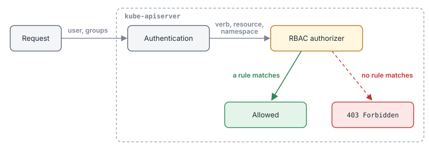

# Roles, Bindings And Scope

Every request to the Kubernetes API server carries an identity and an action. The API server must decide whether to allow the request. If no rule matches, the answer is no.

This page shows the objects that hold those rules. It also shows how to build the smallest rule that still lets a workload do its job. You give the `shuttle` ServiceAccount read access to ConfigMaps in one namespace, and you prove with commands where that access stops.

## What the authorizer decides

The API server checks every request in two steps. First it runs authentication, which answers "who is this?". Then it runs authorization, which answers "may this identity do this action?". The component that makes the second decision is called an authorizer.

The `--authorization-mode` flag of `kube-apiserver` lists the authorization modules. A cluster created with `kubeadm` uses `Node,RBAC`. The Node authorizer handles requests from kubelets, the agents that run pods on each node. The RBAC authorizer handles everything else. If no module allows a request, the API server answers `403 Forbidden`.

Role Based Access Control (RBAC) describes each request by a set of attributes:

- the user name and the groups of the user;
- the verb, which is the action, such as `get` or `delete`;
- the API group, the resource and the resource name;
- the namespace.

The RBAC authorizer then looks for at least one rule that matches all of those attributes. The rule must come from a binding that applies to the user or to one of its groups. One match is enough to allow the request.



The drawing shows that the RBAC authorizer either finds a matching rule and allows the request, or finds none, and then the API server rejects the request.

## The four RBAC objects

So the authorizer needs rules, and it needs to know who holds them. RBAC uses four resource kinds for this, all in the API group `rbac.authorization.k8s.io`. Two of them define permissions, and two of them attach those permissions to identities.

| Kind | Scope | What it does |
| --- | --- | --- |
| `Role` | One namespace | Lists rules that apply inside its own namespace |
| `ClusterRole` | Whole cluster | Lists rules for namespaced resources in any namespace, for cluster-scoped resources such as nodes, or for non-resource URLs |
| `RoleBinding` | One namespace | Gives the rules of a Role or a ClusterRole to subjects, inside the namespace of the binding only |
| `ClusterRoleBinding` | Whole cluster | Gives the rules of a ClusterRole to subjects in every namespace and for cluster-scoped resources |

A **subject** is the identity that receives a grant. Its kind is `User`, `Group` or `ServiceAccount`. A ServiceAccount is a namespaced identity for a workload.

Inside the API server, the user name of a ServiceAccount is `system:serviceaccount:<namespace>:<name>`. So the ServiceAccount `shuttle` in `starfleet` is `system:serviceaccount:starfleet:shuttle`. This is the name you give to `--as` when you test it.

A Role or ClusterRole holds a list of `rules`. Each rule has these fields:

- `apiGroups` lists the API groups. The core group, which holds Pods, Services, ConfigMaps and Secrets, is written as the empty string `''`. Deployments are in `apps`.
- `resources` lists the resource types, such as `pods` or `configmaps`. A subresource is written with a slash, for example `pods/log` or `pods/exec`.
- `verbs` lists the allowed actions: `get`, `list`, `watch`, `create`, `update`, `patch`, `delete` and `deletecollection`.
- `resourceNames` optionally limits the rule to objects with these names.

A rule matches only when the request matches all of its fields. A rule for `pods` in the core group does not cover Deployments. A rule for `get` does not cover `list`.

## Check the starting state

Before you change anything, look at the identity. The first command below shows that the ServiceAccount exists. The second command asks the API server whether the ServiceAccount may list ConfigMaps in `outpost`.

`kubectl auth can-i` sends a `SubjectAccessReview` request to the API server. The API server runs the same authorization that a real request would run, and answers yes or no. The `--as` flag makes `kubectl` act as another identity. Your `cluster-admin` role allows you to do this.

<!-- astrona:playground:renew -->

```sh
kubectl -n starfleet get serviceaccount shuttle
kubectl auth can-i list configmaps -n outpost --as=system:serviceaccount:starfleet:shuttle
```

The first command lists the ServiceAccount. The second command prints `no`, because no Role or binding gives `shuttle` anything.

The second command also exits with status `1`. A script can use this status to detect a denied action. A `yes` answer exits with status `0`.

## Build a namespaced grant

Now give `shuttle` the access it needs. The `shuttle` workload must read ConfigMaps in `outpost` and nothing else. That needs two objects: a Role in `outpost` with the rule, and a RoleBinding in `outpost` that gives the Role to the ServiceAccount.

Save this as `role-configmap-reader.yaml`:

```yaml
apiVersion: rbac.authorization.k8s.io/v1
kind: Role
metadata:
  name: configmap-reader
  namespace: outpost
rules:
  - apiGroups: [""]
    resources: ["configmaps"]
    verbs: ["get", "list"]
---
apiVersion: rbac.authorization.k8s.io/v1
kind: RoleBinding
metadata:
  name: shuttle-configmap-reader
  namespace: outpost
roleRef:
  apiGroup: rbac.authorization.k8s.io
  kind: Role
  name: configmap-reader
subjects:
  - kind: ServiceAccount
    name: shuttle
    namespace: starfleet
```

The binding lives in `outpost`, so the grant applies in `outpost`. The subject names the ServiceAccount together with its own namespace, `starfleet`. A ServiceAccount subject without a namespace is invalid, and a wrong namespace names a different identity that does not exist.

The `roleRef` field names the Role. You cannot change it after the binding exists. To point a binding at another role, you delete the binding and create it again.

Apply it:

```sh
kubectl apply -f role-configmap-reader.yaml
```

Then check the result. Each command asks the authorizer one question:

```sh
kubectl auth can-i list configmaps -n outpost --as=system:serviceaccount:starfleet:shuttle
kubectl auth can-i delete configmaps -n outpost --as=system:serviceaccount:starfleet:shuttle
kubectl auth can-i list configmaps -n starfleet --as=system:serviceaccount:starfleet:shuttle
kubectl auth can-i list secrets -n outpost --as=system:serviceaccount:starfleet:shuttle
```

The first command prints `yes`. The other three print `no`, each for a different reason:

- the Role does not include the verb `delete`;
- the binding does not reach the `starfleet` namespace;
- the rule does not include Secrets.

Each answer shows one limit of the grant: the verb, the namespace and the resource.


The drawing shows the two objects in `outpost`, the ServiceAccount in `starfleet`, and the one question that gets `yes` next to the three that get `no`.

## The imperative form

You can also create these objects without a file. On the exam you often do this with `kubectl create`, because it is faster. The `--dry-run=client -o yaml` flags make `kubectl` print the object it would create without sending it to the API server, so you can read it or save it.

> [!TIP]
> Let `kubectl` write the first draft of an RBAC object. `kubectl create role configmap-reader --verb=get,list --resource=configmaps -n outpost --dry-run=client -o yaml` prints a Role. `kubectl create rolebinding shuttle-configmap-reader --role=configmap-reader --serviceaccount=starfleet:shuttle -n outpost --dry-run=client -o yaml` prints the matching binding. Remove `--dry-run=client -o yaml` to create the object directly.

You can now build a Role and a RoleBinding. You can also prove with `kubectl auth can-i` that the grant stops at its verb, its resource and its namespace. The open question is what changes when the permissions come from a ClusterRole, and what stops an identity from handing out more than it has.

## Common pitfalls

> [!WARNING]
> - **Leaving out the namespace of a ServiceAccount subject.** The binding is rejected or names a different identity. Write `name` and `namespace` together.
> - **Putting the binding in the wrong namespace.** The grant applies in the namespace of the RoleBinding, not in the namespace of the ServiceAccount.
> - **Writing `apiGroups: ["core"]`.** The core group is the empty string `""`.
> - **Testing with your own identity.** `kubectl auth can-i` without `--as` answers for you. You are `cluster-admin`, so every answer is `yes`.
> - **Trying to edit `roleRef`.** It cannot be changed. Delete the binding and create it again.
