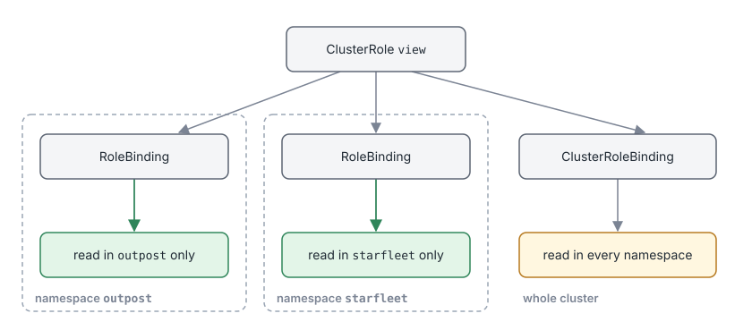
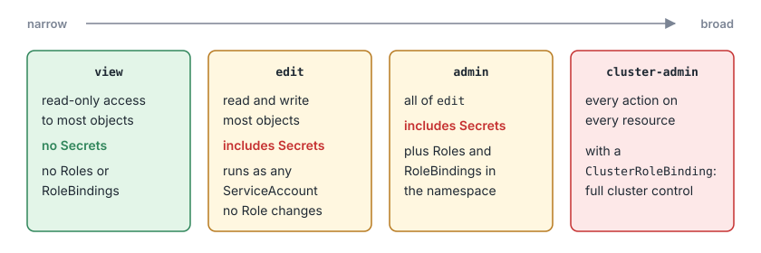
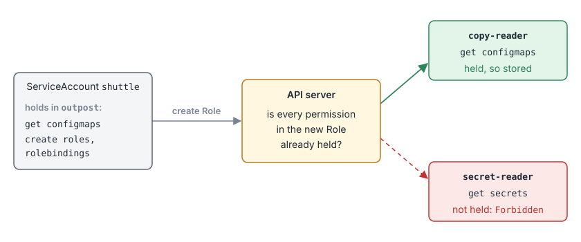

# ClusterRoles, Reuse And Escalation Prevention

Many namespaces often need the same set of permissions. You should not copy that set into a Role in each namespace. Kubernetes lets you define it once as a ClusterRole and bind it where it is needed.

This page shows how the type of binding decides the reach of a ClusterRole. It also lists the built-in ClusterRoles. Finally, it shows the check that stops an identity from creating a grant that is larger than its own permissions.

## A ClusterRole is a definition, the binding is the reach

A ClusterRole is a list of rules that is not tied to a namespace. What it grants depends only on the binding that uses it:

- A RoleBinding that references a ClusterRole gives those rules inside the namespace of the RoleBinding, and nowhere else.
- A ClusterRoleBinding that references the same ClusterRole gives the rules in every namespace. It is also the only way to grant cluster-scoped resources, such as nodes or namespaces.



The drawing shows one ClusterRole with three different reaches, and the binding alone decides each reach.

You also need a ClusterRole for rules that a Role cannot hold. These are rules for cluster-scoped resources and for non-resource URLs. A non-resource URL is an API server path that is not an object, such as `/healthz`.

## The built-in ClusterRoles

You do not have to write every ClusterRole yourself. Kubernetes creates a set of ClusterRoles when the API server starts. Four of them are meant for users. You use them with a RoleBinding to give a person or a workload a standard level of access in a namespace:

- `view` allows read-only access to most namespaced objects. It does not include Secrets, and it does not include Roles or RoleBindings.
- `edit` allows read and write access to most objects, including Secrets. It also allows a workload to run as any ServiceAccount of the namespace. It does not allow changing Roles or RoleBindings.
- `admin` allows what `edit` allows, plus managing Roles and RoleBindings inside the namespace.
- `cluster-admin` allows every action on every resource. Bound with a ClusterRoleBinding, it gives full control of the cluster.



The drawing orders the four roles from narrow to broad and marks where Secrets and the management of Roles first appear.

Names that start with `system:` belong to Kubernetes components. The API server re-creates the built-in ClusterRoles and their bindings at startup. So it can overwrite any edits you make to them.

Now look at the built-in roles in the playground. The first command lists the four roles. The second command prints the rules of `view` as a table of resources and verbs:

<!-- astrona:playground:renew -->

```sh
kubectl get clusterrole view edit admin cluster-admin
kubectl describe clusterrole view
```

In the table from `describe`, find the resources the role covers. You see many resources, such as `pods`, `services` and `configmaps`, each with the verbs `get`, `list` and `watch`. You do not find `secrets`. Kubernetes leaves Secrets out of `view` on purpose, because reading a Secret exposes credentials.

## Bind a ClusterRole inside one namespace

Next, put a built-in role to use. The `shuttle` ServiceAccount now needs to read Pods in `outpost`. Reusing `view` is shorter than writing a Role. But `view` is broader than the need, because it also reads Services, ConfigMaps and more.

So binding `view` is a trade-off: less YAML, but more access. For this exercise, the namespace boundary is the safeguard.

Save this as `rolebinding-shuttle-view.yaml`:

```yaml
apiVersion: rbac.authorization.k8s.io/v1
kind: RoleBinding
metadata:
  name: shuttle-view
  namespace: outpost
roleRef:
  apiGroup: rbac.authorization.k8s.io
  kind: ClusterRole
  name: view
subjects:
  - kind: ServiceAccount
    name: shuttle
    namespace: starfleet
```

Apply it:

```sh
kubectl apply -f rolebinding-shuttle-view.yaml
```

Then check the result:

```sh
kubectl auth can-i list pods -n outpost --as=system:serviceaccount:starfleet:shuttle
kubectl auth can-i get secrets -n outpost --as=system:serviceaccount:starfleet:shuttle
kubectl auth can-i list pods -n starfleet --as=system:serviceaccount:starfleet:shuttle
```

The first command prints `yes`. The second prints `no`, because `view` has no rule for Secrets. The third prints `no`, because the RoleBinding exists only in `outpost`, even though it references a cluster-wide definition.

## Escalation prevention

Binding roles raises a security question. RBAC would be easy to defeat if any identity that may create Roles could write a Role with any permission and bind it to itself. The API server blocks this with two rules:

- A user can create or update a Role or ClusterRole only if the user already holds every permission in it, in the same scope. The exception is a user who holds the special verb `escalate` on roles.
- A user can create a RoleBinding only if the user holds all permissions of the referenced role. The exception is a user who holds the verb `bind` on that role.

The API server makes this check when it stores the object. It is not part of the normal allow decision of the RBAC authorizer.

You can see the check at work with `shuttle`. First, give it the right to manage Roles and RoleBindings in `outpost`. Save this as `role-role-manager.yaml`:

```yaml
apiVersion: rbac.authorization.k8s.io/v1
kind: Role
metadata:
  name: role-manager
  namespace: outpost
rules:
  - apiGroups: ["rbac.authorization.k8s.io"]
    resources: ["roles", "rolebindings"]
    verbs: ["create", "get", "list"]
---
apiVersion: rbac.authorization.k8s.io/v1
kind: RoleBinding
metadata:
  name: shuttle-role-manager
  namespace: outpost
roleRef:
  apiGroup: rbac.authorization.k8s.io
  kind: Role
  name: role-manager
subjects:
  - kind: ServiceAccount
    name: shuttle
    namespace: starfleet
```

Apply it:

```sh
kubectl apply -f role-role-manager.yaml
```

Then try to create two Roles as `shuttle`. The first Role asks for a permission that `shuttle` already holds through the earlier `configmap-reader` grant. The second Role asks for Secrets, which `shuttle` does not hold:

```sh
kubectl create role copy-reader --verb=get --resource=configmaps -n outpost --as=system:serviceaccount:starfleet:shuttle
kubectl create role secret-reader --verb=get --resource=secrets -n outpost --as=system:serviceaccount:starfleet:shuttle
```

The first command succeeds and prints that the Role was created. The second command fails with a `Forbidden` error. The error says that the user is attempting to grant RBAC permissions not currently held. So the ServiceAccount may create Roles, but only Roles that stay inside what it already has.



The drawing shows the API server comparing each new Role with the permissions that `shuttle` already holds, and storing only the Role that fits inside them.

Two verbs bypass this check on purpose. `escalate` lets an identity write larger Roles, and `bind` lets it create bindings to roles it does not hold. So both verbs are as dangerous as the permissions they unlock.

You now know that the binding decides the reach of a ClusterRole, that `view` leaves out Secrets, and that the API server stops an identity from granting more than it holds. These checks do not cancel a grant that exists somewhere else. The open question is what happens to access when you remove a grant while another grant still allows the same action.

## Common pitfalls

> [!WARNING]
> - **Thinking a RoleBinding to a ClusterRole is cluster-wide.** It applies only in the namespace of the RoleBinding.
> - **Binding `edit` or `admin` for convenience.** Both include Secrets, and `admin` also manages Roles and RoleBindings in the namespace.
> - **Editing a built-in `system:` role.** The API server restores it at startup.
> - **Giving `escalate`, `bind` or `impersonate` to a workload.** The first two remove the protection against self-granted permissions. `impersonate` lets the holder act as another identity.
