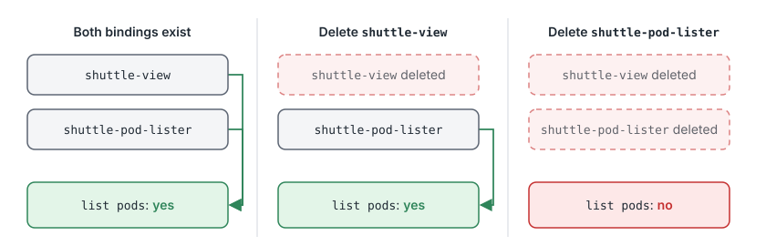
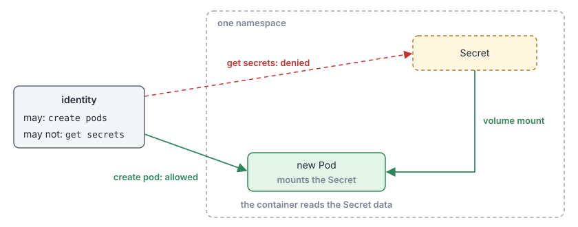

# Additive Grants, Dangerous Verbs And Auditing Access

Hardening RBAC means finding and removing access, not only adding it. Two facts make that harder than it looks. First, RBAC has no deny rule, so removing one grant does not help while a second grant allows the same action. Second, some verbs give much more than their names suggest.

This page removes a grant while another one stays. It then lists the permissions to treat with care, and it shows the commands that list who can do what.

## Grants add up and nothing subtracts

The RBAC authorizer allows a request when any rule from any applicable binding matches. The applicable bindings are the ones that name the user, one of its groups, or a ServiceAccount.

Groups matter more than they seem. Kubernetes puts identities into some groups automatically:

- A ServiceAccount is always a member of the groups `system:serviceaccounts` and `system:serviceaccounts:<namespace>`.
- Every authenticated identity is a member of `system:authenticated`.

A binding to any of those groups reaches the ServiceAccount too. The effective permission is the union of all matching rules. There is no rule that says "deny".


The drawing shows that every binding that reaches `shuttle`, directly or through one of its groups, adds rules to the same total, and nothing takes rules away.

<!-- astrona:playground:renew -->

The playground shows this with a second path to the same permission. A RoleBinding named `shuttle-view` in `outpost` binds the `view` ClusterRole to `shuttle`, so `shuttle` can list Pods there. To add a second path, save this as `role-pod-lister.yaml`:

```yaml
apiVersion: rbac.authorization.k8s.io/v1
kind: Role
metadata:
  name: pod-lister
  namespace: outpost
rules:
  - apiGroups: [""]
    resources: ["pods"]
    verbs: ["list"]
---
apiVersion: rbac.authorization.k8s.io/v1
kind: RoleBinding
metadata:
  name: shuttle-pod-lister
  namespace: outpost
roleRef:
  apiGroup: rbac.authorization.k8s.io
  kind: Role
  name: pod-lister
subjects:
  - kind: ServiceAccount
    name: shuttle
    namespace: starfleet
```

If the `shuttle-view` binding does not exist yet, create it with `kubectl -n outpost create rolebinding shuttle-view --clusterrole=view --serviceaccount=starfleet:shuttle`. Then apply the Role:

```sh
kubectl apply -f role-pod-lister.yaml
```

Now remove the first path and test again. The first command deletes the binding of `view`. The second command asks whether `shuttle` can still list Pods in `outpost`:

```sh
kubectl -n outpost delete rolebinding shuttle-view
kubectl auth can-i list pods -n outpost --as=system:serviceaccount:starfleet:shuttle
```

The answer is still `yes`, because `shuttle-pod-lister` allows the same action. Delete the second binding and ask again:

```sh
kubectl -n outpost delete rolebinding shuttle-pod-lister
kubectl auth can-i list pods -n outpost --as=system:serviceaccount:starfleet:shuttle
```

Now the answer is `no`.



The drawing shows the three states in order: the answer changes to `no` only when the last binding that allows the action is gone.

So to remove an action from an identity, you must find and remove every binding that grants it. Changing one Role is not enough if another Role, a ClusterRole or a group binding still matches.

## Permissions that give more than they say

Removing access is only half of a review. You also need to spot rules that look harmless and are not. When you review a Role, check the effect of each rule, not only the verb:

- `get`, `list` or `watch` on `secrets`. Secrets hold passwords, tokens and keys. `list` and `watch` return the full content of every Secret in the scope, so they are as sensitive as `get`.
- `create` on `pods`. A Pod can mount any Secret and any ServiceAccount token of its namespace. The creator can read them from inside the container, even without permission to read Secrets directly.
- `pods/exec` and `pods/attach`. They run commands in an existing container, with its mounted credentials.
- `create` on `serviceaccounts/token`. It requests a token for any ServiceAccount of the namespace, so the holder can act as that account.
- `escalate`, `bind` and `impersonate`. The first two remove the escalation check. `impersonate` lets the holder send requests as another user, group or ServiceAccount.
- `nodes/proxy`. It reaches the kubelet API on a node.
- The wildcard `*` in `verbs`, `resources` or `apiGroups`. It also matches resources that do not exist yet, such as those added by a new custom resource definition.
- Binding a role to `system:authenticated`, `system:unauthenticated` or `system:serviceaccounts`. Every identity in that group receives the grant.

The `create pods` case needs a closer look. The reason to read it as a Secret-read permission is the mechanism, not the verb: the volumes of the Pod are the path to the data.



The drawing shows the two paths to the same Secret: the direct read is denied, and the path through a new Pod is allowed. So a namespace where Pod creation is allowed but Secret reading is not is only partly protected.

## List who can do what

Once you know what to look for, you need to find it in a live cluster. Reviewing RBAC is a read task, and you can start from the identity or from the binding.

The commands below do both. The first command lists all effective rules of `shuttle` in `outpost`. The second lists the RoleBindings of the namespace with their subjects. The third lists ClusterRoleBindings, so you can look for broad subjects.

```sh
kubectl auth can-i --list -n outpost --as=system:serviceaccount:starfleet:shuttle
kubectl get rolebindings -n outpost -o wide
kubectl get clusterrolebindings -o wide
```

The first command prints a table with the columns `Resources`, `Non-Resource URLs`, `Resource Names` and `Verbs`. It includes a few rules that every authenticated identity receives, such as the right to ask what its own permissions are. It also includes the rules of any other grants you created in `outpost`.

The `-o wide` output of the other two commands adds columns for the role and for the users, groups and ServiceAccounts in each binding. In the ClusterRoleBinding list, look for `cluster-admin` and for subjects that are groups.

Before you change anything, compare your file with the live objects. `kubectl diff -f` shows what an apply would change. `kubectl auth reconcile -f` applies a Role and binding file, and it also creates missing parts or adds missing rules. It does not remove anything unless you ask it to.

You can now find the second path that keeps an action alive, you know which rules grant indirect authority, and you can list the grants of an identity. One question stays open after every RBAC change: which bindings still apply to this identity after the change?

## Common pitfalls

> [!WARNING]
> - **Deleting one binding and calling the access removed.** Another binding, a ClusterRole or a group can still allow it. Test again with `kubectl auth can-i`.
> - **Allowing `create pods` but not Secrets.** A Pod can mount the Secrets of its namespace.
> - **Using a wildcard in a rule.** It covers resources and verbs that appear later.
> - **Binding to `system:authenticated`.** It gives the grant to every identity that can log in.
> - **Reviewing only Roles.** Check ClusterRoleBindings too, because they apply in every namespace.
