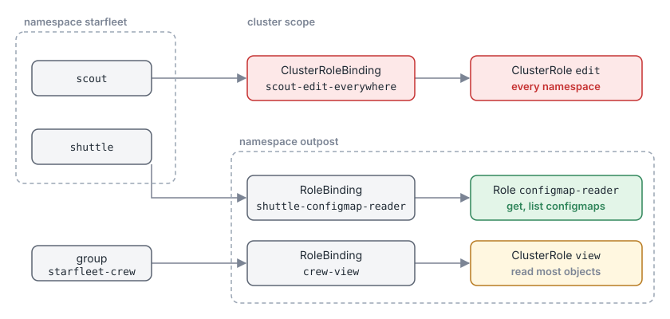

# Audit And Narrow Effective Access

A cluster that has run for a year holds many Roles, ClusterRoles and bindings that nobody remembers writing. Some of them give a workload far more access than it uses. Every extra right is a risk: if an attacker takes over the workload, they get all of that access too.

Role Based Access Control (RBAC) is the authorization mode of the Kubernetes API server. It decides which identity may do which action on which object. RBAC has no deny rule. So the only way to reduce access is to find every grant that reaches an identity and replace the broad grants with narrow ones.

This work is called an access review, and it is a core task of the Certified Kubernetes Security Specialist (CKS) exam. Keep one rule in mind for the whole module: **the effective access of an identity is the union of every rule in every binding that names it or one of its groups.** So an audit starts from the identity, collects every binding, and ends with a test of what the API server really allows.

## What you will learn

After this module, you can:

- test an identity for a verb, a resource, a resource name, a subresource, a non-resource URL and a whole namespace with `kubectl auth can-i`;
- act as a user in a group with `--as` and `--as-group`, and explain which request checks the answer;
- list every RoleBinding and ClusterRoleBinding with its role and subjects, and search them for an identity and for broad groups;
- explain which names an identity has: its own name, its groups and its automatic ServiceAccount groups;
- replace a broad grant with a narrow Role and RoleBinding, in the order that never leaves the workload without access;
- explain why `resourceNames` cannot limit a `create` request.

## How the module is laid out

You start with **Ask The Authorizer Precisely**. It shows what `kubectl auth can-i` asks the API server, how to test a resource name, a subresource, a non-resource URL, a group and a whole namespace, and what the test cannot tell you.

**Find Every Grant That Reaches An Identity** then lists the bindings of a cluster in a form you can search. It follows an identity through its names and its groups to the rules it receives.

**Rewrite A Broad Grant As Least Privilege** closes the module. It replaces a built-in role with a narrow Role, in the safe order: add, test, remove, test again. A lab follows it, so you can practise the skill right away.

## Before you start

You should know the Kubernetes basics: pods, namespaces, YAML manifests, and the commands `kubectl get` and `kubectl apply`. You should know that a Role holds rules and that a binding gives a role to subjects (users, groups or ServiceAccounts). You do not need any earlier module.

## Your playground

The commands run against a playground cluster. Your terminal must use the private kubeconfig of the playground. A kubeconfig is the file that holds the cluster address and the credentials for `kubectl`. Run these two commands once in every new terminal:

```sh
export KUBECONFIG="$(astrona kubeconfig ats-032-playground-010-02)"
test "$(kubectl config current-context)" = "kind-astro-ats-032-playground-010-02" || exit 1
```

The playground is a single-node `kind` cluster that runs Kubernetes 1.35. Your own credentials in this cluster have the `cluster-admin` role. So you can create any RBAC object and act as other identities. The cluster starts with this content:

| Where | What is in it |
| --- | --- |
| Namespace `starfleet` | The ServiceAccounts `shuttle` and `scout` |
| Namespace `outpost` | The ConfigMap `scout-report`, the Role `configmap-reader` with its RoleBinding `shuttle-configmap-reader`, and the RoleBinding `crew-view` that gives the built-in `view` ClusterRole to the group `starfleet-crew` |
| Cluster scope | The ClusterRoleBinding `scout-edit-everywhere`, which gives the built-in `edit` ClusterRole to `scout` in every namespace |



The drawing shows who receives which role at the start: `scout` has the broad cluster-wide grant, while `shuttle` and the group `starfleet-crew` only have grants inside `outpost`.

Start your playground now, and keep it running next to you while you read:

<!-- astrona:playground -->
