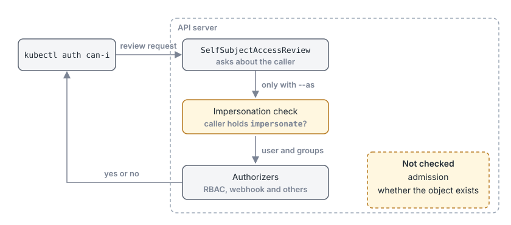
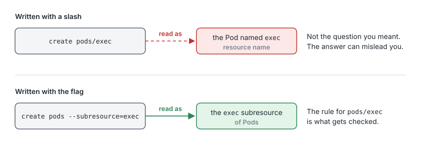

# Ask The Authorizer Precisely

An access review is a series of questions to the API server: may this identity do this action on this object? A vague question gives a vague answer. If you only ask whether `scout` can read ConfigMaps, you miss that it can also read Secrets, run commands in Pods and touch every namespace.

On this page, you learn to ask exact questions with `kubectl auth can-i`. You also learn what the answers mean and what they do not mean.

## What can-i sends to the API server

`kubectl auth can-i` does not guess from the RBAC objects. It sends an access review request to the API server. The API server then runs the same authorization chain that it runs for a real request. The authorization chain is the list of authorizers, such as RBAC or a webhook, that the API server asks in turn.

When no `--as` flag is present, `kubectl` sends a `SelfSubjectAccessReview`, which asks about the caller. The answer is `yes` or `no`. The exit status of the command is `0` for `yes` and `1` for `no`, so a script can use it.

The `--as` flag makes `kubectl` impersonate another user. The API server first checks that the caller holds the verb `impersonate` for that identity. Then it handles the request as that identity. The `--as-group` flag adds a group to the impersonated identity, and it needs `--as` as well.

Your credentials in the playground are `cluster-admin`, which includes `impersonate`, so every example below works. Because the chain is the real one, a `no` can also come from another authorizer, such as a webhook, and not only from RBAC.



The drawing shows that the answer comes from the authorization chain of the API server itself, after an impersonation check when `--as` is used.

Two limits matter for a review:

- The check looks at authorization only. It does not run admission, so it cannot tell you whether a create request would pass admission policies.
- The check does not look for the object. An action on a name that does not exist still gets `yes` when a rule allows it.

## Ask about the verb and the resource

Start with the ServiceAccount `scout`. A ServiceAccount is an identity for a workload inside the cluster. The playground gives `scout` the built-in `edit` ClusterRole in every namespace, and the commands below show how far that reaches.

The first command asks about Secrets. The second asks about creating bindings. The third asks about nodes, which are cluster-scoped objects, so they live outside any namespace.

<!-- astrona:playground:renew -->

```sh
kubectl auth can-i get secrets -n outpost --as=system:serviceaccount:starfleet:scout
kubectl auth can-i create rolebindings.rbac.authorization.k8s.io -n outpost --as=system:serviceaccount:starfleet:scout
kubectl auth can-i get nodes --as=system:serviceaccount:starfleet:scout
```

The first command prints `yes`, because `edit` includes Secrets. The second prints `no`, because `edit` cannot change Roles or bindings. The third prints `no`, because the grant has no rule for nodes.

Look at how the second command names the resource. A resource from an API group other than the core group is written as `resource.group`, as in `rolebindings.rbac.authorization.k8s.io`.

## Ask about names, subresources and URLs

A rule can name one object, one subresource or a URL, and each of these needs its own question. Each form has its own way to write it:

- A **resource name** comes after a slash, as in `configmaps/scout-report`.
- A **subresource** is a part of a resource with its own access rules, such as the log or the exec endpoint of a Pod. You name it with the `--subresource` flag, as in `pods --subresource=log` or `pods --subresource=exec`.
- A **non-resource URL** is an API server path that is not an object, such as `/version`. You write it as a path that starts with `/`.
- The **`--all-namespaces`** flag asks whether the action is allowed in every namespace at once. Only a cluster-wide grant can give that.

Do not write `pods/exec` in this command. `kubectl auth can-i` reads the part after the slash as a resource name, so `pods/exec` asks about a Pod named `exec`.



The drawing compares the two ways to write it: only the `--subresource` flag asks about the exec subresource.

Now run the questions. The first three ask about `scout`, and the last two ask about `shuttle`, which has no cluster-wide grant.

```sh
kubectl auth can-i update configmaps/scout-report -n outpost --as=system:serviceaccount:starfleet:scout
kubectl auth can-i create pods --subresource=exec -n outpost --as=system:serviceaccount:starfleet:scout
kubectl auth can-i list pods --all-namespaces --as=system:serviceaccount:starfleet:scout
kubectl auth can-i list pods --all-namespaces --as=system:serviceaccount:starfleet:shuttle
kubectl auth can-i get /version --as=system:serviceaccount:starfleet:shuttle
```

The first three commands print `yes` for `scout`. This shows what the cluster-wide `edit` grant means in practice: `scout` can run commands inside Pods in every namespace.

The fourth command prints `no` for `shuttle`, which has no cluster-wide grant. The fifth prints `yes`, because the API server gives every authenticated identity the right to read a few version and health URLs.

## Ask as a member of a group

Many grants name a group and not a user. Kubernetes has no object for a user or a group. The name and the groups come from the authentication step, for example from a certificate or a token.

To test a group grant, give any user name together with the group. In the playground, the group `starfleet-crew` holds the `view` ClusterRole in `outpost` through the RoleBinding `crew-view`.

```sh
kubectl auth can-i list pods -n outpost --as=jane --as-group=starfleet-crew
kubectl auth can-i list pods -n outpost --as=jane
kubectl auth whoami --as=jane --as-group=starfleet-crew
```

The first command prints `yes`. The second prints `no`, because the user name `jane` alone has no grant. So the group carried the access.

The third command prints the identity that the API server sees: the user name `jane` and a group list that contains `starfleet-crew` and `system:authenticated`. To see all the rules of an identity at once, run `kubectl auth can-i --list -n outpost --as=jane --as-group=starfleet-crew`. It asks the API server for the rules that apply in that namespace.

You can now ask exact questions about verbs, resources, names, subresources, URLs, groups and namespaces. But a single answer says little about the whole identity, and it does not say which binding allowed the action. The open question is which bindings stand behind the answers, so that you can find a broad grant and change it.

## Common pitfalls

> [!WARNING]
> - **Testing without `--as`.** The answer is for your own `cluster-admin` identity, so it is always `yes`.
> - **Testing a group grant with only `--as-group`.** The flag needs `--as` as well.
> - **Reading `yes` as proof that the object exists.** The check does not look for the object.
> - **Testing only the allowed action.** A review needs the denied actions too: Secrets, subresources such as `pods/exec`, and other namespaces.
> - **Forgetting the group of a non-core resource.** Write `deployments.apps`, not `deployments`, when you test an action on Deployments.
