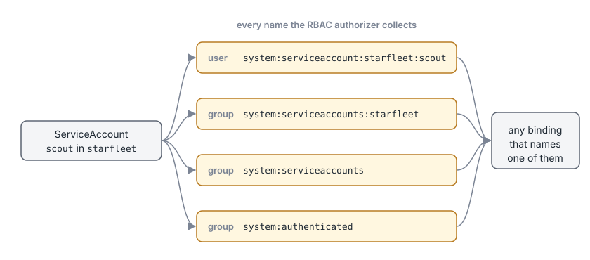
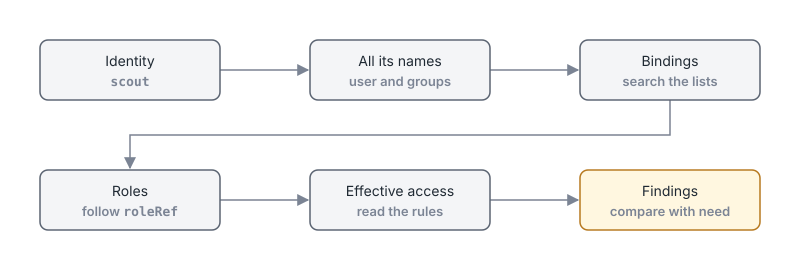

# Find Every Grant That Reaches An Identity

A test with `kubectl auth can-i` tells you that an action is allowed, but not which binding allows it. To remove the access, you must delete or change that binding. And because RBAC has no deny rule, you must find all of them, since any one left behind still grants the access.

On this page, you build a repeatable way to list every binding, search the list for an identity and its groups, and read the roles behind the matches.

## The names an identity answers to

A binding does not have to name the identity directly. The RBAC authorizer collects every name that applies to the request, and any binding that names one of them counts. Which names apply depends on the kind of identity:

- A **ServiceAccount** has the user name `system:serviceaccount:<namespace>:<name>`, the group `system:serviceaccounts`, the group `system:serviceaccounts:<namespace>` and the group `system:authenticated`.
- A **person or a certificate** has the user name and the groups from authentication, plus `system:authenticated`.
- A **request without credentials** is the user `system:anonymous` in the group `system:unauthenticated`.

So a review of `scout` cannot stop at the bindings that contain the word `scout`. It must also look at bindings to `system:serviceaccounts:starfleet`, to `system:serviceaccounts` and to `system:authenticated`, because `scout` is a member of all three. A broad group is the place where unexpected access hides.



The drawing shows the four names of `scout`: a binding that names any one of them gives its role to `scout`.

## List every binding in a form you can search

The default output of `kubectl get` hides the subjects of a binding. The `-o custom-columns` option prints only the fields that you choose, and `[*]` in a path prints every item of a list.

The first command lists the ClusterRoleBindings with the role and the subjects. The second lists the RoleBindings of all namespaces and adds a namespace column. The namespace matters, because a RoleBinding grants access only in its own namespace.

<!-- astrona:playground:renew -->

```sh
kubectl get clusterrolebindings -o custom-columns=NAME:.metadata.name,ROLE:.roleRef.name,KIND:.subjects[*].kind,SUBJECT:.subjects[*].name
kubectl get rolebindings --all-namespaces -o custom-columns=NAMESPACE:.metadata.namespace,NAME:.metadata.name,ROLEKIND:.roleRef.kind,ROLE:.roleRef.name,KIND:.subjects[*].kind,SUBJECT:.subjects[*].name
```

The first list is long, because Kubernetes creates many bindings for its own components. Their names start with `system:`.

The second list also contains RoleBindings that Kubernetes creates in the `kube-system` and `kube-public` namespaces. The two RoleBindings of `outpost`, `shuttle-configmap-reader` and `crew-view`, are in it too. When a binding has several subjects, the columns print them separated by commas, in the same order.

## Search for the identity and for broad groups

On a real cluster, the lists are too long to read by eye, so you pipe them through `grep`. Each of the three commands below searches in a different way:

- The first finds bindings that name `scout`.
- The second uses the `-o wide` output. Its last columns show users, groups and ServiceAccounts, with each ServiceAccount written as `namespace/name`. This separates the ServiceAccount `scout` in `starfleet` from one with the same name in another namespace.
- The third looks for the broad groups that every ServiceAccount or every authenticated identity belongs to.

```sh
kubectl get clusterrolebindings -o custom-columns=NAME:.metadata.name,ROLE:.roleRef.name,KIND:.subjects[*].kind,SUBJECT:.subjects[*].name | grep scout
kubectl get clusterrolebindings -o wide | grep starfleet/scout
kubectl get clusterrolebindings,rolebindings --all-namespaces -o wide | grep -E 'system:authenticated|system:unauthenticated|system:serviceaccounts'
```

The first two commands print the row of `scout-edit-everywhere` with the role `edit`. That is the binding that gives `scout` its cluster-wide access in the earlier `can-i` tests.

The third command prints rows that belong to Kubernetes itself. Built-in bindings for discovery and basic user rights are meant to reach `system:authenticated`. During a review, you read each row and ask whether its role is as small as the built-in ones. A binding of `edit`, `admin` or `cluster-admin` to one of these groups would be a finding, that is, a grant to report and fix.

## Read the role behind the match

A binding only names a role, so the next step is to read that role and see what it allows. For a custom Role, `kubectl describe` prints the rules as a table. For a built-in ClusterRole such as `edit`, that table is very long. So ask the authorizer instead, and read the result for the identity.

```sh
kubectl -n outpost describe role configmap-reader
kubectl auth can-i --list -n outpost --as=system:serviceaccount:starfleet:scout
```

The first command shows one rule: `configmaps` with the verbs `get` and `list`.

The second prints the rules that `scout` has in `outpost`. It is long, and it contains rows for `secrets`, for `pods/exec` and for the write verbs that `edit` carries. Read the `Resources` and `Verbs` columns, and compare them with what the workload really does. The gap between the two is the exposure.



The drawing shows the order of a review: from the identity to all its names, to the bindings, to the roles, and then to a list of findings.

You can now list every grant behind an answer, and you know which groups to include in the search. What is still open is how to change a broad grant without breaking the workload that depends on it.

## Common pitfalls

> [!WARNING]
> - **Searching only for the ServiceAccount name.** Bindings to `system:serviceaccounts`, to the namespace group or to `system:authenticated` also apply.
> - **Searching only RoleBindings.** A ClusterRoleBinding applies in every namespace.
> - **Ignoring the namespace of a ServiceAccount.** Two ServiceAccounts with the same name in different namespaces are different identities.
> - **Reading the role name and not the rules.** A role with a harmless name can hold broad rules. Read the rules or test the actions.
> - **Treating `system:` bindings as safe because they are built in.** Check what each one grants. A broad role bound to a broad group is a finding, wherever it comes from.
