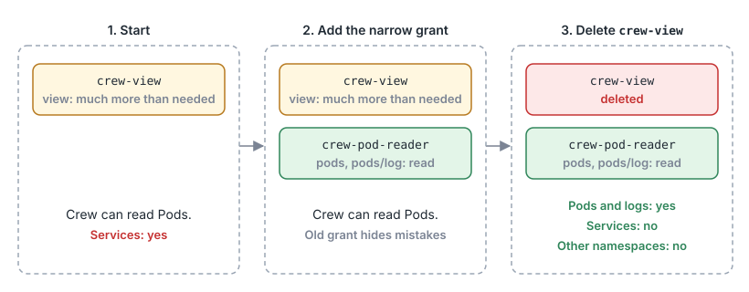
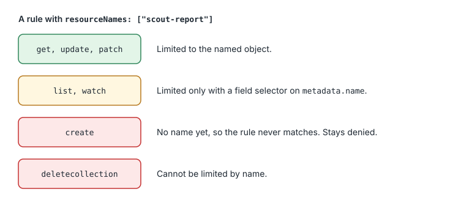

# Rewrite A Broad Grant As Least Privilege

A finding is only useful if the fix does not break the workload. Least privilege means that an identity gets only the access it really needs, and nothing more. To replace a broad grant with a narrow one, follow a safe order: add the narrow grant first, test it, remove the broad one, and test again.

On this page, you follow that order with the group `starfleet-crew`. The group holds the built-in `view` ClusterRole in `outpost`, but it only needs to read Pods and their logs.

## Decide what the identity needs

Least privilege starts from the work, not from the existing role. Ask which API calls the workload or the people really make: which verbs, on which resources, in which namespaces and on which named objects.

Three sources can answer that question: the application documentation, the audit log of the API server, and a trial run with the denied actions logged. A rule that you cannot trace to a need is a rule to leave out.

For the crew, the need is stated: read Pods in `outpost` and read their logs. The built-in `view` role gives much more. It also reads Services, ConfigMaps, Deployments and many other objects. The first command below shows one of the extra reads, and the second shows the part that the crew needs.

<!-- astrona:playground:renew -->

```sh
kubectl auth can-i list services -n outpost --as=jane --as-group=starfleet-crew
kubectl auth can-i get pods --subresource=log -n outpost --as=jane --as-group=starfleet-crew
```

Both commands print `yes`. The first answer is the exposure to remove. The second answer is the access to keep.

## Add the narrow grant first

A narrow grant uses a Role in the namespace of the need, so it cannot reach any other namespace. The Role lists the two resources with read verbs only. The log of a Pod is the subresource `pods/log`, which `pods` does not include, so it needs its own entry. The new RoleBinding goes in the same namespace and names the same group.

Save this as `role-crew-pod-reader.yaml`:

```yaml
apiVersion: rbac.authorization.k8s.io/v1
kind: Role
metadata:
  name: crew-pod-reader
  namespace: outpost
rules:
  - apiGroups: [""]
    resources: ["pods", "pods/log"]
    verbs: ["get", "list", "watch"]
---
apiVersion: rbac.authorization.k8s.io/v1
kind: RoleBinding
metadata:
  name: crew-pod-reader
  namespace: outpost
roleRef:
  apiGroup: rbac.authorization.k8s.io
  kind: Role
  name: crew-pod-reader
subjects:
  - kind: Group
    name: starfleet-crew
    apiGroup: rbac.authorization.k8s.io
```

Apply it:

```sh
kubectl apply -f role-crew-pod-reader.yaml
```

At this point, the crew holds both grants, and nothing has been removed yet. You could test the new grant now, but the old grant would hide a mistake in it: every test would pass through `view` anyway. That is why the old grant must go before the final test.

## Remove the broad grant and test again

Now delete the RoleBinding that gives `view`. You delete only the binding. The built-in ClusterRole `view` stays, because other bindings may use it. Then ask the same questions as before, and add the actions that must stay denied.

```sh
kubectl -n outpost delete rolebinding crew-view
kubectl auth can-i list pods -n outpost --as=jane --as-group=starfleet-crew
kubectl auth can-i get pods --subresource=log -n outpost --as=jane --as-group=starfleet-crew
kubectl auth can-i list services -n outpost --as=jane --as-group=starfleet-crew
kubectl auth can-i list pods -n starfleet --as=jane --as-group=starfleet-crew
```

The first two answers are `yes`, so the crew can still do its work. The last two are `no`: Services are no longer in the grant, and the grant does not reach another namespace.

If a person on the crew later reports a failure, the API server names the missing verb and resource in the error message of the denied request. You then add exactly that one rule.



The drawing shows the safe order: the narrow grant is added before the broad one is removed, so the crew never loses access, and the denied actions are tested last.

## Limits of resourceNames

A narrow Role can go one step further and name single objects. The field `resourceNames` limits a rule to the objects with the listed names. A rule with `resources: ["configmaps"]`, `resourceNames: ["scout-report"]` and the verbs `get`, `update` and `patch` allows those verbs on that one ConfigMap and on no other. This is the narrowest rule for a workload that maintains a single object.

It has limits that you must know, because the authorizer can only match a name that is part of the request:

- A `create` request has no object name when the authorizer checks it. So `resourceNames` cannot limit `create`. A rule that has `create` and `resourceNames` never matches a create request, so `create` stays denied.
- A `list` or `watch` request matches by name only when the request itself selects the object with a field selector on `metadata.name`.
- `deletecollection` cannot be limited by name.

If the workload must create objects, you have two choices. Give `create` in a separate rule without names and accept the wider rule, or create the object ahead of time as an administrator.



The drawing shows which verbs `resourceNames` can limit and which ones it cannot.

You can now replace a broad built-in role with a narrow Role without an outage, and you know where `resourceNames` stops working. The task on the next page applies the same order to the `scout` ServiceAccount and its cluster-wide `edit` grant.

## Common pitfalls

> [!WARNING]
> - **Deleting the broad binding first.** The workload or the crew has no access until the replacement exists.
> - **Deleting the built-in ClusterRole `view`.** Delete the binding, not the role. Other bindings may use the role, and the API server restores built-in roles at startup.
> - **Forgetting the subresource.** `pods` does not include `pods/log`. Name each subresource.
> - **Adding `create` to a rule with `resourceNames`.** The name cannot limit a create request.
> - **Stopping after the allowed tests.** Run the denied tests in the same namespace and in another one.
