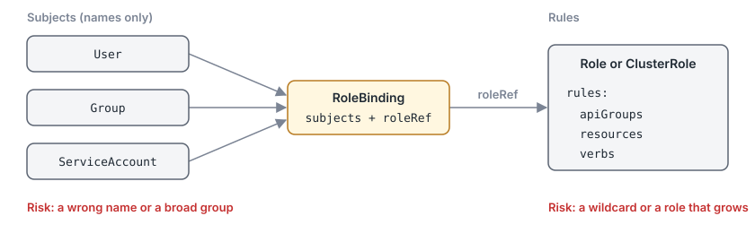

# Subjects, Built-In Roles And Wildcards

Role Based Access Control (RBAC) is the authorization mode of the Kubernetes API server. It decides whether an identity may do an action on a resource. Every RBAC grant has two sides: the rules that say what is allowed, and the subject that receives them. A mistake on either side can expose the cluster.

A subject can be a user, a group or a ServiceAccount, and Kubernetes stores no list of users and no list of groups. A role can be a built-in one that grows by itself, or a custom one with a wildcard that matches more than its author meant. Trimming subjects and wildcards is part of the Certified Kubernetes Security Specialist (CKS) exam.



The drawing shows the two sides of one grant. The binding holds the subjects and points at a role, and the role holds the rules.

Keep one sentence in mind for this module: **a subject is only a name that authentication produces, a built-in role is a set of rules that other roles can extend, and a wildcard matches things that do not exist yet, so name the subject exactly and write the rules out.** You will bind a user, a group and a ServiceAccount in one binding. You will build an aggregated ClusterRole that grows when a labelled role is added. And you will rewrite a wildcard Role without breaking the group that uses it.

## What you will learn

After this module, you can:

- write a binding with a `User`, a `Group` and a `ServiceAccount` subject, and say which fields each subject needs;
- explain where user names and groups come from, and why RBAC does not check that they exist;
- name the built-in ClusterRoles and the built-in bindings to `system:masters` and `system:authenticated`;
- build an aggregated ClusterRole with `aggregationRule`, and explain why its `rules` field must stay empty;
- explain what a wildcard in `apiGroups`, `resources` and `verbs` matches, and find wildcards in Roles;
- replace a wildcard rule with explicit lists, and prove the result with allowed and denied tests.

## How the module is laid out

You start with **Users, Groups And ServiceAccounts As Subjects**, which shows where the names in a binding come from, how a certificate becomes a user and its groups, and what happens when a name does not exist. **Built-In And Aggregated ClusterRoles** then explains the roles Kubernetes creates, the groups they are bound to, and how an aggregated ClusterRole collects rules from labelled roles. **Remove Wildcards And Narrow Rules** closes the module. It shows what a wildcard grants, how to find one, and how to replace it with explicit lists.

A lab follows each part, so you can practise the skill right away.

## Before you start

You should know the Kubernetes basics: pods, namespaces, YAML manifests, and the commands `kubectl get` and `kubectl apply`. You should know that a Role holds rules, and that a binding gives a role to subjects. You do not need any earlier module.

The commands run against a playground cluster. Your terminal must use the private kubeconfig of the playground. A kubeconfig is the file that holds the cluster address and the credentials for `kubectl`. Run these two commands once in every new terminal:

```sh
export KUBECONFIG="$(astrona kubeconfig ats-032-playground-010-03)"
test "$(kubectl config current-context)" = "kind-astro-ats-032-playground-010-03" || exit 1
```

The first command points `kubectl` at the playground. The second command stops if the current context is not the playground cluster.

## Your playground

Your playground is a single-node `kind` cluster that runs Kubernetes 1.35. Your own credentials in this cluster have the `cluster-admin` role. So you can create any RBAC object and act as other identities. The cluster starts with these objects:

| Namespace | Object | What it is |
| --- | --- | --- |
| `starfleet` | `probe` ServiceAccount | An identity for workloads, used as a binding subject |
| `outpost` | `crew-operator` Role | One rule that uses `*` for API groups, resources and verbs |
| `outpost` | `outpost-crew-operator` RoleBinding | Gives the `crew-operator` Role to the group `outpost-crew` |

Start your playground now and keep it running while you read:

<!-- astrona:playground -->
