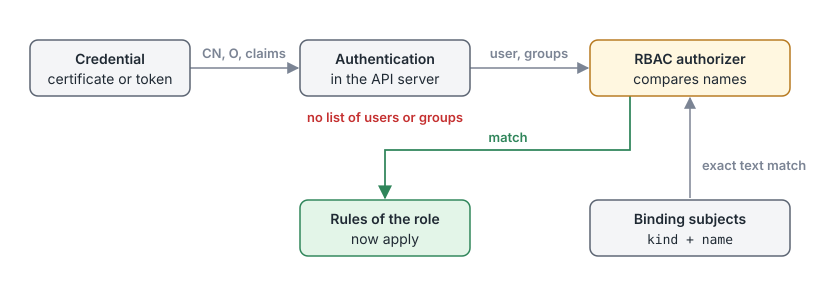
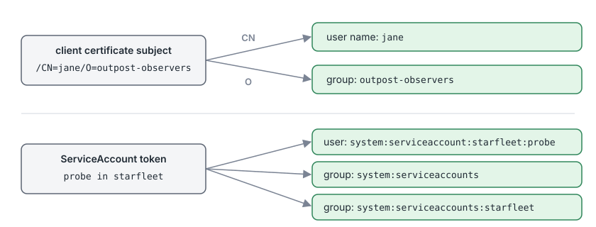
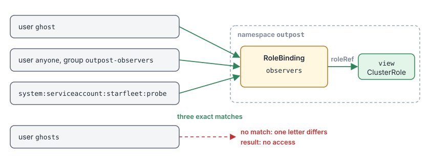

# Users, Groups And ServiceAccounts As Subjects

A binding gives a role to subjects. A subject is the identity that receives the rules of the role, and in a binding it is only a name. If the name is wrong, the grant reaches nobody, or it reaches someone you did not mean.

To write subjects with confidence, you need to know where the names come from. Kubernetes has no User object and no Group object. On this page, you build one binding with all three subject kinds and test each one.

## Where the names come from

Every request to the API server goes through two steps before it runs. The authentication step of the API server turns a credential into an identity: a user name, a list of groups and optional extra data. The RBAC authorizer then compares those names with the subjects of the bindings.

Kubernetes stores no list of users and no list of groups. So nothing checks that a name in a binding belongs to a real person.



The drawing shows who does what. Authentication produces the names, and the RBAC authorizer only compares them with the binding subjects. No component looks the users up.

A client certificate is one source of names. The API server takes the Common Name (CN) field of the certificate subject as the user name. It takes every Organization (O) field as a group. A certificate with the subject `/CN=jane/O=outpost-observers` therefore authenticates as the user `jane` in the group `outpost-observers`.

Tokens are other sources of names. With a token from an external identity provider, the user name and the groups come from claims in the token. A claim is a named value inside the token. A ServiceAccount token gives the user name `system:serviceaccount:<namespace>:<name>` and the groups `system:serviceaccounts` and `system:serviceaccounts:<namespace>`.



The drawing shows how each field of a credential turns into a user name or a group. These are the exact names a binding must use.

You can see the certificate fields yourself. The first command creates a private key and a certificate signing request with the subject above. A certificate signing request (CSR) is the file that asks a certificate authority to sign a certificate. The second command prints the subject of the request.

<!-- astrona:playground:renew -->

```sh
openssl req -new -newkey rsa:2048 -nodes -keyout jane.key -subj "/CN=jane/O=outpost-observers" -out jane.csr
openssl req -in jane.csr -noout -subject
```

The output shows the CN and the O field, written in the format of your OpenSSL version. The request is not submitted anywhere. It only shows the two fields that become the user name and the group when the cluster signs it.

## The three subject kinds

Now that you know where the names come from, you can write them into a binding. A binding lists its subjects in the field `subjects`. Each entry has a `kind` and a `name`, and the other fields depend on the kind:

- `User` uses `apiGroup: rbac.authorization.k8s.io`. The API server fills it in when you leave it out. The name is exactly the user name that authentication produces.
- `Group` uses the same `apiGroup`. The name is exactly one of the group names.
- `ServiceAccount` needs a `namespace` and must not have `apiGroup: rbac.authorization.k8s.io`. The name is the ServiceAccount name without the long prefix.

A ServiceAccount can also be written as a `User` with the name `system:serviceaccount:starfleet:probe`. Both forms match the same identity. The `ServiceAccount` form is clearer, and the API server checks it for the namespace field.

Save this as `rolebinding-observers.yaml`. It gives the built-in `view` ClusterRole in `outpost` to a user, a group and a ServiceAccount at the same time:

```yaml
apiVersion: rbac.authorization.k8s.io/v1
kind: RoleBinding
metadata:
  name: observers
  namespace: outpost
roleRef:
  apiGroup: rbac.authorization.k8s.io
  kind: ClusterRole
  name: view
subjects:
  - kind: User
    name: ghost
    apiGroup: rbac.authorization.k8s.io
  - kind: Group
    name: outpost-observers
    apiGroup: rbac.authorization.k8s.io
  - kind: ServiceAccount
    name: probe
    namespace: starfleet
```

Apply it:

```sh
kubectl apply -f rolebinding-observers.yaml
```

The API server accepts the binding, although no user named `ghost` has ever existed. It does not look the names up. So a typing mistake in a user name creates a valid binding for a person who does not exist. The real person gets nothing, and no error appears.

## Test each subject

Because nothing checks the names, a test is the only proof that a binding works. Test each subject with the identity that carries its name:

- the first command acts as the user `ghost`;
- the second acts as any user in the group `outpost-observers`;
- the third acts as the ServiceAccount;
- the fourth acts as a user with a similar name that is in no group.

```sh
kubectl auth can-i list pods -n outpost --as=ghost
kubectl auth can-i list pods -n outpost --as=anyone --as-group=outpost-observers
kubectl auth can-i list pods -n outpost --as=system:serviceaccount:starfleet:probe
kubectl auth can-i list pods -n outpost --as=ghosts
```

The first three commands print `yes`. The fourth prints `no`, because the name differs by one letter. The group test used the user name `anyone`, which shows that the group alone carries the grant.



The drawing shows that each match is an exact text match. A name that differs by one letter falls outside the binding.

You can also create the same binding with one imperative command: `kubectl create rolebinding observers --clusterrole=view --user=ghost --group=outpost-observers --serviceaccount=starfleet:probe -n outpost`.

Remove the binding when you are done, so that `outpost` is back in its starting state:

```sh
kubectl -n outpost delete rolebinding observers
```

You can now write all three subject kinds, and you know that the API server matches names as text. The open question is which roles a binding should point at, and how the roles that Kubernetes ships are built.

## Common pitfalls

> [!WARNING]
> - **Expecting an error for a user that does not exist.** RBAC does not look names up. Test with `--as` after you write a binding.
> - **Leaving out `namespace` in a ServiceAccount subject.** The subject is invalid without it.
> - **Adding `apiGroup: rbac.authorization.k8s.io` to a ServiceAccount subject.** The API server rejects it. Only User and Group subjects use that group.
> - **Binding a person by group when the group is not in the certificate.** The `O` field of the certificate or the claim in the token must carry the group name.
> - **Copying a private key into a repository.** The key from the certificate request is a credential.
