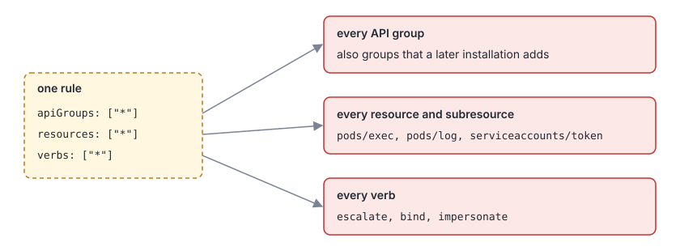
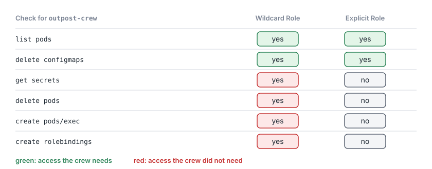
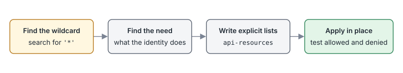

# Remove Wildcards And Narrow Rules

A wildcard in a rule is short to write and hard to review. The character `*` in `apiGroups`, `resources` or `verbs` matches everything. That includes things that do not exist when someone writes the rule, so a custom resource added next year is covered by a rule written today.

On this page, you see what a wildcard grants in practice, how to find wildcards in a cluster, and how to replace them with lists that a reviewer can read.

## What a wildcard matches

Each of the three lists in a rule treats the star in its own way:

- In `verbs`, `*` matches every verb, including `escalate`, `bind` and `impersonate`.
- In `resources`, it matches every resource type and every subresource, such as `pods/exec`, `pods/log` and `serviceaccounts/token`. A subresource is an extra endpoint under a resource, with its own name.
- In `apiGroups`, it matches every API group, including groups that a later installation adds.

A rule with `*` in all three lists is the same as `cluster-admin` limited to the namespace of the Role.



The drawing shows what each star in the rule reaches. Together, the three stars cover every action in the namespace.

The playground has such a Role. The Role `crew-operator` in `outpost` is bound to the group `outpost-crew`. The first command asks whether the crew can read Secrets. The second asks whether it can create bindings, which would let a crew member give any role of the namespace to anyone.

<!-- astrona:playground:renew -->

```sh
kubectl auth can-i get secrets -n outpost --as=jane --as-group=outpost-crew
kubectl auth can-i create rolebindings.rbac.authorization.k8s.io -n outpost --as=jane --as-group=outpost-crew
```

Both commands print `yes`. The second answer is the more serious one. The escalation check of the API server lets a user create a binding only for permissions that the user holds, and the wildcard holds all of them in `outpost`.

## Find wildcards in a cluster

Before you can remove a wildcard, you have to find it. A review searches the YAML of all roles for the quoted star. The first command below prints every line with a star and the eight lines before it, which is enough to see the Role name and the list that holds the star.

The second command does the same search for ClusterRoles, but only counts the hits. The count includes the built-in `cluster-admin` role and a few `system:` roles that use wildcards for good reasons.

```sh
kubectl get roles --all-namespaces -o yaml | grep -n -B8 "'\*'"
kubectl get clusterroles -o yaml | grep -c "'\*'"
```

The first command shows the rule of `crew-operator`, with the Role name `crew-operator` and the namespace `outpost` above it. The second prints a count, which includes the built-in roles. A count is only a first signal. Open each hit and decide whether the wildcard is intended.

## Replace the wildcard with explicit lists

As in any least-privilege change, you write the rule out starting from the need. Least privilege means that an identity gets only the permissions it needs for its job. Suppose the crew needs to manage ConfigMaps and only read Pods.

Take the list of resource names from the cluster, so that you spell them correctly. The command below prints the namespaced resources of the core group with their short names.

```sh
kubectl api-resources --namespaced=true --api-group="" -o name
```

The list contains `configmaps`, `pods`, `secrets`, `services` and more. You copy only the names you need. For other groups, put the group in `--api-group`, for example `apps` for Deployments. Then write `deployments.apps` as `resources: ["deployments"]` with `apiGroups: ["apps"]`.

Save this as `role-crew-operator.yaml`. It has the same name and namespace as the existing Role, so the apply updates the Role in place and the RoleBinding keeps working:

```yaml
apiVersion: rbac.authorization.k8s.io/v1
kind: Role
metadata:
  name: crew-operator
  namespace: outpost
rules:
  - apiGroups: [""]
    resources: ["pods"]
    verbs: ["get", "list", "watch"]
  - apiGroups: [""]
    resources: ["configmaps"]
    verbs: ["get", "list", "watch", "create", "update", "patch", "delete"]
```

Apply it:

```sh
kubectl apply -f role-crew-operator.yaml
```

Then check the result. The first two commands test the allowed actions. The other four test actions that the wildcard allowed and the new rule does not:

```sh
kubectl auth can-i list pods -n outpost --as=jane --as-group=outpost-crew
kubectl auth can-i delete configmaps -n outpost --as=jane --as-group=outpost-crew
kubectl auth can-i get secrets -n outpost --as=jane --as-group=outpost-crew
kubectl auth can-i delete pods -n outpost --as=jane --as-group=outpost-crew
kubectl auth can-i create pods --subresource=exec -n outpost --as=jane --as-group=outpost-crew
kubectl auth can-i create rolebindings.rbac.authorization.k8s.io -n outpost --as=jane --as-group=outpost-crew
```

The first two commands print `yes`. The other four print `no`. The group binding did not change, and the crew still has what it needs.



The drawing compares the six checks before and after the change. The two needed actions stay allowed, and the four extra actions are now denied.

## Where a wildcard is still acceptable

Not every star is a finding. Some identities really do control a whole group of resources:

- A ClusterRole for a controller that manages its own custom resource group may use `resources: ["*"]` with `apiGroups: ["example.com"]`, because the group belongs to that controller.
- A wildcard in `verbs` for a resource that the identity owns can be the right choice.

The test is whether the group, the resources and the verbs are limited to what the identity is meant to control. A star in all three lists never passes that test for a workload or a team.



The drawing shows the order of work for each wildcard: find it, learn the real need, write explicit lists, then apply and test.

You can now find wildcards, judge how much they grant, and replace them without changing the binding. The open question is how this works on a Role that a group of operators already depends on, which the task on the next page covers.

## Common pitfalls

> [!WARNING]
> - **Replacing `*` in `resources` and keeping it in `verbs`.** The rule still allows every action on the listed resources, including `escalate` and `impersonate`.
> - **Writing `deployments` with `apiGroups: [""]`.** Deployments are in the `apps` group, so the rule matches nothing.
> - **Assuming `pods` includes `pods/log` and `pods/exec`.** Each subresource needs its own entry, and leaving it out is the point of least privilege.
> - **Deleting the Role to start again.** The RoleBinding then points at a Role that does not exist, and the group has no access until you create the Role again.
> - **Counting stars as the only risk.** A long explicit list can still include Secrets, `pods/exec` or `create` on Pods.
