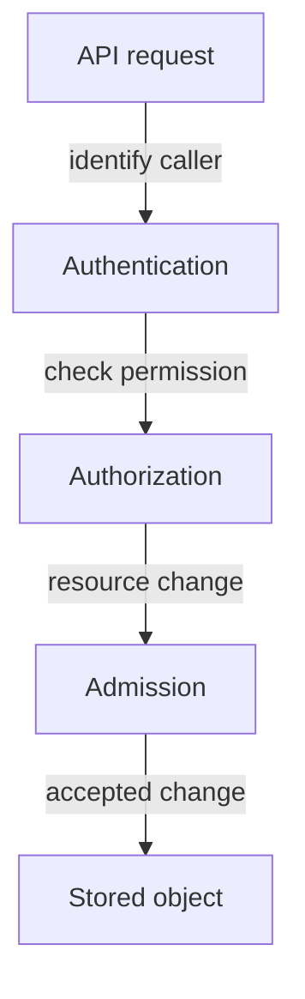
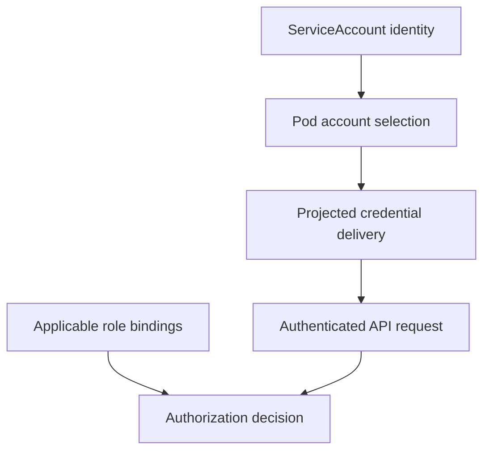

# API Identity And ServiceAccounts

An example `probe` application can run without reading Kubernetes resources, while a controller needs a workload identity to call the API. Giving both the same mounted credentials exposes authority where it may not be needed.

## Learning objectives

- Distinguish established identity from granted API permission.
- Explain ServiceAccount token audience and lifetime.
- Identify unnecessary credential mounting and disclosure paths.

## Before you start

This chapter is standalone reading material; no running cluster or installed tools are required. A Pod is the Kubernetes unit for running one or more containers, and a namespace groups namespaced objects. Treat the worked configurations as teaching examples rather than recorded observations from a provisioned environment.

## Responsible components and behavior

The `shuttle` application asks the Kubernetes application programming interface (API) to read Pods. Before returning data, the API server evaluates the request. Authentication establishes the caller's identity. Authorization decides whether that identity may perform the requested action on the target resource.

Admission handles additional checks and possible mutation for relevant resource-changing requests after authorization. An admission policy might reject a privileged Pod even when the caller is authorized to create Pods. Authentication failure, insufficient permission and a policy rejection describe different stages and require different corrections.

A ServiceAccount is a namespaced Kubernetes identity intended for workloads and automation. A Pod can use one to authenticate API requests through a token. Modern projected tokens can have bounded lifetime and audience, limiting where and for how long they are useful. A token still needs protection against disclosure.

Every namespace has a default ServiceAccount, but using it does not imply administrative access. Permissions come from authorization configuration. A workload that does not need API access can avoid automatically mounting credentials, reducing unnecessary credential exposure.

Identity, permission and admission policy are distinct checks before a resource change is stored.

If the application authenticates successfully but receives a forbidden response, investigate its permissions rather than replacing the token first. If a Pod creation is rejected for security settings, inspect the admission policy and requested fields. Fix the stage supported by the evidence.

## Following A Resource-Changing Request

A developer requests a new Pod. The API server first establishes a caller identity through a configured authentication mechanism. A presented certificate or token must be valid for the intended use. Successfully identifying the caller does not yet decide whether the developer may create Pods in the target namespace.

Authorization then evaluates the requested action, resource and scope. A read grant does not imply a create grant. The namespace and API group are part of the request's meaning. If this check fails, changing the proposed Pod's image may be irrelevant because the caller lacks permission to create any such object.

For an authorized resource change, admission can mutate or validate the request through configured checks. A mutating check might supply a default, while a validating check can reject disallowed behavior. These mechanisms must be evaluated as part of the cluster's policy; authorization alone is not the complete acceptance contract.

## Workload Credentials Have A Scope And Lifetime

A ServiceAccount identifies a workload within a namespace. The Pod can obtain a projected token with a defined audience and lifetime. Audience describes the intended recipient, so a token accepted by one service should not automatically be useful everywhere. Limited lifetime reduces continued usefulness after expiry, but exposure while valid still matters.

The workload should receive credentials only when it needs them. Disabling automatic token mounting can reduce unnecessary access for an application that never calls the Kubernetes API. That choice is separate from the ServiceAccount's role grants: not mounting a credential changes availability of that credential to the process, while role-based access control (RBAC) defines what an authenticated identity may do.

A diagnosis should state which stage rejected the request and which identity made it. An admission error about privilege is not repaired by issuing another token. A forbidden response is not resolved merely by adding a namespace label. The corrective action belongs to the failed contract.

## Work through the decision

A ServiceAccount is a namespaced workload identity. The admitted Pod's `serviceAccountName` identifies the chosen account; admission can supply the namespace's default when no explicit account was requested. Projected credentials may include an audience and lifetime, and the kubelet manages supported rotation.

Credential delivery and authorization are separate. Disabling automatic token mounting reduces credential availability to a process that does not need API access; it does not remove grants from the identity itself. Conversely, a mounted token supplies a way to authenticate but does not grant administrative actions. Inspect references and mount structure rather than displaying token contents.

Selecting and delivering a workload identity does not determine its permissions without authorization grants.

You can now inspect identity and credential delivery without disclosing secrets. A workload should receive only the API authority and credential access that its actual responsibility requires.

## Common pitfalls

> [!WARNING]
> A valid token does not grant every permission. Authorization and admission can reject a request after authentication succeeds.
