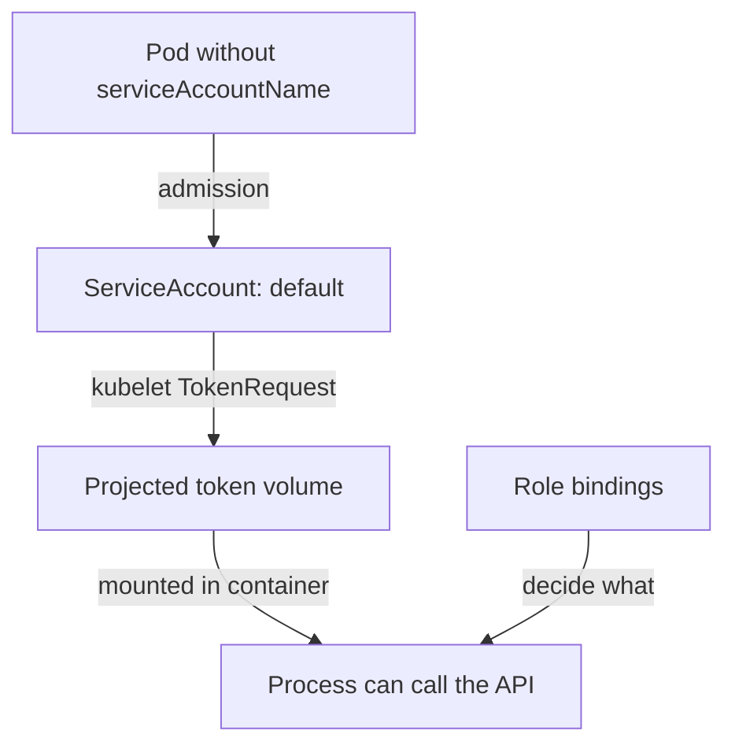

# ServiceAccounts And The Default Token

Most pods never call the Kubernetes API, yet most pods carry a credential for it. That happens because Kubernetes adds the credential automatically, unless you tell it not to. Before you change this behavior, you need to see exactly what is added, who adds it and what the credential allows. This part inspects the `shuttle` pod and the `default` ServiceAccount.

## How a pod gets an identity

A ServiceAccount is a namespaced API object that represents a workload. Users are people; ServiceAccounts are for processes in pods. When the API server receives a pod without the field `spec.serviceAccountName`, the ServiceAccount admission controller sets it to `default`. It rejects a pod that names a ServiceAccount that does not exist. Every namespace gets a `default` ServiceAccount, created by the ServiceAccount controller inside `kube-controller-manager`.

The same admission step adds a volume to the pod. The kubelet, the node agent that starts containers, then fills that volume and mounts it in every container at `/var/run/secrets/kubernetes.io/serviceaccount`. The volume is a **projected volume**: one volume that combines several sources. It has three sources:

- A token. The kubelet asks the API server for it with the TokenRequest API and writes it to the file `token`.
- The cluster certificate authority (CA) bundle from the ConfigMap `kube-root-ca.crt`, in the file `ca.crt`. A client uses it to trust the API server certificate.
- The namespace of the pod, in the file `namespace`.

The token is a JSON Web Token (JWT) that the API server signs. It is **bound** to the pod: it carries the name and unique ID of the pod and the ServiceAccount, it has an expiry time, and the API server stops accepting it when the pod is deleted. The kubelet refreshes the file before it expires, so the application should read the file again when it makes a new call and not cache the value forever.

## Look at the default token in a running pod

Start with the pod `shuttle`. The first command lists the ServiceAccounts in `starfleet`. The second prints which account the pod uses. The third lists the volume names.

<!-- astrona:playground:renew -->

```sh
kubectl -n starfleet get serviceaccount
kubectl -n starfleet get pod shuttle -o jsonpath='{.spec.serviceAccountName}{"\n"}'
kubectl -n starfleet get pod shuttle -o jsonpath='{.spec.volumes[*].name}{"\n"}'
```

The list shows the ServiceAccount `default`. The second command prints `default`, although the pod manifest never named an account. The third command prints one volume name that starts with `kube-api-access-` and ends in a random suffix. That volume is the projected volume. Next, list the files in the mount path of the container. The command lists names only. Never print the file `token` in a shared terminal, because anyone who reads it can call the API as this pod until it expires.

```sh
kubectl -n starfleet exec shuttle -- ls /var/run/secrets/kubernetes.io/serviceaccount
kubectl -n starfleet get pod shuttle -o jsonpath='{.spec.volumes[0].projected.sources[0].serviceAccountToken}{"\n"}'
```

The first command prints three names: `ca.crt`, `namespace` and `token`. The second prints the settings of the token source as JSON: an `expirationSeconds` value of `3607`, which is a little over one hour, and the path `token`. There is no `audience` field, which means the token uses the default audience, the API server itself.

## What the default account can do

A token only proves an identity. What that identity may do comes from RBAC. A new `default` ServiceAccount has no Role or binding of its own. Ask the API server for its permissions in `starfleet`:

```sh
kubectl auth can-i --list -n starfleet --as=system:serviceaccount:starfleet:default
```

The table that comes back is short. It contains only the rules that every authenticated identity receives from built-in bindings, such as the right to ask what its own permissions are, and read access to a few non-resource URLs such as `/version`. It has no rule for Pods, Secrets or any other namespaced object.

So a fresh `default` account is harmless. The danger is that clusters change over time. An administrator who binds a Role to `default` to fix one broken application gives every pod in the namespace the same rights, because every pod without an account uses `default`. The mounted token then turns any code execution inside one container into API access. Mounting is the first thing to remove, and permissions are the second.



The diagram shows that admission picks the account, the kubelet mounts the token, and RBAC bindings decide what a request with that token may do.

You have now seen what a default pod receives: an automatic account, a projected token that expires after about an hour, the cluster CA and the namespace. The `default` account has almost no permissions, but the token is present in every container. The next question is how to stop it from being mounted.

## Common pitfalls

> [!WARNING]
> - **Assuming the `default` account is powerful.** A new one is not. The risk comes from bindings that someone adds to it later.
> - **Printing the token to check it.** Check that the file exists, not its content.
> - **Binding roles to `default`.** Every pod without a named account then gets the rights.
> - **Caching the token in the application.** The kubelet rotates the file, so the application must reread it.
