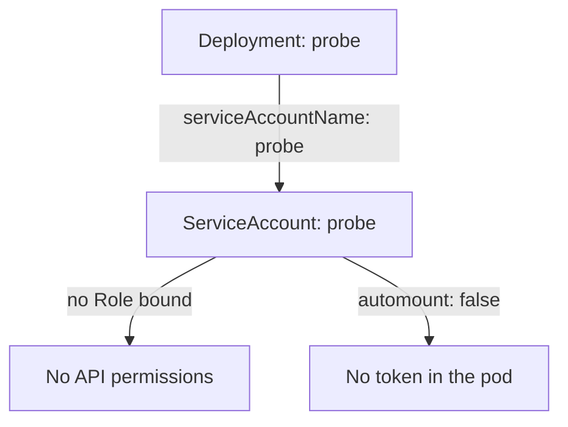

# One ServiceAccount For Each Workload

When several workloads share the `default` ServiceAccount, every permission given to one of them is given to all of them. A reviewer cannot tell from a binding which application needed it, and nobody can remove it without risking a second application. The fix is simple to state: each workload gets its own ServiceAccount, named after the workload. This part creates one, assigns it to a Deployment, and shows how the assignment works for Deployments and for bare pods.

## Why sharing one identity is a risk

A ServiceAccount is the identity that RBAC checks when a pod calls the Kubernetes API. RBAC has no notion of "this application". It only knows the subject name, such as `system:serviceaccount:starfleet:default`. Two pods that use the same account are the same subject, so they have the same permissions.

Sharing also hides intent. A binding to `default` does not say which workload needs it. Over time the account collects grants from every team, and no one dares to remove one. A dedicated account turns each grant into a clear statement: this workload may do this. If the workload is removed, its account and its grants are removed with it.

## Look at who uses what

The `starfleet` namespace runs the Deployment `probe` and the pod `shuttle`. Neither names a ServiceAccount. The command below lists the account of every pod in the namespace. The second command lists the ServiceAccounts that exist.

<!-- astrona:playground:renew -->

```sh
kubectl -n starfleet get pods -o custom-columns=NAME:.metadata.name,SERVICEACCOUNT:.spec.serviceAccountName
kubectl -n starfleet get serviceaccounts
```

All three pods show `default`, and the namespace has only the `default` account. The application `probe` is a web server that never calls the Kubernetes API, so it needs no permission and no token at all. A dedicated account lets you say that in the cluster itself.

## Create the account and assign it

The ServiceAccount below is for `probe`. It sets `automountServiceAccountToken: false` because the application does not call the API. A new account has no permissions, so this one can do nothing even if a token leaked.

Save this as `serviceaccount-probe.yaml`:

```yaml
apiVersion: v1
kind: ServiceAccount
metadata:
  name: probe
  namespace: starfleet
automountServiceAccountToken: false
```

Apply it:

```sh
kubectl apply -f serviceaccount-probe.yaml
```

The account exists, but the Deployment does not use it yet. The field `spec.template.spec.serviceAccountName` in the Deployment names the account. The command `kubectl set serviceaccount` changes that field. Because it changes the pod template, the Deployment controller starts a rollout: it creates new pods with the new account and removes the old ones. Then check the result:

```sh
kubectl -n starfleet set serviceaccount deployment/probe probe
kubectl -n starfleet rollout status deployment/probe --timeout=180s
kubectl -n starfleet get pods -o custom-columns=NAME:.metadata.name,SERVICEACCOUNT:.spec.serviceAccountName
kubectl -n starfleet exec deploy/probe -- ls /var/run/secrets/kubernetes.io/serviceaccount
```

The `probe` pods now show the account `probe`, and the `shuttle` pod still shows `default`. The `ls` command fails with an error, because the directory does not exist: the account turned mounting off, so the kubelet did not create the volume. The failure is the result you want.



The diagram shows what the Deployment now reaches: an account with no grants and no mounted token.

## Pods cannot change their account

A pod accepts a ServiceAccount only when it is created. The field `spec.serviceAccountName` cannot be changed on a running pod, and the same holds for `automountServiceAccountToken`. To move a bare pod such as `shuttle` to another account, you delete the pod and create it again with the new field. A Deployment does this for you through a rollout, which is why a Deployment is the better way to run a workload.

The API server also checks the name when a pod is created. A pod that names an account that does not exist is rejected. A Deployment behaves differently: the Deployment itself is accepted, but its ReplicaSet cannot create any pod, and the events of the ReplicaSet show the error. If a rollout stalls right after you set an account, look at the events in the namespace for a message that the account was not found.

You now know how to give a workload its own identity and how the change reaches running pods. The account `probe` has no permissions, which is right for an application that does not call the API. The next question is what to do for a workload that does call the API.

## Common pitfalls

> [!WARNING]
> - **Typing the account name wrong in a Deployment.** The Deployment is accepted, but no pods start. Check the events of the ReplicaSet.
> - **Expecting a running pod to take a new account.** The field is fixed at creation. Delete and recreate the pod, or roll out the Deployment.
> - **Reusing one new account for several workloads.** That rebuilds the problem of the `default` account under another name.
> - **Naming an account after a person or a team.** Name it after the workload, so a reader of a binding knows what it is for.
