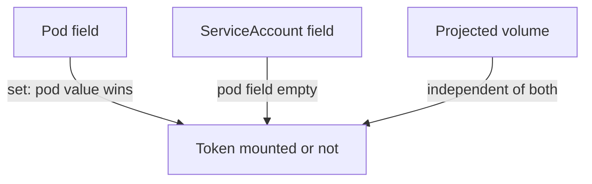

# Find Which Pods Use Which ServiceAccount

A review starts with an inventory. You cannot judge the risk of a ServiceAccount before you know which pods run as it and whether those pods hold its token. Both facts are stored in the pod objects, so one `kubectl get` with the right output columns answers them for the whole cluster. This part builds that inventory and shows why an unset field needs careful reading.

## Two fields decide whether a pod holds a token

The ServiceAccount of a pod is in `spec.serviceAccountName`. The admission step fills it with `default` when the pod names none, so after creation the field is always set. Whether the token is mounted depends on `automountServiceAccountToken` in the pod and in the account. The pod value wins. If the pod leaves the field out, the account value is used. If neither sets it, the token is mounted.

This makes an empty cell in an audit table ambiguous. An empty pod field says "ask the account". The inventory therefore needs both objects: the pods and the accounts. A third source matters as well: a pod can mount a token through its own projected volume even when automounting is off, as the pod `ledger-client` in the playground does.

## List pods with their accounts

The command below prints one line for each pod in all namespaces. `custom-columns` selects fields by their path. A field that is not set prints as `<none>`. The output has many system pods in `kube-system`, so the second command limits the view to the `outpost` namespace.

<!-- astrona:playground:renew -->

```sh
kubectl get pods -A -o custom-columns=NAMESPACE:.metadata.namespace,NAME:.metadata.name,SERVICEACCOUNT:.spec.serviceAccountName,AUTOMOUNT:.spec.automountServiceAccountToken
kubectl get pods -n outpost -o custom-columns=NAME:.metadata.name,SERVICEACCOUNT:.spec.serviceAccountName,AUTOMOUNT:.spec.automountServiceAccountToken
```

In the first listing, system pods use their own accounts, such as the one for CoreDNS, and the AUTOMOUNT column shows `<none>` for most pods. In the `outpost` listing, `ledger-client` shows `false`, because its pod sets the field, and `archive-reader` shows `<none>`, because only its account sets the field.

## List the accounts and their settings

The accounts hold the other half of the answer. List them in the same way:

```sh
kubectl get serviceaccounts -A -o custom-columns=NAMESPACE:.metadata.namespace,NAME:.metadata.name,AUTOMOUNT:.automountServiceAccountToken
```

The `archive` account shows `false`, so `archive-reader` has no token. The `ledger` account and every `default` account show `<none>`, which means the token is mounted for any pod that does not turn it off. Combine the two listings by hand: a pod holds a token when its own field is `true`, or when its own field is empty and the account field is empty or `true`.

## Check the mount instead of computing it

Reasoning about the two fields is useful, but the container is the proof. Look for the token directory in each pod you care about, as you would in a test. The first command checks the `drifter` pod, which uses `default`. The second checks `archive-reader`.

```sh
kubectl -n outpost exec drifter -- ls /var/run/secrets/kubernetes.io/serviceaccount
kubectl -n outpost exec archive-reader -- ls /var/run/secrets/kubernetes.io/serviceaccount
```

The first command lists `ca.crt`, `namespace` and `token`. The second fails, because the directory does not exist. A pod such as `ledger-client` has no directory at that path but holds a token at `/var/run/tokens/token`, so an audit must also read the volumes. This command prints the projected volumes of that pod as JSON:

```sh
kubectl -n outpost get pod ledger-client -o jsonpath='{.spec.volumes[*].projected}{"\n"}'
```

The result shows one `serviceAccountToken` source with `path` set to `token` and `expirationSeconds` set to `86400`. That is a token that lives one day. The next part of the audit asks what that token, and every other one, is allowed to do.



The diagram shows three sources for a token in a container: the pod field, the account field and an explicit projected volume.

You now have an inventory: every pod, its account, and whether it holds a token by default or by its own volume. The inventory says nothing about permissions yet.

## Common pitfalls

> [!WARNING]
> - **Reading `<none>` as "no token".** It means the field is not set, and the token is mounted unless the other object turns it off.
> - **Checking only `automountServiceAccountToken`.** A projected volume can hold a token anyway.
> - **Passing `-n` twice.** `kubectl` uses the last one. Use `-A` or one command for each namespace.
> - **Printing the token to prove it exists.** List the directory instead.
