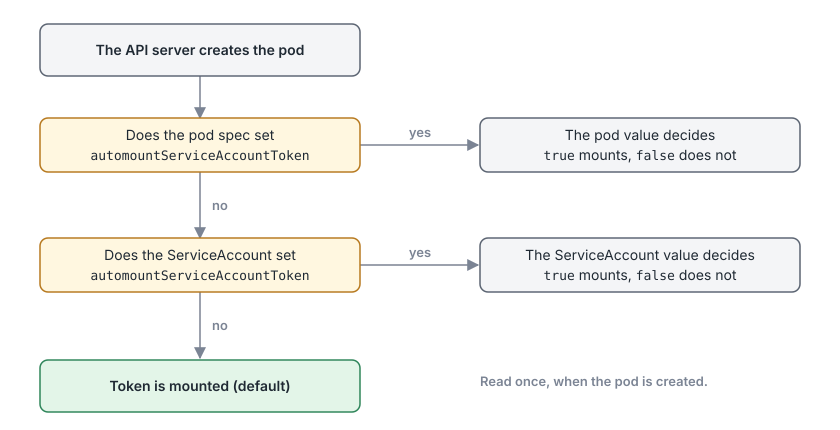
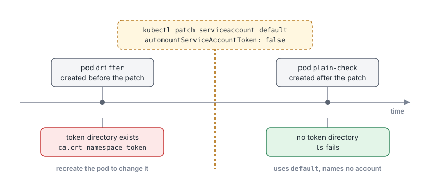
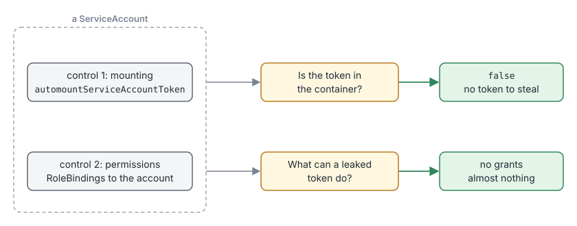

# Disable Automounting And Minimize Permissions

A workload that does not call the Kubernetes API should not receive an API credential. Kubernetes has one field for this, `automountServiceAccountToken`. The field exists in two places, and a clear order of precedence decides which one wins.

On this page, you set the field on a ServiceAccount and override it on a pod. Then you change the `default` account of a namespace. Finally, you see how to keep a newly created account free of permissions.

## Two places for one setting

The field `automountServiceAccountToken` is a boolean, so its value is `true` or `false`. It can appear in the ServiceAccount object and in the pod `spec`. The API server decides in this order:

- If the pod sets the field, the pod value is used.
- If the pod leaves it out, the value from the ServiceAccount is used.
- If neither sets it, the token is mounted.

The API server reads the setting when the pod is created. The setting does not change pods that are already running. The table lists every case.

| Pod setting | ServiceAccount setting | Token mounted |
| --- | --- | --- |
| not set | not set | yes |
| not set | `false` | no |
| `false` | `true` or not set | no |
| `true` | `false` | yes |



The drawing shows the same order as a decision path: the pod is asked first, then the ServiceAccount, and the default is to mount the token.

The last row of the table matters for review work. A ServiceAccount that says `false` does not protect a namespace on its own, because any pod can say `true` again. A pod-level `false` is the strongest local setting. To enforce it for everyone, you need an admission policy.

## Disable it in a ServiceAccount

Now try both levels on a real example. The `outpost` namespace gets a new ServiceAccount named `quiet`. It sets `automountServiceAccountToken: false`, so a pod that uses it gets no token unless the pod asks for one.

Two pods use the account. The pod `quiet-reader` leaves the pod-level field out. The pod `quiet-override` sets it to `true`.

<!-- astrona:playground:renew -->

Save this as `serviceaccount-quiet.yaml`:

```yaml
apiVersion: v1
kind: ServiceAccount
metadata:
  name: quiet
  namespace: outpost
automountServiceAccountToken: false
---
apiVersion: v1
kind: Pod
metadata:
  name: quiet-reader
  namespace: outpost
spec:
  serviceAccountName: quiet
  restartPolicy: Never
  containers:
    - name: reader
      image: docker.io/library/busybox:1.37.0
      command: ["sh", "-c", "sleep 3600"]
---
apiVersion: v1
kind: Pod
metadata:
  name: quiet-override
  namespace: outpost
spec:
  serviceAccountName: quiet
  automountServiceAccountToken: true
  restartPolicy: Never
  containers:
    - name: reader
      image: docker.io/library/busybox:1.37.0
      command: ["sh", "-c", "sleep 3600"]
```

Apply it:

```sh
kubectl apply -f serviceaccount-quiet.yaml
```

Then check the result. The first command waits until both pods are ready. The next two look for the token directory in each container:

```sh
kubectl -n outpost wait --for=condition=Ready pod/quiet-reader pod/quiet-override --timeout=90s
kubectl -n outpost exec quiet-reader -- ls /var/run/secrets/kubernetes.io/serviceaccount
kubectl -n outpost exec quiet-override -- ls /var/run/secrets/kubernetes.io/serviceaccount
```

The command for `quiet-reader` fails and exits with an error, because the directory does not exist. The ServiceAccount setting removed the volume. The command for `quiet-override` lists `ca.crt`, `namespace` and `token`, because the pod-level `true` takes precedence over the ServiceAccount.

The check you run on a pod is always the same: does the directory exist inside the container?

## Change the default account

The `quiet` account only protects pods that name it. Most pods name no account and use `default`. You cannot delete the `default` ServiceAccount for long, because the ServiceAccount controller creates it again.

You can patch it, though. The patch turns off mounting for every pod in the namespace that uses `default` and does not set the field itself. The command patches the `default` account of `outpost`:

```sh
kubectl -n outpost patch serviceaccount default -p '{"automountServiceAccountToken": false}'
```

The patch does not touch pods that already run. The pod `drifter` was created before the patch, so it still has its token. To prove that the setting applies to new pods, create a pod that names no ServiceAccount.

Save this as `pod-plain-check.yaml`:

```yaml
apiVersion: v1
kind: Pod
metadata:
  name: plain-check
  namespace: outpost
spec:
  restartPolicy: Never
  containers:
    - name: reader
      image: docker.io/library/busybox:1.37.0
      command: ["sh", "-c", "sleep 3600"]
```

Apply it:

```sh
kubectl apply -f pod-plain-check.yaml
```

Then check the result. Compare the old pod with the new pod:

```sh
kubectl -n outpost wait --for=condition=Ready pod/plain-check --timeout=90s
kubectl -n outpost exec drifter -- ls /var/run/secrets/kubernetes.io/serviceaccount
kubectl -n outpost exec plain-check -- ls /var/run/secrets/kubernetes.io/serviceaccount
```

The `drifter` pod lists the three files. The command for the `plain-check` pod fails, because the API server admitted that pod after the patch. To change `drifter`, you delete it and create it again. For a Deployment, this means a rollout.



The drawing shows the time line: only pods that are created after the patch lose the token.

## Keep new accounts small

Turning off the mount is one control. Permissions are a second, separate control. Disabling the mount hides the token from the container. Permissions limit what the token can do if it leaks, and a workload that does call the API still needs a token. The rules for new accounts are short:

- Create one ServiceAccount for each workload that needs the API. Do not share one account between unrelated workloads.
- Give a new account no permissions at first, then add only the verbs and resources the workload uses.
- Never bind a Role or ClusterRole to `default`, and never bind to the groups `system:serviceaccounts` or `system:serviceaccounts:<namespace>`, which contain all accounts.
- Set `automountServiceAccountToken: false` on accounts and pods that do not call the API.

The command `kubectl create serviceaccount` creates an account with no grants. Create one, check its permissions, and look for broad bindings that name accounts. The last command lists RoleBindings in all namespaces with their subjects. Read the `SERVICEACCOUNTS` column for `default`:

```sh
kubectl -n outpost create serviceaccount reporter
kubectl auth can-i --list -n outpost --as=system:serviceaccount:outpost:reporter
kubectl get rolebindings -A -o wide
```

The new account `reporter` has only the rules that every authenticated identity receives. The binding list shows which Roles reach which accounts. In a clean namespace, no binding names `default`.



The drawing shows the two controls side by side. Turning off the mount removes the token from the container, and an account without bindings keeps a leaked token harmless.

You now know the order of precedence between the pod and the ServiceAccount. You can set the default for a namespace, and you can keep new accounts free of grants. A workload that really calls the API still needs a token. The open question is how to make that token short-lived and limited.

## Common pitfalls

> [!WARNING]
> - **Setting `false` on the ServiceAccount and stopping there.** A pod can set `true` and mount the token again.
> - **Expecting a patch to change running pods.** The field is read at pod creation. Recreate the pods.
> - **Confusing mounting with permissions.** A pod without a token still belongs to a ServiceAccount, and the grants of that account still exist.
> - **Putting `automountServiceAccountToken` in the container section.** It belongs to the pod `spec`, next to `serviceAccountName`.
