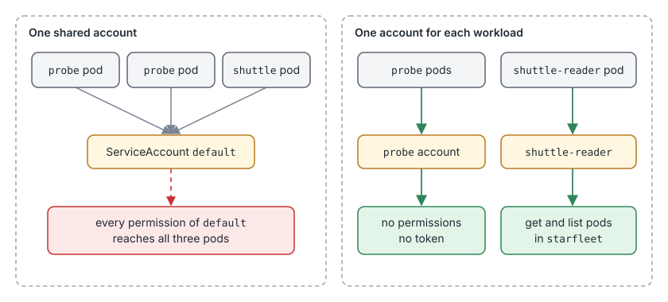
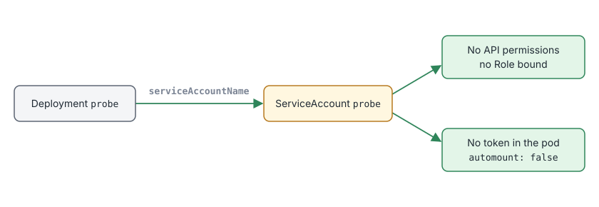
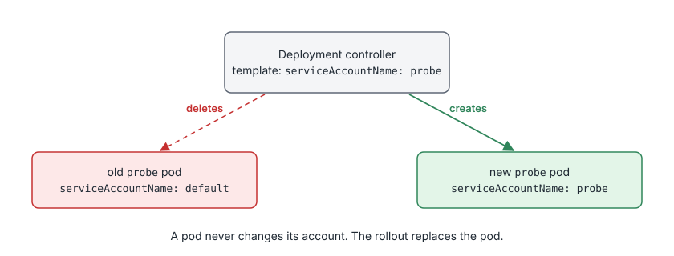

# One ServiceAccount For Each Workload

When several workloads share the `default` ServiceAccount, every permission given to one of them is given to all of them. A reviewer cannot tell from a binding which application needed it. Nobody can remove the permission without the risk of breaking a second application.

The fix is simple to state: each workload gets its own ServiceAccount, named after the workload. On this page, you create one, assign it to a Deployment, and see how the assignment works for Deployments and for bare pods.

## Why sharing one identity is a risk

A ServiceAccount is the identity that RBAC (role-based access control) checks when a pod calls the Kubernetes API. RBAC has no idea of "this application". It only knows the subject name, such as `system:serviceaccount:starfleet:default`. Two pods that use the same account are the same subject, so they have the same permissions.

Sharing also hides intent. A binding to `default` does not say which workload needs it. Over time, the account collects permissions from every team, and nobody dares to remove one.

A dedicated account turns each permission into a clear statement: this workload may do this. If you remove the workload, you remove its account and its permissions with it.



The drawing compares the two setups. With one shared account, a permission meant for one workload reaches every pod. With dedicated accounts, each permission reaches only the workload it was made for.

## Look at who uses what

Before you change anything, look at the accounts the pods use today. The `starfleet` namespace runs the Deployment `probe` and the pod `shuttle`, and neither of them names a ServiceAccount. The first command below lists the account of every pod in the namespace. The second command lists the ServiceAccounts that exist.

<!-- astrona:playground:renew -->

```sh
kubectl -n starfleet get pods -o custom-columns=NAME:.metadata.name,SERVICEACCOUNT:.spec.serviceAccountName
kubectl -n starfleet get serviceaccounts
```

All three pods show `default`, and the namespace has only the `default` account. The `probe` application is a web server that never calls the Kubernetes API. So it needs no permission and no token at all, and a dedicated account lets you state that in the cluster itself.

## Create the account and assign it

The ServiceAccount below is for `probe`. It sets `automountServiceAccountToken: false` because the application does not call the API. This field stops Kubernetes from mounting a token into the pods that use the account. The kubelet, the agent on each node that starts the pods, then creates no token volume. A new account also has no permissions, so this account can do nothing even if its token leaked.

Save this as `serviceaccount-probe.yaml`:

```yaml
apiVersion: v1
kind: ServiceAccount
metadata:
  name: probe
  namespace: starfleet
automountServiceAccountToken: false
```

Apply it:

```sh
kubectl apply -f serviceaccount-probe.yaml
```

The account exists now, but the Deployment does not use it yet. The field `spec.template.spec.serviceAccountName` in the Deployment names the account, and the command `kubectl set serviceaccount` changes that field. Because the command changes the pod template, the Deployment controller starts a rollout. It creates new pods with the new account and removes the old pods. Then check the result:

```sh
kubectl -n starfleet set serviceaccount deployment/probe probe
kubectl -n starfleet rollout status deployment/probe --timeout=180s
kubectl -n starfleet get pods -o custom-columns=NAME:.metadata.name,SERVICEACCOUNT:.spec.serviceAccountName
kubectl -n starfleet exec deploy/probe -- ls /var/run/secrets/kubernetes.io/serviceaccount
```

The `probe` pods now show the account `probe`, and the `shuttle` pod still shows `default`. The `ls` command fails with an error, because the directory does not exist. The account turned mounting off, so the kubelet did not create the token volume. This failure is the result you want.



The drawing shows what the Deployment reaches now: an account with no permissions and no mounted token.

## Pods cannot change their account

The rollout was needed because a pod accepts a ServiceAccount only when it is created. You cannot change the field `spec.serviceAccountName` on a running pod, and the same is true for `automountServiceAccountToken`. To move a bare pod such as `shuttle` to another account, you delete the pod and create it again with the new field. A Deployment does this for you through a rollout, which is one reason why a Deployment is the better way to run a workload.



The drawing shows that the account never changes inside a pod. The Deployment controller replaces the old pod with a new pod that carries the new account.

The API server also checks the account name when a pod is created, and it rejects a pod that names an account that does not exist. A Deployment behaves differently. The API server accepts the Deployment itself, but its ReplicaSet cannot create any pod, and the events of the ReplicaSet show the error. If a rollout stops right after you set an account, look at the events in the namespace for a message that the account was not found.

You now know how to give a workload its own identity and how the change reaches running pods. The account `probe` has no permissions, which is right for an application that does not call the API. The open question is what to do for a workload that does call the API.

## Common pitfalls

> [!WARNING]
> - **Typing the account name wrong in a Deployment.** The API server accepts the Deployment, but no pods start. Check the events of the ReplicaSet.
> - **Expecting a running pod to take a new account.** The field is fixed when the pod is created. Delete and recreate the pod, or roll out the Deployment.
> - **Reusing one new account for several workloads.** That builds the problem of the `default` account again under another name.
> - **Naming an account after a person or a team.** Name it after the workload, so that a reader of a binding knows what it is for.
