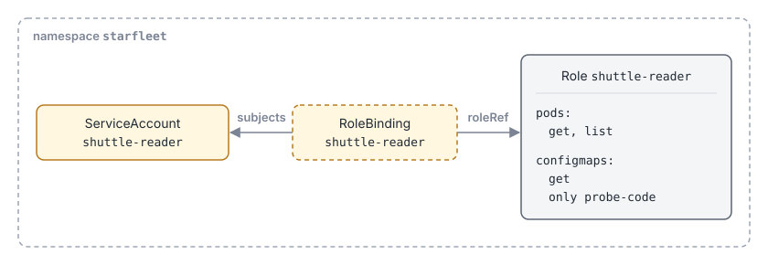
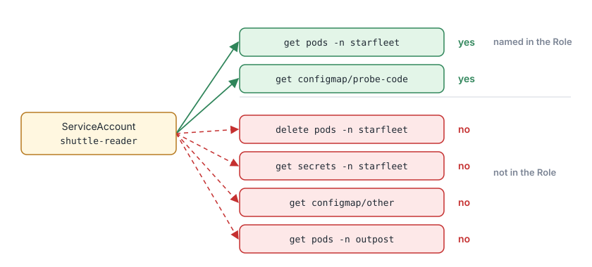

# Grant Only What The Workload Uses

Some workloads must call the Kubernetes API. One example is a pod that lists other pods to find its peers. Such a workload needs a token and a permission.

The risk is in the size of the permission: a broad Role turns a stolen token into broad access. On this page, you create an account for a client that needs to read pods. You write a Role with the smallest list of rules that works, bind it to that one account, and test the result without running the workload.

## Start from what the workload does

Write down the API calls first. The `shuttle` client in `starfleet` must read pods in its own namespace. That is two verbs, `get` and `list`, on one resource, `pods`, in one namespace. It does not need `watch`, `create`, `delete`, Secrets or any other namespace, so the Role contains exactly the two verbs and nothing else.

Three RBAC (role-based access control) objects turn that list into a permission:

- A **Role** is a list of rules that belongs to one namespace. Each rule names API groups, resources and verbs. Pods are in the core API group, which you write as an empty string. A rule can also list `resourceNames` to limit a verb to objects with those names.
- A **RoleBinding** connects a Role to subjects, here one ServiceAccount. It applies the Role only inside its own namespace. A RoleBinding can also point to a ClusterRole, and then the rules apply only in the namespace of the binding.
- A **ClusterRoleBinding** applies its role in every namespace. Avoid it for a workload that works in one namespace.



The drawing shows how the three objects fit together. The RoleBinding links the account to the Role, and the Role holds the rules.

## Create the account, the Role and the binding

The file below holds three objects. The ServiceAccount `shuttle-reader` keeps the default token mounting, because this workload really calls the API. The Role has two rules: `get` and `list` on pods, and `get` on one ConfigMap with the name `probe-code`.

A rule with `resourceNames` works for `get`, `update` and `delete`. It does not limit `list` or `watch` unless the request uses a field selector on `metadata.name`. So do not use `resourceNames` to limit those two verbs.

<!-- astrona:playground:renew -->

Save this as `rbac-shuttle-reader.yaml`:

```yaml
apiVersion: v1
kind: ServiceAccount
metadata:
  name: shuttle-reader
  namespace: starfleet
---
apiVersion: rbac.authorization.k8s.io/v1
kind: Role
metadata:
  name: shuttle-reader
  namespace: starfleet
rules:
- apiGroups: [""]
  resources: ["pods"]
  verbs: ["get", "list"]
- apiGroups: [""]
  resources: ["configmaps"]
  resourceNames: ["probe-code"]
  verbs: ["get"]
---
apiVersion: rbac.authorization.k8s.io/v1
kind: RoleBinding
metadata:
  name: shuttle-reader
  namespace: starfleet
roleRef:
  apiGroup: rbac.authorization.k8s.io
  kind: Role
  name: shuttle-reader
subjects:
- kind: ServiceAccount
  name: shuttle-reader
  namespace: starfleet
```

Apply it:

```sh
kubectl apply -f rbac-shuttle-reader.yaml
```

Two fields of the binding need care. You cannot change the `roleRef` field after the binding exists, so to point a binding at another Role, you delete the binding and create it again. The `subjects` list must repeat the namespace of the ServiceAccount, because a binding can name accounts from other namespaces.

## Test the permissions without running the workload

The API server can tell you what a subject may do. `kubectl auth can-i` sends that question to the API server. The `--as` flag sends the request on behalf of another subject, which is called impersonation. Your own credentials have the `cluster-admin` role, so you can impersonate any account.

The first three commands ask about allowed and denied actions in `starfleet`. The next two use the `resource/name` form to ask about one ConfigMap. The last one asks about another namespace.

```sh
kubectl auth can-i get pods -n starfleet --as=system:serviceaccount:starfleet:shuttle-reader
kubectl auth can-i delete pods -n starfleet --as=system:serviceaccount:starfleet:shuttle-reader
kubectl auth can-i get secrets -n starfleet --as=system:serviceaccount:starfleet:shuttle-reader
kubectl auth can-i get configmap/probe-code -n starfleet --as=system:serviceaccount:starfleet:shuttle-reader
kubectl auth can-i get configmap/other -n starfleet --as=system:serviceaccount:starfleet:shuttle-reader
kubectl auth can-i get pods -n outpost --as=system:serviceaccount:starfleet:shuttle-reader
```

The answers are `yes`, `no`, `no`, `yes`, `no` and `no`. A `no` makes `kubectl` exit with status 1, which is useful in a script.



The drawing sorts the six answers. Only the two actions that the Role names are allowed, and every other action is denied.

To see the whole list of rules of the account in one namespace, run `kubectl auth can-i --list -n starfleet --as=system:serviceaccount:starfleet:shuttle-reader`. The table contains the rules from your Role, plus the few rules that every authenticated identity receives.

## Run the workload with the account

The account exists and you have tested it, so a workload can use it now. A pod uses the account through the field `serviceAccountName`. Save this as `pod-shuttle-reader.yaml`:

```yaml
apiVersion: v1
kind: Pod
metadata:
  name: shuttle-reader
  namespace: starfleet
spec:
  serviceAccountName: shuttle-reader
  restartPolicy: Never
  containers:
  - name: reader
    image: docker.io/library/busybox:1.37.0
    command: ["sh", "-c", "sleep 3600"]
```

Apply it:

```sh
kubectl apply -f pod-shuttle-reader.yaml
```

Then check the result. The pod mounts a token, because the account allows it, and the account has a binding:

```sh
kubectl -n starfleet wait --for=condition=Ready pod/shuttle-reader --timeout=90s
kubectl -n starfleet exec shuttle-reader -- ls /var/run/secrets/kubernetes.io/serviceaccount
kubectl -n starfleet describe rolebinding shuttle-reader
```

The `ls` command lists `ca.crt`, `namespace` and `token`. The `describe` command shows the Role and the one subject. The pod can now read pods in `starfleet` and nothing else, and a token stolen from this container carries only that permission.

You can now create an identity, give it the smallest useful Role and prove its limits with permission checks. The open question is the account that every namespace already has, and the permissions that may sit on it.

## Common pitfalls

> [!WARNING]
> - **Using `*` for verbs or resources to "make it work".** A wildcard grants everything now, and also everything that is added later.
> - **Binding with a ClusterRoleBinding for a workload in one namespace.** The permission then applies in every namespace.
> - **Forgetting the namespace in `subjects`.** A ServiceAccount subject needs its namespace.
> - **Relying on `resourceNames` to limit `list`.** It does not, unless the request filters by name.
> - **Testing only the allowed action.** Always test at least one denied action as well.
