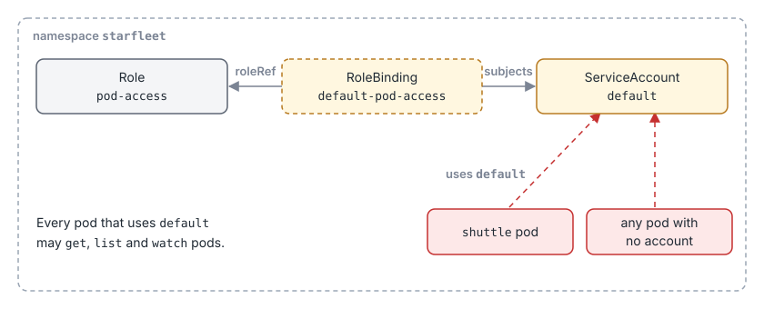
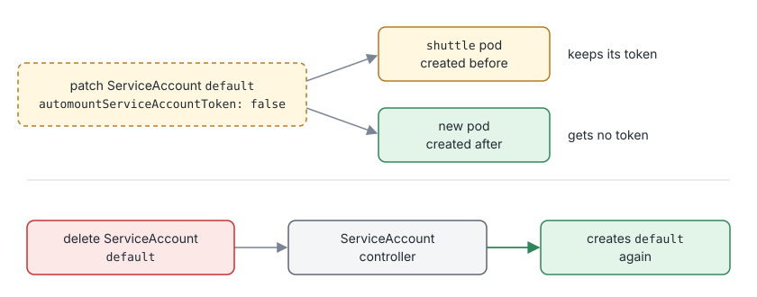

# Clean Up The Default ServiceAccount

Every namespace has a `default` ServiceAccount, and every pod that names no account uses it. A new `default` account has no permissions. The problem begins when someone fixes a "Forbidden" error by binding a Role to it, because that permission then reaches every pod of the namespace that has no account of its own.

On this page, you find such a binding in the playground and remove it. Then you turn off token mounting on the account, and you apply the same cleanup to the namespaces you own.

## Find permissions on the default account

The playground has one such case. In `starfleet`, the Role `pod-access` lets its subjects read pods, and the RoleBinding `default-pod-access` gives the Role to the `default` account. First ask the API server what `default` may do, and then list the bindings of the namespace. The `-o wide` output has a column `SERVICEACCOUNTS` that shows each ServiceAccount subject as `namespace/name`.

<!-- astrona:playground:renew -->

```sh
kubectl auth can-i get pods -n starfleet --as=system:serviceaccount:starfleet:default
kubectl auth can-i --list -n starfleet --as=system:serviceaccount:starfleet:default
kubectl -n starfleet get rolebindings -o wide
```

The first command prints `yes`. The rule list shows `get`, `list` and `watch` on pods, which is more than a new `default` account has. The binding list shows `default-pod-access` with `starfleet/default` in the subject column.

The `shuttle` pod still uses `default`, so it can read pods. Any other pod of the namespace that names no account can read pods too.



The drawing shows why a binding on `default` is so wide. The permission does not reach one workload, it reaches every pod that falls back to the `default` account.

A review of one namespace also needs the cluster-wide bindings, because a ClusterRoleBinding to a `default` account works in every namespace. List them with the same wide output and read the `SERVICEACCOUNTS` column:

```sh
kubectl get clusterrolebindings -o wide
```

Most rows are system bindings that Kubernetes creates. Look for rows whose subjects are `default` accounts or the groups `system:serviceaccounts` and `system:serviceaccounts:<namespace>`. Those groups contain every ServiceAccount, so a binding to them also reaches `default`.

## Remove the permission and stop the mount

Now that you found the binding, you can remove it. Deleting the binding removes the permission. The Role `pod-access` stays, and it does no harm without a binding. If a workload really needs it, bind it to a dedicated account instead.

The second command below turns off token mounting for new pods that use `default`. Then check what the account may do:

```sh
kubectl -n starfleet delete rolebinding default-pod-access
kubectl -n starfleet patch serviceaccount default -p '{"automountServiceAccountToken": false}'
kubectl auth can-i get pods -n starfleet --as=system:serviceaccount:starfleet:default
```

The last command now prints `no`. The patch changes only pods that are created after it, so the `shuttle` pod that already runs keeps its token until you recreate it.

The `default` account also never stays deleted for long. The ServiceAccount controller, a part of the Kubernetes control plane, creates it again. So patching the account is the correct control, not deleting it.



The drawing shows the limits of the patch. It acts on new pods only, and it is the only lasting control because a deleted `default` account comes back.

## Repeat for every namespace you own

One namespace is clean now, but the same risk exists in every namespace. The cleanup is a loop over the namespaces. The command below patches the `default` account in `starfleet` and `outpost`.

Name the namespaces one by one. Do not run the loop over all namespaces. The system namespaces such as `kube-system` hold components that Kubernetes manages, and a patch there can change how those components start.

```sh
for namespace in starfleet outpost; do
  kubectl -n "$namespace" patch serviceaccount default -p '{"automountServiceAccountToken": false}'
done
kubectl get serviceaccounts -A -o custom-columns=NAMESPACE:.metadata.namespace,NAME:.metadata.name,AUTOMOUNT:.automountServiceAccountToken
```

The table shows `false` for the two `default` accounts you patched. Accounts that never set the field show `<none>`. This means that the token is mounted, unless the pod says otherwise.

The patch does not cover two cases. A new namespace starts with a new `default` account that again has no setting, so you must repeat the patch for each new namespace. A pod can also set `automountServiceAccountToken: true` itself and mount the token again. Two controls close these gaps:

- a provisioning step that patches `default` when it creates a namespace;
- an admission policy that rejects pods that set `true` or that name `default`.

Patching alone depends on people remembering to do it.

You now know how to find a permission on `default`, remove it, and turn off mounting for the account. The rule of this module now holds in the cluster: each workload has its own account, each account has only the permissions its workload uses, and `default` has none.

## Common pitfalls

> [!WARNING]
> - **Deleting the Role and keeping the binding.** A binding to a missing Role grants nothing now. It grants again when someone creates a Role with that name.
> - **Looking only at RoleBindings.** A ClusterRoleBinding or a group subject can reach the `default` account too.
> - **Patching every namespace in a loop.** Include only the namespaces you own. Leave `kube-system` and the other system namespaces alone.
> - **Believing a patch changes running pods.** Recreate the pods or roll out the Deployment.
> - **Forgetting new namespaces.** Each new namespace gets a new `default` account.
