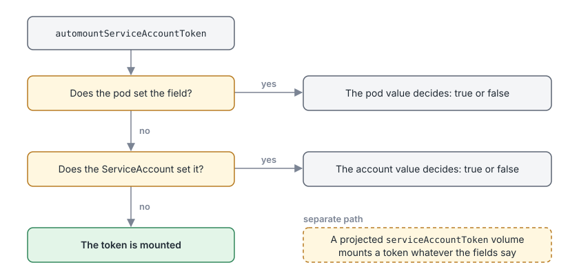
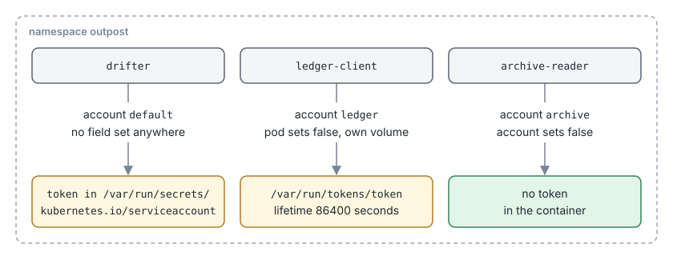

# Find Which Pods Use Which ServiceAccount

A review starts with an inventory. You cannot judge the risk of a ServiceAccount before you know which pods run as it and whether those pods hold its token. A ServiceAccount token is a credential that lets a pod authenticate to the API server as that account.

Both facts live in the pod objects. So one `kubectl get` with the right output columns answers them for the whole cluster. On this page, you build that inventory, and you see why a field that is not set needs careful reading.

## Two fields decide whether a pod holds a token

The ServiceAccount of a pod is in the field `spec.serviceAccountName`. When a pod names no account, the ServiceAccount admission controller fills in `default` while the API server creates the pod. So after creation, this field is always set.

Whether the token is mounted depends on the field `automountServiceAccountToken`. It exists both in the pod and in the ServiceAccount, and the rules are short:

- If the pod sets the field, the pod value wins.
- If the pod leaves the field out, the value of the account is used.
- If neither object sets it, the token is mounted.



The drawing shows the order in which the two fields are read, and the projected volume as a separate path that ignores both fields.

This makes an empty cell in an audit table hard to read. An empty pod field does not mean "no token". It means "ask the account". So the inventory needs both kinds of objects: the pods and the accounts.

A third source matters as well. A projected volume is a pod volume that can request a ServiceAccount token from the API server and write it to a file. A pod can mount a token this way even when automounting is off. The pod `ledger-client` in the playground does exactly this.

## List pods with their accounts

With these rules in mind, start with the pods. The command below prints one line for each pod in all namespaces. The `custom-columns` output picks fields by their path, and a field that is not set prints as `<none>`. The first listing has many system pods in `kube-system`, so the second command limits the view to the `outpost` namespace.

<!-- astrona:playground:renew -->

```sh
kubectl get pods -A -o custom-columns=NAMESPACE:.metadata.namespace,NAME:.metadata.name,SERVICEACCOUNT:.spec.serviceAccountName,AUTOMOUNT:.spec.automountServiceAccountToken
kubectl get pods -n outpost -o custom-columns=NAME:.metadata.name,SERVICEACCOUNT:.spec.serviceAccountName,AUTOMOUNT:.spec.automountServiceAccountToken
```

In the first listing, the system pods use their own accounts, such as the account for CoreDNS. The AUTOMOUNT column shows `<none>` for most pods.

In the `outpost` listing, `ledger-client` shows `false`, because the pod sets the field itself. The pod `archive-reader` shows `<none>`, because only its account sets the field.

## List the accounts and their settings

The accounts hold the other half of the answer. List them in the same way:

```sh
kubectl get serviceaccounts -A -o custom-columns=NAMESPACE:.metadata.namespace,NAME:.metadata.name,AUTOMOUNT:.automountServiceAccountToken
```

The `archive` account shows `false`, so `archive-reader` has no token. The `ledger` account and every `default` account show `<none>`. That means the token is mounted for any pod that does not turn it off.

Now combine the two listings by hand. A pod holds a token in two cases:

- its own field is `true`;
- its own field is empty, and the account field is empty or `true`.

## Check the mount instead of computing it

Reasoning about the two fields is useful, but the container is the proof. Look for the token directory in each pod you care about, as you would in a test. The first command checks the `drifter` pod, which uses `default`. The second checks `archive-reader`.

```sh
kubectl -n outpost exec drifter -- ls /var/run/secrets/kubernetes.io/serviceaccount
kubectl -n outpost exec archive-reader -- ls /var/run/secrets/kubernetes.io/serviceaccount
```

The first command lists `ca.crt`, `namespace` and `token`. The second command fails, because the directory does not exist.

The pod `ledger-client` is a third case. It has no directory at that path, but it holds a token at `/var/run/tokens/token`. So an audit must also read the volumes of each pod. This command prints the projected volumes of that pod as JSON:

```sh
kubectl -n outpost get pod ledger-client -o jsonpath='{.spec.volumes[*].projected}{"\n"}'
```

The result shows one `serviceAccountToken` source with `path` set to `token` and `expirationSeconds` set to `86400`. That is a token that lives for one day.



The drawing sums up the three `outpost` pods: which account each one uses, which setting decides, and where its token is, if it has one.

You now have an inventory: every pod, its account, and whether it holds a token by default or through its own volume. The inventory says nothing about permissions yet. The open question is what each of these tokens is allowed to do.

## Common pitfalls

> [!WARNING]
> - **Reading `<none>` as "no token".** It means the field is not set. The token is mounted unless the other object turns it off.
> - **Checking only `automountServiceAccountToken`.** A projected volume can hold a token anyway.
> - **Passing `-n` twice.** `kubectl` uses only the last one. Use `-A`, or run one command for each namespace.
> - **Printing the token to prove it exists.** List the directory instead.
