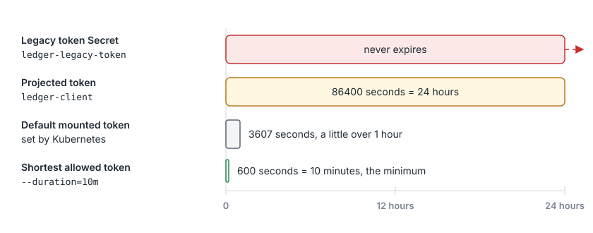
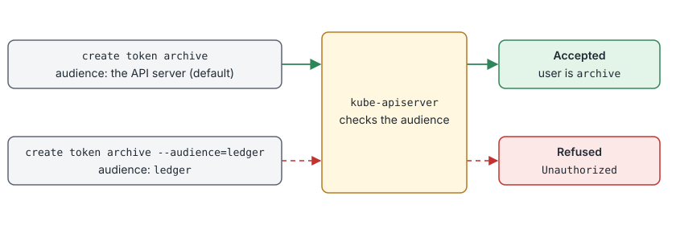

# Audit Tokens: Secrets, Lifetimes And Audience

A token is a credential, and a review has to find every credential. Kubernetes has two kinds of ServiceAccount token that can last a long time:

- a Secret of type `kubernetes.io/service-account-token`, which never expires;
- a projected token that a pod requests with a very long lifetime.

On this page, you list both kinds and match each Secret to its ServiceAccount. Then you use the TokenRequest API to show that the API server accepts a token only for its own audience. The TokenRequest API is the part of the API server that issues short-lived tokens for a ServiceAccount on request.

## Find the legacy token Secrets

A Secret of type `kubernetes.io/service-account-token` holds a JSON Web Token (JWT). A JWT is a signed text string that states who the holder is. The token controller in the controller manager writes this JWT for the ServiceAccount named in the annotation `kubernetes.io/service-account.name`.

The token in such a Secret has no expiry and is not tied to a pod. Anyone who reads it can act as the account until someone deletes the Secret or the account.

The field selector `type` finds these Secrets across the cluster. The custom columns add the account name from the annotation. The backslash before each dot is needed, because the annotation key itself contains dots.

<!-- astrona:playground:renew -->

```sh
kubectl get secrets -A --field-selector type=kubernetes.io/service-account-token
kubectl get secrets -A --field-selector type=kubernetes.io/service-account-token -o custom-columns=NAMESPACE:.metadata.namespace,NAME:.metadata.name,SERVICEACCOUNT:'.metadata.annotations.kubernetes\.io/service-account\.name'
```

The playground has one such Secret, `ledger-legacy-token` in `outpost`. The second command shows that it belongs to `ledger`.

A Secret of this type is a finding, unless a documented system needs it. The usual replacement is a token with a lifetime, created at the moment it is needed. Delete the Secret when nothing uses it:

```sh
kubectl -n outpost delete secret ledger-legacy-token
```

## Find projected tokens with long lifetimes

The Secret is one long-lived credential. A projected token can be another one. Its lifetime is the value that the pod author chooses in `expirationSeconds`.

The default is 3607 seconds, a little over an hour. A pod can ask for much more, and the API server accepts it. The pod `ledger-client` asks for 86400 seconds. To find such pods across the cluster, print the lifetime of each projected token. A pod without an explicit volume prints the default.

```sh
kubectl get pods -A -o jsonpath='{range .items[*]}{.metadata.namespace}{"/"}{.metadata.name}{"\t"}{.spec.volumes[*].projected.sources[*].serviceAccountToken.expirationSeconds}{"\n"}{end}'
```

Pods that use the default mount show 3607. The line for `outpost/ledger-client` shows 86400, which is a full day.

A long lifetime is a finding, because a stolen token stays useful for that long. The kubelet, the agent on each node that runs the pods, only writes a fresh token to the file at about 80 percent of the lifetime. Short lifetimes limit the damage. The minimum lifetime that the API accepts is 600 seconds.



The drawing compares the lifetimes on this page. The shorter the bar, the shorter the time that a stolen token can be used.

## Request a token and test it against the API server

Reading lifetimes tells you what a token could do. Now test a token for real. The command `kubectl create token` calls the TokenRequest API and prints the JWT. Put the command inside `$(...)`, so the token goes straight into the next command and never appears on the screen.

The option `kubectl --token` does not test the token on every cluster. When your kubeconfig user also has a client certificate, as on a kind cluster, the API server authenticates the certificate, and you stay the administrator.

So store the token as a separate kubeconfig user with `kubectl config set-credentials`, and select that user with `--user`. The command `kubectl auth whoami` prints the identity that the API server sees:

```sh
kubectl config set-credentials archive-token --token="$(kubectl -n outpost create token archive)"
kubectl --user=archive-token auth whoami
kubectl config set-credentials archive-token --token="$(kubectl -n outpost create token archive --audience=ledger)"
kubectl --user=archive-token auth whoami
```

The first `whoami` prints the user name `system:serviceaccount:outpost:archive` together with its groups. The second fails with `error: You must be logged in to the server (Unauthorized)`.

The second token is valid, but its audience is `ledger`. The audience is the claim in a token that names the service the token is meant for. The API server accepts only tokens that name its own audience. You use this property when a workload needs a token for another service: that token is useless against the API server.



The drawing shows the two requests side by side. The API server checks the audience in each token before it looks at any permission.

The same method shows the effect of the lifetime. Ask for the shortest token, test it, and then remove the user from your kubeconfig file:

```sh
kubectl config set-credentials archive-token --token="$(kubectl -n outpost create token archive --duration=10m)"
kubectl --user=archive-token auth can-i list pods -n outpost
kubectl config delete-user archive-token
```

The answer is `yes` while the group binding `outpost-all-view` still exists. Ten minutes after the token was created, the same call is refused.

Tokens from `kubectl create token` can also be tied to an object with `--bound-object-kind` and `--bound-object-name`. Such a token stops working as soon as that pod or Secret is deleted.

## What to record in a review

An audit has to end with a list that someone can act on. For each ServiceAccount, record:

- the pods that use it;
- its effective permissions;
- its long-lived token Secrets;
- its projected tokens with long lifetimes.

Order the list by the size of the permissions, not by the number of findings. A token that can read Secrets in a namespace has a higher priority than ten tokens that can read nothing.

You now know how to find long-lived credentials, how to match them to accounts and how to test tokens without showing them. Together with the inventory of pods and accounts and the check of bindings and effective permissions, that is the whole audit. The fixes follow three rules: remove what is not needed, narrow what is too broad, and shorten what lives too long.

## Common pitfalls

> [!WARNING]
> - **Printing a token to the screen or into a ticket.** Use `$(...)` to pass it to the next command.
> - **Forgetting the backslashes in the annotation column.** The key contains dots, and `custom-columns` reads dots as path separators.
> - **Deleting a token Secret that a system still uses.** Check which workload reads it before you delete it.
> - **Rating only the Secrets.** A projected token with a 24-hour lifetime is also a long-lived credential.
> - **Testing a token only against its own audience.** Also test that the API server refuses a token meant for another service.
