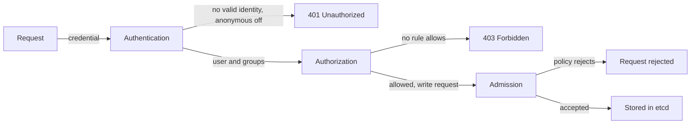

# How An API Request Is Checked

You cannot restrict access to something you cannot trace. This part follows one request through the API server and names the three decisions made on the way. Then you send requests from inside a Pod, with and without a credential, and read the status codes to see which decision stopped each one.

## Three checks in a fixed order

Every request to the API server is an HTTPS call. The server answers it in three stages, and a request must pass all of them.

1. **Authentication** establishes who is calling. The server tries each configured method, such as client certificates, bearer tokens and OIDC tokens. If a method accepts the credential, the request has a user name and groups. If no method accepts it, the request is anonymous when anonymous access is enabled, and it is rejected with `401 Unauthorized` otherwise.
2. **Authorization** decides whether that identity may do the action. The modes in `--authorization-mode` are asked in order, and one `allow` is enough. If none allows, the answer is `403 Forbidden`.
3. **Admission** runs only for requests that create, change or delete objects. Admission controllers can change the object, such as adding a default, or reject it. A rejection returns an error that names the plugin or policy.



The diagram shows that a request fails at the first check it does not pass, and only a write that passes all three reaches the datastore.

The status code tells you which stage said no. A `401` is an authentication problem and a `403` is an authorization problem. A rejected write from admission has an explicit message, because the identity was already known and allowed.

## Anonymous access

When a request carries no credential, or a credential that no method knows, and anonymous access is enabled, the API server treats it as the user `system:anonymous` in the group `system:unauthenticated`. The flag `--anonymous-auth` controls this, and its default is `true`. The request still goes through authorization, so the question is what RBAC grants to that user and group.

A kubeadm cluster grants anonymous callers only a small, read-only set of paths through the ClusterRole `system:public-info-viewer`. It covers the health endpoints `/healthz`, `/livez` and `/readyz` and the version information at `/version`. Some tools and load balancers use the health endpoints without a credential, which is why anonymous access is not switched off blindly. The risk appears when somebody binds a broader role to `system:anonymous` or to `system:unauthenticated`: then any host that can reach the port can use that role without logging in.

## Send requests from inside a Pod

The Pods of the `probe` Deployment run Python, and every Pod has a ServiceAccount token and the cluster CA certificate mounted. That is enough to call the API as a workload would. Define a shell function on your machine that runs a small script in a probe Pod and prints only the HTTP status code. The first argument is the request path and the second is either `anon` for no credential or `token` for the mounted ServiceAccount token. The certificate check stays on, so the call verifies the identity of the API server.

<!-- astrona:playground:renew -->

```sh
call_api() {
  kubectl -n starfleet exec -i deployment/probe -- python - "$@" <<'PY'
import sys, ssl, urllib.request, urllib.error
from pathlib import Path
path, mode = sys.argv[1], sys.argv[2]
root = Path('/var/run/secrets/kubernetes.io/serviceaccount')
ctx = ssl.create_default_context(cafile=str(root / 'ca.crt'))
req = urllib.request.Request('https://kubernetes.default.svc' + path)
if mode == 'token':
    req.add_header('Authorization', 'Bearer ' + (root / 'token').read_text())
try:
    print(urllib.request.urlopen(req, context=ctx, timeout=5).status)
except urllib.error.HTTPError as e:
    print(e.code)
PY
}
```

Define the function by pasting the block into your terminal. Then send four requests:

```sh
call_api /version anon
call_api /api/v1/namespaces/starfleet/pods anon
call_api /version token
call_api /api/v1/namespaces/starfleet/pods token
```

On a kubeadm-style cluster such as the playground, the first request prints `200`, because `/version` is readable by anyone. The second prints `403`: the caller is `system:anonymous`, and no rule allows listing Pods. The third prints `200`. The fourth prints `403` as well. This time the caller is known: it is the `default` ServiceAccount of `starfleet`, and it has no Role that allows listing Pods. The mounted token proves identity, not permission.

You can ask the same question about the identity without a Pod. The command asks the authorizer whether the `default` ServiceAccount of `starfleet` may list Pods, and `--list` shows everything it may do:

```sh
kubectl auth can-i list pods -n starfleet --as=system:serviceaccount:starfleet:default
kubectl auth can-i --list -n starfleet --as=system:serviceaccount:starfleet:default
```

The first command prints `no`. The second prints only the few rules that every authenticated identity receives, such as checking its own permissions.

## Admission is a separate decision

Authorization looks only at who and what. Admission looks at the content of a write. A user allowed to create Pods can still be refused a Pod that asks for a privileged container, if an admission controller or policy forbids it. The Pod Security admission controller is built in and enforces the Pod Security Standards per namespace through namespace labels. Validating admission policies and admission webhooks add custom rules. If a webhook is unreachable, the `failurePolicy` of the webhook decides whether the request is rejected (`Fail`) or let through (`Ignore`). A security policy with `Ignore` stops protecting when its service is down.

Now you can name the stage that stops a request and test it with a status code. The next question is how to give a workload an identity that passes authorization for exactly one thing.

## Common pitfalls

> [!WARNING]
> - **Reading every error as an RBAC problem.** A `401` means the server did not accept the credential, and a `403` means the identity is known but not allowed. Admission errors name the policy that rejected the request.
> - **Binding a role to `system:unauthenticated` or `system:anonymous`.** It exposes that role to every host that can reach the API port.
> - **Disabling certificate verification in a client to get past a TLS error.** Use the CA file from the ServiceAccount mount instead.
> - **Setting a security webhook to `failurePolicy: Ignore`.** The policy is skipped whenever the webhook is down.
> - **Testing only as `cluster-admin`.** It passes every check. Test as the identity that the workload uses.
