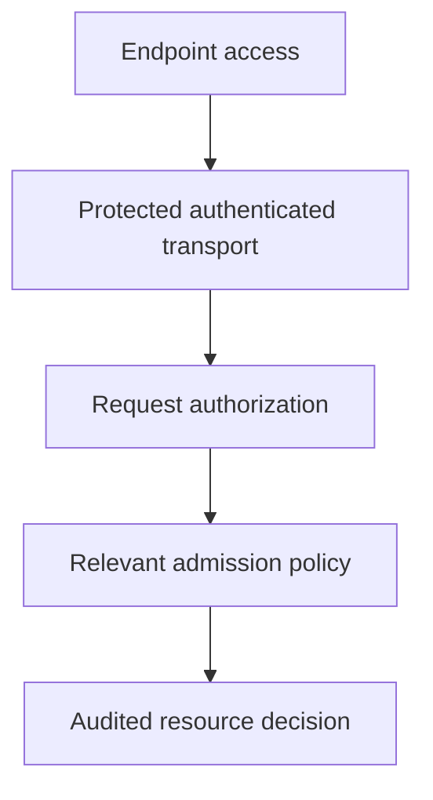

# Protecting The Cluster API

A workload cannot use a broad role, but the API endpoint still exposes an insecure authentication path. Network access, credential verification, authorization and admission protect different parts of the control surface.

## Learning objectives

- Explain the API server's identity, permission and admission checks.
- Relate API transport protection to authenticated peer identity.
- Identify risks from excessive API exposure and powerful credentials.

## Before you start

This chapter is standalone reading material; no running cluster or installed tools are required. A Pod is the Kubernetes unit for running one or more containers, and a namespace groups namespaced objects. Treat the worked configurations as teaching examples rather than recorded observations from a provisioned environment.

## Responsible components and behavior

The Kubernetes application programming interface (API) controls stored cluster resources. A caller able to change workloads or permissions can affect application execution and data access. The API server is therefore a central security boundary, not merely an administrative convenience.

## Authentication And Authorization

Authentication establishes the caller's identity through configured mechanisms such as certificates or tokens. Authorization checks the requested action against the identity's grants. The resource type, API group, verb and namespace can all affect the decision. A valid identity is not automatically a trusted administrator.

A Role-Based Access Control (RBAC) configuration can grant narrow resource actions, while other supported authorization modes have their own decision behavior. Broad grants increase the consequences of credential exposure. Permission to create workloads can indirectly expose identities or storage if admission and runtime controls allow the resulting configuration.

Relevant resource changes then pass admission. Admission can mutate allowed defaults or reject disallowed specifications. A developer permitted to create Pods can still be prevented from requesting privileged execution. This is a separate policy layer, not evidence that authentication failed.

## Transport And Endpoint Exposure

Transport Layer Security (TLS) protects a connection and supports verification of the intended server. A client should validate trusted certificate identity rather than disable verification to avoid a connection error. A stolen credential remains dangerous even on an encrypted connection, so transport protection does not replace credential scope and lifetime controls.

Network restrictions reduce who can attempt API connections. A private endpoint or firewall is useful, but workloads or administrators inside the allowed network still need appropriate permission. An internet-facing endpoint with strong authentication can have different exposure and availability risks. Analyze both the network path and the API authority available to accepted callers.

Administrative credentials deserve especially careful handling. Separate routine narrow roles from emergency broad roles, avoid sharing identities and preserve evidence of sensitive changes. A client-side context selects credentials; the server's checks determine what those credentials permit.

## Stored State And Dependent Components

Accepted resources are stored in etcd. Controllers, schedulers and kubelets use the API to observe or change state according to their roles. Direct access to the datastore can bypass the ordinary API security path, so it needs a separate restricted boundary.

An admission webhook can become a dependency of resource acceptance. If required policy is unavailable, configured failure behavior determines whether requests are rejected or allowed past that check. This affects both security and availability. The webhook's identity, serving certificate, permissions and operating reliability matter to the API path.

## Evidence And Recovery

Audit records can identify API requests, caller identities, target resources and response outcomes according to the configured policy. They are different from application logs, which describe business requests to workloads. Audit content can itself be sensitive, especially if request or response bodies contain credentials or data.

Suppose an exposed deployment credential creates an unexpected workload. The API can have behaved correctly according to an excessively broad grant. Investigate the identity, granted actions, audit timeline and resulting resources. Revoke exposed authority, restore reviewed state and inspect any data or infrastructure the workload could access.

A secure API design combines trusted transport, narrow permissions, suitable admission, protected storage and useful evidence. Each part enforces or observes a particular boundary; none alone proves that every accepted declaration is harmless.

## Work through the decision

The API server is the decision point for supported resource requests. Protect its transport, authentication configuration and datastore access. Limit who can reach management endpoints under the platform's design, while recognizing that network reachability does not itself grant or deny every API action.

An authenticated read of sensitive data can be harmful even without administrative writes. Broad workload-creation authority can also enable indirect access subject to other controls. Review actual identities, effective grants and admission behavior together. Audit evidence records supported request activity, while host execution and external data actions need their own observation sources.

API protection combines independent boundaries rather than relying on one restrictive role or firewall rule.

API protection combines independent boundaries rather than relying on one restrictive role or firewall rule.

## Common pitfalls

> [!WARNING]
> Encryption and authentication do not imply authorization. Direct datastore access and admission dependencies require separate protection, and audit records can contain sensitive data.
