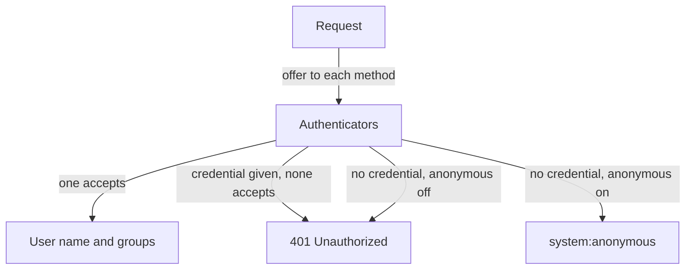

# Authentication Methods And Identities

A request that the API server cannot attribute to a caller cannot be limited, logged or revoked in any useful way. This part explains how the API server turns a credential into an identity. You read your own identity, open a ServiceAccount token to see what it claims, and send a request with a token that is not valid to see that the API server refuses it.

## Methods and the identity they produce

The API server holds a list of authentication methods and offers each request to them in turn. The first method that accepts the credential decides the identity. An identity has a user name, an optional unique ID, a list of groups and optional extra fields. The authorizer later sees only these values.

- **Client certificates** are checked against the CA in `--client-ca-file`. The common name (CN) of the certificate becomes the user name and each organization (O) entry becomes a group. The `kubectl` credentials of an administrator normally use this method. A certificate cannot be revoked before it expires, because Kubernetes has no certificate revocation list.
- **ServiceAccount tokens** are signed JSON Web Tokens (JWT). The API server checks the signature, the expiry and the audience. The user name is `system:serviceaccount:<namespace>:<name>` and the groups are `system:serviceaccounts`, `system:serviceaccounts:<namespace>` and `system:authenticated`.
- **OpenID Connect (OIDC) tokens** are JWTs from an external identity provider. The API server maps claims of the token to a user name and groups. They are configured with `--oidc-*` flags or with a structured authentication configuration file.
- **Webhook token authentication** sends the token to an external service that returns the identity.
- **A static token file** (`--token-auth-file`) lists tokens, users and groups in a plain file. The tokens never expire and a change needs an API server restart. Do not use it in a real cluster.
- **An authenticating proxy** passes the identity in request headers. The API server trusts the headers only from a proxy that presents a client certificate from a configured CA.



The diagram shows three outcomes. A valid credential gives an identity. A missing credential gives an anonymous caller or a `401`, depending on one flag. A credential that no method accepts is always a `401`.

## Read your own identity

The `kubectl auth whoami` command sends a `SelfSubjectReview` to the API server, and the server answers with the identity that it attached to your request. That is the identity the authorizer sees, not the one you assume.

<!-- astrona:playground:renew -->

```sh
kubectl auth whoami
```

The output shows the user name from your client certificate and a list of groups. The group `system:authenticated` is in the list, because the API server adds it to every caller that is not anonymous. You can run the same review for another identity with impersonation:

```sh
kubectl auth whoami --as=system:serviceaccount:starfleet:default
```

This time the user name is `system:serviceaccount:starfleet:default`, and the groups are the three ServiceAccount groups named above.

## Look inside a ServiceAccount token

A ServiceAccount token is three Base64-encoded parts separated by dots. The middle part holds the claims. The next command asks the API server for a token for the `default` ServiceAccount of `starfleet` and prints the claims. The default lifetime of a requested token is one hour.

```sh
kubectl -n starfleet create token default | python3 -c "import sys,base64,json;p=sys.stdin.read().split('.')[1];print(json.dumps(json.loads(base64.urlsafe_b64decode(p+'='*(-len(p)%4))),indent=2))"
```

The claims include `iss` (the issuer of the token), `aud` (the audience, the service the token is meant for), `exp` (the expiry time), `sub` (the subject) and a `kubernetes.io` object. The value of `sub` is `system:serviceaccount:starfleet:default`, and the `kubernetes.io` object names the namespace and the ServiceAccount. Decoding a token does not check the signature, so a decoded claim is information and not proof. Only the API server, which holds the public key, can validate it.

## An invalid credential is not anonymous

Define a helper that runs a Python script in a `probe` Pod and prints only the HTTP status code of a request to the API server. The first argument is the path. The second argument is `anon` for no credential, `token` for the token mounted in the Pod and `bad` for a token that is not valid. The certificate check stays on, so the call verifies the API server.

```sh
call_api() {
  kubectl -n starfleet exec -i deployment/probe -- python - "$@" <<'PY'
import sys, ssl, urllib.request, urllib.error
from pathlib import Path
path, mode = sys.argv[1], sys.argv[2]
root = Path('/var/run/secrets/kubernetes.io/serviceaccount')
ctx = ssl.create_default_context(cafile=str(root / 'ca.crt'))
req = urllib.request.Request('https://kubernetes.default.svc' + path)
if mode == 'token':
    req.add_header('Authorization', 'Bearer ' + (root / 'token').read_text())
elif mode == 'bad':
    req.add_header('Authorization', 'Bearer not-a-real-token')
try:
    print(urllib.request.urlopen(req, context=ctx, timeout=5).status)
except urllib.error.HTTPError as e:
    print(e.code)
PY
}
```

Paste the function into your terminal. Then send the same request with all three modes:

```sh
call_api /version anon
call_api /version token
call_api /version bad
```

The first two print `200`, because the path `/version` is readable by every caller. The third prints `401`. A caller with no credential can be treated as anonymous. A caller that presents a credential which fails verification is rejected, even on a path that anonymous callers may read. The API server does not downgrade a bad credential to anonymous, which is why a `401` always points to the credential and never to RBAC.

You can now name the methods, read the identity that a request received and tell a missing credential from an invalid one. The next question is what a caller with no credential can do, because the answer depends on bindings you control.

## Common pitfalls

> [!WARNING]
> - **Treating a decoded token as verified.** Decoding shows the claims only. The signature is checked by the API server.
> - **Using a static token file.** Its tokens never expire and cannot be rotated without a restart.
> - **Relying on certificates for people.** A client certificate cannot be revoked before it expires. Prefer short-lived tokens from an identity provider.
> - **Expecting a bad token to act as anonymous.** It returns `401`. Anonymous treatment is only for requests with no credential.
> - **Testing as `cluster-admin` only.** Use `--as` to see the groups and permissions of the identity that matters.
