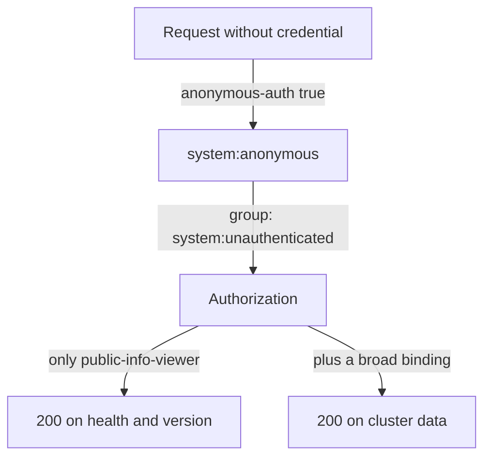

# Anonymous Access In Practice

An API server on a reachable address receives requests from callers that no one has vetted. Anonymous access decides what happens to those that carry no credential. This part sends anonymous requests to the playground, finds the binding that lets them read Pods, removes it and checks that only the health and version paths stay open.

## What anonymous access is

When `--anonymous-auth` is `true`, which is the default, a request with no credential is not rejected by authentication. The API server gives it the user `system:anonymous` and the group `system:unauthenticated`, and the request goes on to authorization. Anonymous access therefore does not bypass RBAC. It only gives the caller a name that a binding can match.

A kubeadm cluster binds the ClusterRole `system:public-info-viewer` to both `system:authenticated` and `system:unauthenticated`. The role lets a caller read `/healthz`, `/livez`, `/readyz`, `/livez/*`, `/readyz/*` and `/version`. It is the reason a load balancer can check the health of the API server without a credential.

The risk is a binding that grants more to the anonymous names. Three subjects need attention. The user `system:anonymous` and the group `system:unauthenticated` reach every host that can open a connection to the API port. The group `system:authenticated` is wider than it sounds, because it holds every user and every ServiceAccount in the cluster, including workloads that have nothing to do with the grant.



The diagram shows that the difference between a safe cluster and an open one is the set of bindings that Authorization finds for the anonymous subjects.

## Send anonymous requests

The playground starts with a binding that you have to find. Define the helper from the previous steps if it is not defined in this terminal. It prints the HTTP status code of a request from a `probe` Pod. The second argument is `anon`, `token` or `bad`.

<!-- astrona:playground:renew -->

```sh
call_api() {
  kubectl -n starfleet exec -i deployment/probe -- python - "$@" <<'PY'
import sys, ssl, urllib.request, urllib.error
from pathlib import Path
path, mode = sys.argv[1], sys.argv[2]
root = Path('/var/run/secrets/kubernetes.io/serviceaccount')
ctx = ssl.create_default_context(cafile=str(root / 'ca.crt'))
req = urllib.request.Request('https://kubernetes.default.svc' + path)
if mode == 'token':
    req.add_header('Authorization', 'Bearer ' + (root / 'token').read_text())
elif mode == 'bad':
    req.add_header('Authorization', 'Bearer not-a-real-token')
try:
    print(urllib.request.urlopen(req, context=ctx, timeout=5).status)
except urllib.error.HTTPError as e:
    print(e.code)
PY
}
```

Send an anonymous request to a health-like path and to a path with cluster data:

```sh
call_api /version anon
call_api /api/v1/namespaces/starfleet/pods anon
```

The first prints `200`. The second also prints `200`, which a hardened cluster must not do: an unauthenticated caller just listed the Pods of a namespace. Authorization found a rule for the anonymous subjects, so one binding exists that does not belong.

## Find the binding

You can ask the authorizer the same question without a Pod. The `--as` and `--as-group` options send the request with the anonymous names:

```sh
kubectl auth can-i list pods -n starfleet --as=system:anonymous --as-group=system:unauthenticated
```

The command prints `yes`. To find the cause, print every ClusterRoleBinding with the role it grants and the subjects it names:

```sh
kubectl get clusterrolebindings -o jsonpath='{range .items[*]}{.metadata.name}{"\t"}{.roleRef.name}{"\t"}{.subjects[*].name}{"\n"}{end}'
```

Read the third column of each line. In the playground the line for `anonymous-viewer` shows the role `view` and the subject `system:unauthenticated`. The line for `ops-viewer` shows `view` for the group `ops`, which is a normal grant for a named team and stays. The built-in lines, such as `system:public-info-viewer`, belong to the cluster and stay as well. Also search RoleBindings, because a Role can grant anonymous access inside a namespace: use `kubectl get rolebindings -A` with the same jsonpath idea.

## Remove the binding and test again

Delete the binding by name. Do not edit a built-in role such as `system:public-info-viewer`, because the API server restores the default rules of its own roles when it starts.

```sh
kubectl delete clusterrolebinding anonymous-viewer
```

Repeat the two requests:

```sh
call_api /version anon
call_api /api/v1/namespaces/starfleet/pods anon
```

The first still prints `200`. The second now prints `403`: the caller is still `system:anonymous`, but no rule allows it to list Pods. The change takes effect within a short time, so if you still see `200`, repeat the request after a few seconds.

## Switching anonymous access off

The flag `--anonymous-auth=false` goes one step further. A request with no credential then returns `401` on every path, including `/healthz` and `/version`. That is the right setting when nothing needs an unauthenticated read. On a kubeadm cluster the liveness and readiness probes of the API server static Pod send anonymous requests to `/livez` and `/readyz`, so switching anonymous access off without another plan can make the kubelet restart the API server. The structured authentication configuration solves this. Its `anonymous` setting can enable anonymous access only for a list of paths, such as `/livez`, `/readyz` and `/healthz`. Everything else gets `401`.

You now know how to prove that a cluster is open to anonymous callers and how to close it. The remaining piece is the authorizer itself: which modes exist, how they combine and what a caller with the right to impersonate can do.

## Common pitfalls

> [!WARNING]
> - **Binding a role to `system:unauthenticated`, `system:anonymous` or `system:authenticated` for convenience.** Any caller that can reach the API port, or any identity in the cluster, gets the grant.
> - **Testing only from inside the cluster.** The risk is a caller outside it. Use `kubectl auth can-i` with `--as=system:anonymous --as-group=system:unauthenticated` to see the effective rights.
> - **Checking only ClusterRoleBindings.** A RoleBinding to the anonymous names opens one namespace.
> - **Editing `system:public-info-viewer`.** The API server resets built-in roles. Change the binding and the flag, not the role.
> - **Setting `--anonymous-auth=false` without checking the probes.** The API server probes can fail and the Pod restarts in a loop.
