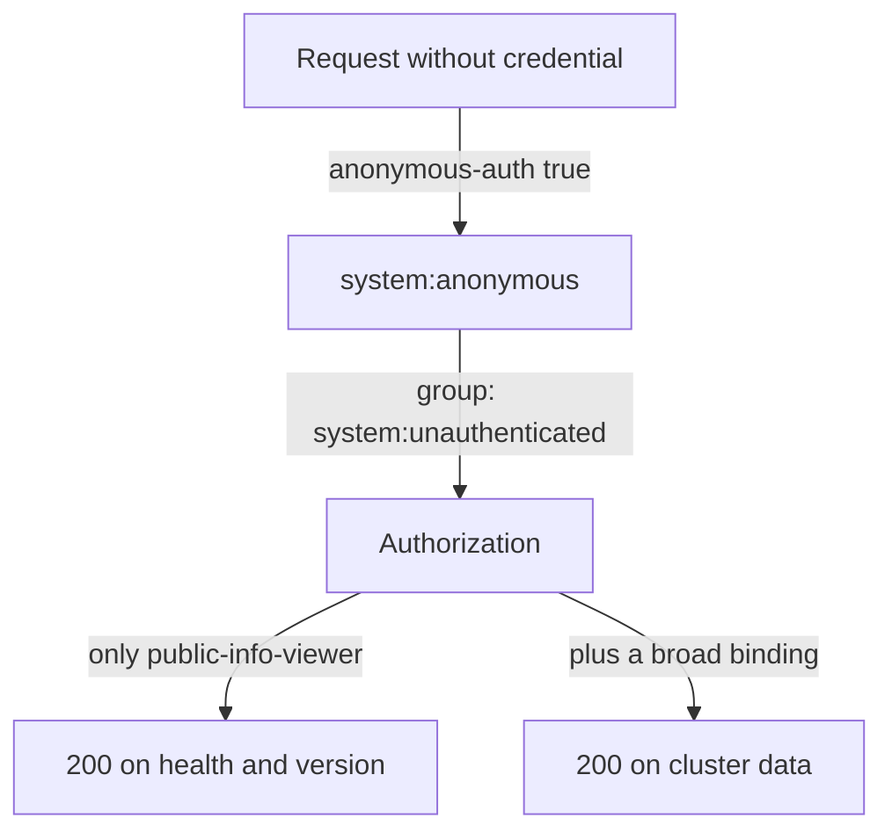

---
exam_objectives:
- Restrict access to Kubernetes API
---
# Anonymous Access In Practice

An API server on a reachable address receives requests from callers that no one has vetted. Anonymous access decides what happens to those that carry no credential. This part sends anonymous requests to the playground, finds the binding that lets them read Pods, removes it and checks that only the health and version paths stay open.

## What anonymous access is

When `--anonymous-auth` is `true`, which is the default, a request with no credential is not rejected by authentication. The API server gives it the user `system:anonymous` and the group `system:unauthenticated`, and the request goes on to authorization. Anonymous access therefore does not bypass RBAC. It only gives the caller a name that a binding can match.

A kubeadm cluster binds the ClusterRole `system:public-info-viewer` to both `system:authenticated` and `system:unauthenticated`. The role lets a caller read `/healthz`, `/livez`, `/readyz`, `/livez/*`, `/readyz/*` and `/version`. It is the reason a load balancer can check the health of the API server without a credential.

The risk is a binding that grants more to the anonymous names. Three subjects need attention. The user `system:anonymous` and the group `system:unauthenticated` reach every host that can open a connection to the API port. The group `system:authenticated` is wider than it sounds, because it holds every user and every ServiceAccount in the cluster, including workloads that have nothing to do with the grant.



The diagram shows that the difference between a safe cluster and an open one is the set of bindings that Authorization finds for the anonymous subjects.

## Send anonymous requests

The playground starts with a binding that you have to find. Define this helper in your shell on the playground if it is not defined there yet. It prints the HTTP status code of a request from a `probe` Pod. The second argument is `anon`, `token` or `bad`.

<!-- astrona:playground:renew -->

```sh
call_api() {
  kubectl -n starfleet exec -i deployment/probe -- python - "$@" <<'PY'
import sys, ssl, urllib.request, urllib.error
from pathlib import Path
path, mode = sys.argv[1], sys.argv[2]
root = Path('/var/run/secrets/kubernetes.io/serviceaccount')
ctx = ssl.create_default_context(cafile=str(root / 'ca.crt'))
req = urllib.request.Request('https://kubernetes.default.svc' + path)
if mode == 'token':
    req.add_header('Authorization', 'Bearer ' + (root / 'token').read_text())
elif mode == 'bad':
    req.add_header('Authorization', 'Bearer not-a-real-token')
try:
    print(urllib.request.urlopen(req, context=ctx, timeout=5).status)
except urllib.error.HTTPError as e:
    print(e.code)
PY
}
```

Send an anonymous request to a health-like path and to a path with cluster data:

```sh
call_api /version anon
call_api /api/v1/namespaces/starfleet/pods anon
```

The output is two lines:

```text
200
200
```

The first `200` is expected. The second `200` is one that a hardened cluster must not return: an unauthenticated caller just listed the Pods of a namespace. Authorization found a rule for the anonymous subjects, so one binding exists that does not belong.

## Find the binding

You can ask the authorizer the same question without a Pod. A `SubjectAccessReview` is an API object that asks the authorizer whether a given user and groups may do one action. The API server does not store it. It fills in the answer in the `status` field of its response. Save this as `subjectaccessreview-anonymous-pods.yaml`:

```yaml
apiVersion: authorization.k8s.io/v1
kind: SubjectAccessReview
spec:
  user: system:anonymous
  groups:
  - system:unauthenticated
  resourceAttributes:
    verb: list
    resource: pods
    namespace: starfleet
```

A review is a question, not an object to keep, so `kubectl apply` cannot send it. Send it with `kubectl create` and print only its `status`:

```sh
kubectl create -f subjectaccessreview-anonymous-pods.yaml -o jsonpath='{.status}{"\n"}'
```

The authorizer allows the request and names the binding that allowed it:

```text
{"allowed":true,"reason":"RBAC: allowed by ClusterRoleBinding \"anonymous-viewer\" of ClusterRole \"view\" to Group \"system:unauthenticated\""}
```

You may expect `kubectl auth can-i list pods -n starfleet --as=system:anonymous --as-group=system:unauthenticated` to give the same answer. On this cluster it fails with `User "system:anonymous" cannot create resource "selfsubjectaccessreviews"`. With `--as`, `kubectl` sends its question as the impersonated identity. The right to ask that question comes from the ClusterRoleBinding `system:basic-user`, which names only `system:authenticated`, so an anonymous caller may not ask. The `SubjectAccessReview` avoids this, because your own `cluster-admin` credentials send it.

The reason names one binding. To see every binding that could matter, print each ClusterRoleBinding with the role it grants and the subjects it names:

```sh
kubectl get clusterrolebindings -o jsonpath='{range .items[*]}{.metadata.name}{"\t"}{.roleRef.name}{"\t"}{.subjects[*].name}{"\n"}{end}'
```

The list has more than 50 lines. The output below is shortened to the lines that name the anonymous subjects, `system:authenticated` or the group `ops`:

```text
anonymous-viewer	view	system:unauthenticated
ops-viewer	view	ops
system:basic-user	system:basic-user	system:authenticated
system:discovery	system:discovery	system:authenticated
system:public-info-viewer	system:public-info-viewer	system:authenticated system:unauthenticated
```

Read the third column of each line. The line for `anonymous-viewer` shows the role `view` and the subject `system:unauthenticated`. That binding does not belong. The line for `ops-viewer` shows `view` for the group `ops`, which is a normal grant for a named team and stays. The built-in lines, such as `system:public-info-viewer`, belong to the cluster and stay as well.

A Role can also grant anonymous access inside one namespace, so search the RoleBindings in the same way:

```sh
kubectl get rolebindings -A -o jsonpath='{range .items[*]}{.metadata.namespace}{"\t"}{.metadata.name}{"\t"}{.roleRef.name}{"\t"}{.subjects[*].name}{"\n"}{end}'
```

The output has eleven lines. Only one of them names an anonymous subject:

```text
kube-public	kubeadm:bootstrap-signer-clusterinfo	kubeadm:bootstrap-signer-clusterinfo	system:anonymous
```

`kubeadm` created this RoleBinding. It lets anonymous callers read only the ConfigMap `cluster-info` in `kube-public`, which a new node reads when it joins the cluster with `kubeadm join`. It is a known, narrow grant. Remove it only if no node will join with a bootstrap token.

## Remove the binding and test again

Delete the binding by name. Do not edit a built-in role such as `system:public-info-viewer`, because the API server restores the default rules of its own roles when it starts.

```sh
kubectl delete clusterrolebinding anonymous-viewer
```

Repeat the two requests:

```sh
call_api /version anon
call_api /api/v1/namespaces/starfleet/pods anon
```

The output is:

```text
200
403
```

The first request still gets `200`. The second now gets `403`: the caller is still `system:anonymous`, but no rule allows it to list Pods. If you still see `200`, repeat the request after a few seconds. Then send the same review again:

```sh
kubectl create -f subjectaccessreview-anonymous-pods.yaml -o jsonpath='{.status}{"\n"}'
```

The answer is now `{"allowed":false}`. No authorizer allows the request, so the review has no reason.

## Switching anonymous access off

The flag `--anonymous-auth=false` goes one step further. A request with no credential then returns `401` on every path, including `/healthz` and `/version`. That is the right setting when nothing needs an unauthenticated read. On a kubeadm cluster the liveness and readiness probes of the API server static Pod send anonymous requests to `/livez` and `/readyz`, so switching anonymous access off without another plan can make the kubelet restart the API server. The structured authentication configuration solves this. Its `anonymous` setting can enable anonymous access only for a list of paths, such as `/livez`, `/readyz` and `/healthz`. Everything else gets `401`.

You now know how to prove that a cluster is open to anonymous callers and how to close it. The remaining piece is the authorizer itself: which modes exist, how they combine and what a caller with the right to impersonate can do.

## Common pitfalls

> [!WARNING]
> - **Binding a role to `system:unauthenticated`, `system:anonymous` or `system:authenticated` for convenience.** Any caller that can reach the API port, or any identity in the cluster, gets the grant.
> - **Testing only from inside the cluster.** The risk is a caller outside it. Send a `SubjectAccessReview` for `system:anonymous` in `system:unauthenticated` to see the effective rights. `kubectl auth can-i --as=system:anonymous` fails, because an anonymous caller may not ask the question itself.
> - **Checking only ClusterRoleBindings.** A RoleBinding to the anonymous names opens one namespace.
> - **Editing `system:public-info-viewer`.** The API server resets built-in roles. Change the binding and the flag, not the role.
> - **Setting `--anonymous-auth=false` without checking the probes.** The API server probes can fail and the Pod restarts in a loop.
