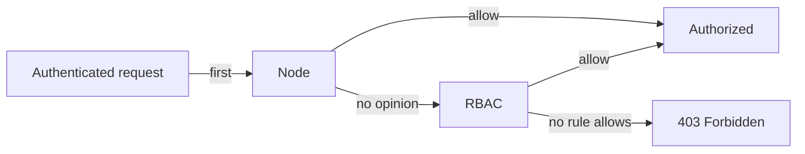

# Authorization Modes And Impersonation

Authentication names the caller. Authorization decides what the named caller may do, and the API server can run several authorizers at once. A single wrong mode can make every other rule pointless. This part reads the authorization flag of the live API server, explains each mode and shows how impersonation lets one identity act as another, which is both a testing tool and a dangerous permission.

## Read the mode flag

The API server flag `--authorization-mode` takes a comma-separated list. The API server asks the authorizers in the order of the list. If one answers `allow`, the request is authorized. If one answers `deny`, the request is refused and no later authorizer is asked. If an authorizer has no opinion, the next one is asked. When none allows, the request is refused with `403`.

<!-- astrona:playground:renew -->

```sh
kubectl -n kube-system get pod -l component=kube-apiserver -o jsonpath='{range .items[0].spec.containers[0].command[*]}{@}{"\n"}{end}' | grep -e authorization -e anonymous
```

On a kubeadm-based cluster such as the playground, the output contains the line `--authorization-mode=Node,RBAC`. The command filters the full flag list, so it prints nothing for `--anonymous-auth` when the flag is not set and the default `true` applies.

## The modes

- **Node** is a special-purpose authorizer for kubelets. It allows a kubelet to read the objects that Pods on its own node need, such as their Secrets and ConfigMaps, and to write the status of its node and those Pods.
- **RBAC** allows a request when a Role or ClusterRole bound to the identity lists the verb, resource and name. It has only allow rules and never answers `deny`.
- **Webhook** sends a `SubjectAccessReview` to an external service. That service can allow or deny. Use it when decisions come from a policy engine outside the cluster.
- **ABAC** reads rules from a static file and needs an API server restart for each change. Do not use it.
- **AlwaysAllow** authorizes every request. With it, the permission model is gone, and anonymous callers can do everything. It exists for tests.
- **AlwaysDeny** refuses every request and also exists for tests.

A hardened kubeadm cluster uses `Node,RBAC`. `Node` comes first so that a kubelet request is decided cheaply, and `RBAC` handles everyone else. If `AlwaysAllow` is in the list, RBAC never gets a chance to refuse anything, because the request is already authorized.



The diagram shows the chain for `Node,RBAC`: an allow at any step authorizes the request, and the end of the chain without an allow is a `403`.

## Ask the authorizer about any identity

The `kubectl auth can-i` command sends an access review to the authorizer chain. With `--as` it asks about another identity, and with `--list` it prints the whole set of rules for that identity in a namespace.

```sh
kubectl auth can-i list pods -n starfleet --as=system:serviceaccount:starfleet:default
kubectl auth can-i list pods -n starfleet --as=ops-user --as-group=ops
```

The first command prints `no`, because the `default` ServiceAccount has no Role. The second prints `yes`, because the group `ops` holds `view` through the ClusterRoleBinding `ops-viewer`. The second command shows that the group is what matters. The user name `ops-user` does not need to exist anywhere, because Kubernetes has no user objects: a user is whatever name the authenticator reports.

## Impersonation

Impersonation lets a caller send a request as another identity. `kubectl` does it with `--as`, `--as-group` and `--as-uid`. The API server first authenticates the real caller, then checks whether that caller may impersonate the requested user, group or ServiceAccount, and only then continues with the impersonated identity for authorization. The permission is the verb `impersonate` on the resources `users`, `groups`, `serviceaccounts` or `uids`.

```sh
kubectl get pods -n starfleet --as=system:serviceaccount:starfleet:default
kubectl auth can-i impersonate serviceaccounts
```

The first command fails with a `Forbidden` error that names the ServiceAccount and says it cannot list Pods. That error proves that your administrator rights let you impersonate, and it shows what the identity can do. The second command prints `yes`, because `cluster-admin` has every verb.

Impersonation is a strong permission. A subject that may impersonate a group such as `system:masters` or a highly privileged ServiceAccount can do whatever that identity can do. Grant `impersonate` only to the administrators or services that need it, name the exact `resourceNames` where possible, and treat a ClusterRole with `impersonate` the same way as `cluster-admin`. Audit logs record the impersonated identity in a separate field, so you can still see the real caller.

You now know which modes decide a request, why only `Node,RBAC` belongs in the list and how to test an identity safely. A caller that is authenticated and authorized still has a last check for writes, which is admission.

## Common pitfalls

> [!WARNING]
> - **Leaving `AlwaysAllow` in `--authorization-mode`.** Every request is authorized, including anonymous ones. Check the live flag.
> - **Putting `RBAC` without `Node`.** Kubelets then depend on RBAC rules that were not designed for them.
> - **Granting `impersonate` broadly.** It lets the holder act as any identity that it names, including administrators.
> - **Reading `can-i` without `--as`.** The answer is for your own credentials, which are `cluster-admin` in the playground.
> - **Looking for user objects.** Kubernetes has no user resource. The name comes from the credential.
