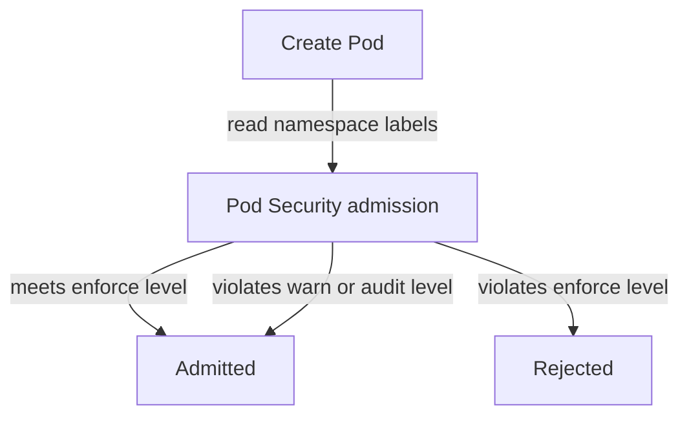

# Pod Security Admission

A Pod can ask for settings that give its container the power of the node: privileged mode, the host network, host paths. If any user with the right to create Pods can request them, a single mistake or a stolen token ends in a node compromise. Pod Security admission is the built-in answer. It is an admission controller, enabled by default, that checks every Pod against a standard that you choose per namespace.

## Standards and modes

The **Pod Security Standards** define three levels.

- **privileged** has no restrictions.
- **baseline** blocks the known paths to privilege escalation: privileged containers, host namespaces, host paths, extra capabilities beyond a short list and similar settings. Most workloads run under it unchanged.
- **restricted** follows current hardening practice. Containers must run as non-root, drop all capabilities, forbid privilege escalation and use a runtime default seccomp profile.

The **modes** say what happens when a Pod violates the level.

- **enforce** rejects the Pod.
- **audit** lets the Pod in and adds an annotation to the audit record.
- **warn** lets the Pod in and returns a warning to the user.

A namespace label sets each mode, in the form `pod-security.kubernetes.io/<mode>=<level>`. An optional label `pod-security.kubernetes.io/<mode>-version` pins the version of the standard, and the default is the latest. The three modes are independent, so a namespace can enforce `baseline` while it warns about `restricted`. That combination shows a team what a stricter level would break before it is enforced.



The diagram shows that only the `enforce` level rejects. A violation of the `warn` or `audit` level still admits the Pod and produces a message or a record.

## Before the label: any Pod is admitted

In the playground, `outpost` has no Pod Security labels, so no standard applies. Save this as `pod-privileged.yaml`. The container asks for privileged mode, the strongest request a Pod can make:

<!-- astrona:playground:renew -->

```yaml
apiVersion: v1
kind: Pod
metadata:
  name: debugger
  namespace: outpost
spec:
  containers:
    - name: debugger
      image: docker.io/library/busybox:1.37.0
      command: ["sh", "-c", "sleep 3600"]
      securityContext:
        privileged: true
```

Apply it:

```sh
kubectl apply -f pod-privileged.yaml
```

The command creates the Pod. Nothing in the API server asked whether privileged mode was acceptable, and this is the default state of a namespace. Delete the Pod before you continue:

```sh
kubectl -n outpost delete pod debugger
```

## Turn on enforcement

Label the namespace with the `baseline` level in `enforce` mode:

```sh
kubectl label namespace outpost pod-security.kubernetes.io/enforce=baseline
```

The namespace has a Pod already, the `drifter`. When you add an enforce label, the admission controller checks the Pods that exist and prints a warning for any violation, but it does not remove them. The `drifter` meets `baseline`, so the only output is the line that confirms the label. Apply the same Pod file again:

```sh
kubectl apply -f pod-privileged.yaml
```

This time the command fails with an error from the admission controller. The message says the Pod violates PodSecurity at the level `baseline`, and it names the privileged setting of the container. The check ran for `cluster-admin` as well, because admission does not look at who the caller is.

## Warn about a stricter level

A second label adds a mode without changing enforcement. Add `warn` at `restricted`, then apply a plain Pod that meets `baseline` but not `restricted`. Save this as `pod-plain.yaml`:

```yaml
apiVersion: v1
kind: Pod
metadata:
  name: plain
  namespace: outpost
spec:
  containers:
    - name: plain
      image: docker.io/library/busybox:1.37.0
      command: ["sh", "-c", "sleep 3600"]
```

Apply the label and the file:

```sh
kubectl label namespace outpost pod-security.kubernetes.io/warn=restricted
kubectl apply -f pod-plain.yaml
```

The Pod is created. The command also prints a warning that lists what the Pod would need to change to meet `restricted`, for example a security context that forbids privilege escalation. A warning does not stop the request. It is a way to measure the effect of a stricter level before you enforce it.

## What the controller checks

The controller checks Pods. For workload resources such as a Deployment, it does not reject the Deployment itself. The Deployment is stored, the ReplicaSet tries to create Pods, and the Pods are rejected. The Deployment then shows fewer ready replicas than desired, and the reason is in the events of the ReplicaSet. When a rollout does not progress in a namespace with an enforce label, read those events first.

Cluster administrators can also set defaults and exemptions for users, runtime classes and namespaces in the configuration file of the controller. The exempt namespaces are a way to keep system components running, and they are a path to look at when you review a cluster.

You now know how to make the API server refuse dangerous Pod settings with two labels. The built-in standards cover the common risks, and for any rule they do not express, you write your own.

## Common pitfalls

> [!WARNING]
> - **Assuming a label on a namespace removes Pods that already break the rule.** The existing Pods stay. Only new Pods are checked.
> - **Looking for the error on the Deployment.** The Pod creation fails in the ReplicaSet. Read the events there.
> - **Using only `warn` or `audit` and believing the namespace is protected.** Only `enforce` rejects.
> - **Expecting `cluster-admin` to bypass the check.** Admission applies to every caller.
> - **Pinning an old `-version` label forever.** The standard is updated with new Kubernetes versions. Review the pinned version.
