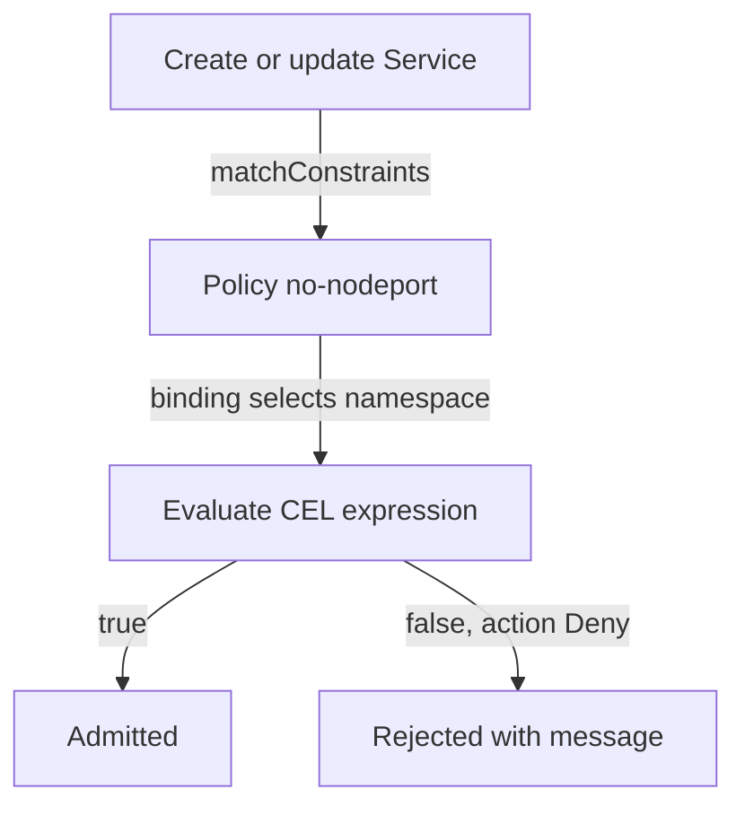

# ValidatingAdmissionPolicy With CEL

The Pod Security Standards cover Pods. A real cluster has other rules: no Service of type `NodePort`, no image from an unknown registry, a label on every Deployment. Before the ValidatingAdmissionPolicy, such rules needed an admission webhook, which is a service that you build, run and keep available. A ValidatingAdmissionPolicy puts the rule inside the API server as a short expression, so there is no service to fail.

## Policy, binding and expression

Two objects work together, and neither does anything alone.

- A **ValidatingAdmissionPolicy** says which requests it matches (`matchConstraints`) and lists one or more `validations`. A validation has a CEL expression and an optional `message`. The request is allowed when the expression evaluates to `true`.
- A **ValidatingAdmissionPolicyBinding** switches the policy on. It names the policy in `policyName`, lists the `validationActions` and can narrow the scope with `matchResources`, for example with a namespace selector.

Common Expression Language (CEL) is a small language for expressions. The variables in an expression include `object` (the new object), `oldObject` (the previous object, empty on create), `request` (details of the request, such as the user name and operation) and `params` (an optional parameter object). The expression `object.spec.type != 'NodePort'` is true for every Service whose type is not `NodePort`.

The `validationActions` of the binding choose what a failure does:

- `Deny` rejects the request.
- `Warn` admits it and returns a warning to the caller.
- `Audit` admits it and adds an annotation to the audit record.

A new rule usually starts with `Warn` and `Audit` together to see what it would reject, and then moves to `Deny`.



The diagram shows that the binding decides where the policy is active. The policy alone matches requests, but nothing is enforced until a binding selects the request.

## Write a policy for Services

The rule for this part is that no Service of type `NodePort` may be created in `outpost`. A NodePort Service opens a port on every node, which widens the network exposure of the cluster. Save this as `vap-no-nodeport.yaml`:

<!-- astrona:playground:renew -->

```yaml
apiVersion: admissionregistration.k8s.io/v1
kind: ValidatingAdmissionPolicy
metadata:
  name: no-nodeport
spec:
  failurePolicy: Fail
  matchConstraints:
    resourceRules:
      - apiGroups: [""]
        apiVersions: ["v1"]
        operations: ["CREATE", "UPDATE"]
        resources: ["services"]
  validations:
    - expression: "object.spec.type != 'NodePort'"
      message: "NodePort Services are not allowed in this namespace"
```

Apply it:

```sh
kubectl apply -f vap-no-nodeport.yaml
```

The field `failurePolicy: Fail` applies to the policy itself. If the expression cannot be evaluated, for example because of a type error, the request is rejected. The policy is not active yet, because no binding exists. Try a NodePort Service before you add the binding:

```sh
kubectl -n outpost create service nodeport demo --tcp=80:80
```

The Service is created. Remove it with `kubectl -n outpost delete service demo` and continue.

## Bind the policy to one namespace

Save this as `vapb-no-nodeport-outpost.yaml`. The namespace selector uses the label `kubernetes.io/metadata.name`, which the API server sets on every namespace:

```yaml
apiVersion: admissionregistration.k8s.io/v1
kind: ValidatingAdmissionPolicyBinding
metadata:
  name: no-nodeport-outpost
spec:
  policyName: no-nodeport
  validationActions: ["Deny"]
  matchResources:
    namespaceSelector:
      matchLabels:
        kubernetes.io/metadata.name: outpost
```

Apply it:

```sh
kubectl apply -f vapb-no-nodeport-outpost.yaml
```

Then check the result. The binding becomes active after a short time, so if the first request is still admitted, repeat it after a few seconds:

```sh
kubectl -n outpost create service nodeport demo --tcp=80:80
kubectl -n outpost create service clusterip demo --tcp=80:80
kubectl -n starfleet create service nodeport demo --tcp=80:80
```

The first request fails. The message names the policy `no-nodeport`, the binding `no-nodeport-outpost` and the text `NodePort Services are not allowed in this namespace`. The second request creates a ClusterIP Service, because the expression is true for it. The third request creates a NodePort Service in `starfleet`, because the binding selects only `outpost`. The administrator is not exempt in any of the three cases. Clean up the two Services you created:

```sh
kubectl -n outpost delete service demo
kubectl -n starfleet delete service demo
```

## Choosing between a policy and a webhook

A ValidatingAdmissionPolicy runs in the API server process, needs no network call and cannot be down. Its limits are that it can only validate, not change an object, and that it can read only the request and the optional parameter object. Use a webhook when the rule needs data from outside the API server, such as an image scan result, or when it must modify the object.

You can now write a rule that the API server enforces by itself. The remaining option is the external webhook, and the setting that decides what it does when it fails.

## Common pitfalls

> [!WARNING]
> - **Creating the policy and forgetting the binding.** Nothing is enforced until a binding selects the request.
> - **Matching only `CREATE`.** A user can then change an existing object into a forbidden one. Match `UPDATE` as well.
> - **Writing an expression that is true by accident.** Test both the allowed and the denied object.
> - **Starting with `Deny` on a live namespace.** Start with `Warn` and `Audit`, read the results and then switch.
> - **Leaving the namespace selector out.** The policy then applies to every namespace, including `kube-system`.
