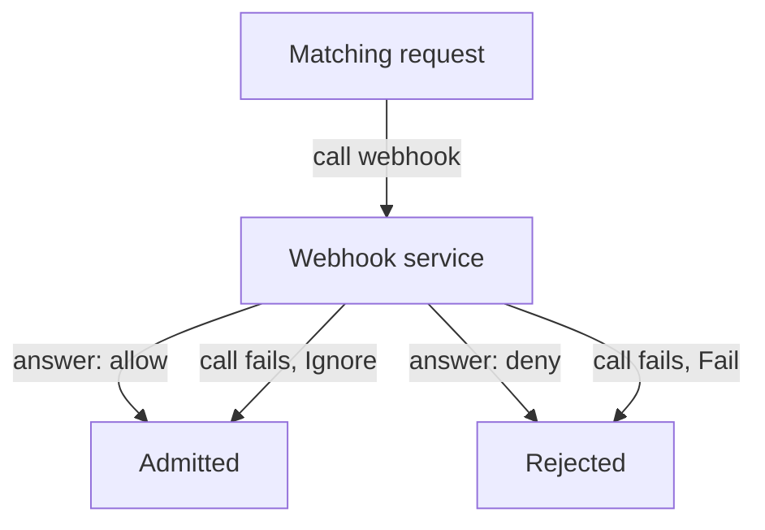

# Admission Webhooks And Failure Policy

When an admission rule needs outside data or must change the object, the API server calls a webhook: an HTTPS service that receives the request and answers with a decision. That call can fail. The setting that decides what a failure means is the difference between a rule that always applies and a rule that disappears whenever its service is down.

## Mutating and validating webhooks

Webhooks come in two kinds. A **mutating** webhook can change the object, for example by adding a sidecar container or a default label. A **validating** webhook can only accept or reject. In the request path, mutating webhooks run first, then the API server validates the schema of the object, then validating admission policies and validating webhooks run. Because validators run last, they see the object after all changes.

Each webhook entry in a `ValidatingWebhookConfiguration` or `MutatingWebhookConfiguration` has the fields that decide its behaviour.

- `rules` lists the operations, API groups and resources that trigger the call.
- `namespaceSelector` and `objectSelector` narrow the calls by namespace labels and object labels.
- `clientConfig` says where to call: a Service in the cluster or a URL, with a CA bundle to verify the server.
- `failurePolicy` is `Fail` or `Ignore` and tells the API server what to do when the call fails or times out.
- `timeoutSeconds` is the time the API server waits, between 1 and 30 seconds.
- `sideEffects` says whether the webhook changes anything outside the request. A value of `None` or `NoneOnDryRun` makes dry-run requests safe.

## Fail closed, fail open

With `failurePolicy: Fail`, a failed call rejects the request. The rule always applies, and the cost is that the cluster can no longer create the matching objects when the webhook is down. With `failurePolicy: Ignore`, a failed call lets the request through. The cluster stays available, and the rule silently stops applying. For a security rule the second behaviour is a bypass: anyone who can make the service fail, for example by overloading it, can skip the rule.

The common way to avoid a deadlock is to keep the webhook out of the objects it needs to run. If the webhook service runs in the same cluster, a `Fail` rule that matches the Pods of the webhook service itself would block its own restart. Exclude the namespace of the webhook and `kube-system` with a `namespaceSelector`.



The diagram shows that a failed call has the same result as a deny under `Fail` and the same result as an allow under `Ignore`.

## Observe a failed call

You do not need a working webhook to see the behaviour. This configuration points at a Service that does not exist, and it matches only ConfigMaps in `outpost` that carry the label `review: required`. Save it as `webhook-require-review.yaml`:

<!-- astrona:playground:renew -->

```yaml
apiVersion: admissionregistration.k8s.io/v1
kind: ValidatingWebhookConfiguration
metadata:
  name: require-review
webhooks:
  - name: require-review.outpost.example
    admissionReviewVersions: ["v1"]
    sideEffects: None
    failurePolicy: Fail
    timeoutSeconds: 5
    clientConfig:
      service:
        name: review-service
        namespace: outpost
        path: /validate
    rules:
      - apiGroups: [""]
        apiVersions: ["v1"]
        operations: ["CREATE"]
        resources: ["configmaps"]
    namespaceSelector:
      matchLabels:
        kubernetes.io/metadata.name: outpost
    objectSelector:
      matchLabels:
        review: required
```

Apply it:

```sh
kubectl apply -f webhook-require-review.yaml
```

Save this ConfigMap as `configmap-reviewed.yaml`:

```yaml
apiVersion: v1
kind: ConfigMap
metadata:
  name: reviewed
  namespace: outpost
  labels:
    review: required
data:
  key: value
```

Apply it:

```sh
kubectl apply -f configmap-reviewed.yaml
```

The request fails. The error says that the API server failed to call the webhook `require-review.outpost.example` and that the Service `review-service` was not found. The object selector matched the ConfigMap, the call could not be made and `Fail` turned that into a rejection. A ConfigMap without the label does not match the selector, so it is created without any call.

Now change the failure policy of the webhook and apply the ConfigMap again:

```sh
kubectl patch validatingwebhookconfiguration require-review --type=json -p '[{"op":"replace","path":"/webhooks/0/failurePolicy","value":"Ignore"}]'
kubectl apply -f configmap-reviewed.yaml
```

This time the ConfigMap is created, although the webhook never answered. With `Ignore`, the API server skipped the rule because the call failed. Remove both objects so that the broken webhook does not stay in the cluster:

```sh
kubectl delete validatingwebhookconfiguration require-review
kubectl -n outpost delete configmap reviewed
```

## What the API server checks first

Admission is the last gate of a write. Two built-in plugins are worth knowing in this context: `NodeRestriction`, which limits what a kubelet may change, and `ValidatingAdmissionPolicy` and the webhook plugins themselves, which must be enabled for the objects above to work. They are on by default in a current kubeadm cluster. Read the flag `--enable-admission-plugins` on the API server to see the extra plugins that were switched on.

You now have the three ways to enforce rules on writes: labels for Pod Security, expressions in the API server and external webhooks, each with a different cost when it fails. Choosing the setting for a failure is part of the rule itself.

## Common pitfalls

> [!WARNING]
> - **Using `failurePolicy: Ignore` for a security rule.** The rule stops applying whenever the service is down or slow.
> - **Using `Fail` without excluding the namespace of the webhook.** The service cannot restart, and the cluster cannot recover without removing the configuration.
> - **Matching resources in `kube-system`.** A broken webhook can then block system components.
> - **Leaving a test webhook configuration in place.** It keeps rejecting or skipping requests. Delete it after the test.
> - **Forgetting that mutating webhooks run before validators.** A validator sees the changed object, not the one the user sent.
