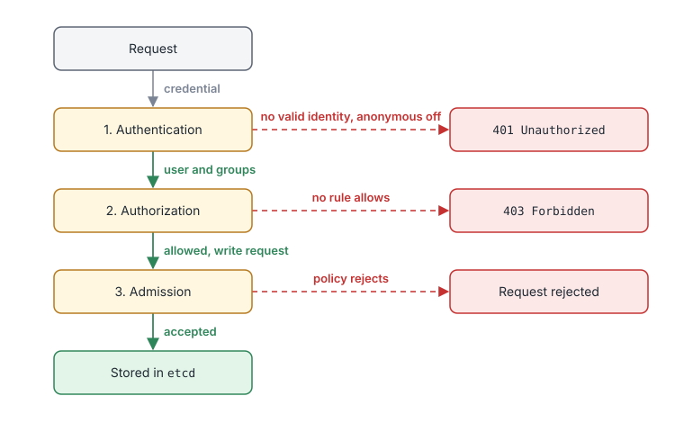
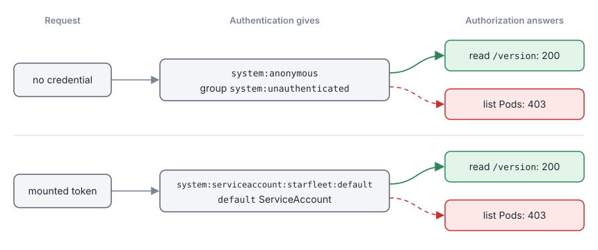

# How An API Request Is Checked

You cannot restrict access to something you cannot trace. Before you change any setting, you need to know what the API server does with a request, and at which point it can say no.

On this page, you follow one request through the API server and name the three decisions it makes on the way. Then you send requests from inside a Pod, with and without a credential. The HTTP status code of each answer tells you which decision stopped the request.

## Three checks in a fixed order

Every request to the API server is an HTTPS call. The API server handles it in three stages, and a request must pass all of them:

1. **Authentication** finds out who is calling. The API server tries each method that is set up, such as client certificates, bearer tokens and OpenID Connect (OIDC) tokens. If a method accepts the credential, the request gets a user name and a list of groups. If no method accepts it, the request becomes anonymous when anonymous access is turned on. When anonymous access is off, the API server rejects the request with `401 Unauthorized`.
2. **Authorization** decides whether that identity may do the action. The API server asks the modes in `--authorization-mode` in order, and one `allow` is enough. If no mode allows the request, the answer is `403 Forbidden`.
3. **Admission** runs only for requests that create, change or delete objects. An admission controller is a plugin in the API server that checks the object in the request. It can change the object, for example by adding a default value, or it can reject it. A rejection returns an error that names the plugin or policy.



The drawing shows that a request stops at the first check it does not pass, and only a write that passes all three checks reaches etcd, the datastore of the cluster.

So the status code tells you which stage said no. A `401` is an authentication problem, and a `403` is an authorization problem. A write that admission rejects comes back with an explicit message, because the identity was already known and allowed.

## Anonymous access

The first check has a special case that matters for hardening. When a request has no credential, or a credential that no method knows, the API server can still let it continue as an anonymous request. It then treats the caller as the user `system:anonymous` in the group `system:unauthenticated`.

The flag `--anonymous-auth` controls this, and its default is `true`. An anonymous request still goes through authorization. So the real question is what RBAC (role-based access control) allows that user and that group to do.

A kubeadm cluster gives anonymous callers only a small, read-only set of paths, through the ClusterRole `system:public-info-viewer`. It covers the health endpoints `/healthz`, `/livez` and `/readyz` and the version information at `/version`. Some tools and load balancers call the health endpoints without a credential, so you should not switch off anonymous access without checking first.

The risk appears when somebody binds a broader role to `system:anonymous` or to `system:unauthenticated`. Then any host that can reach the API server port can use that role without logging in.

## Send requests from inside a Pod

The best way to see these checks is to call the API the way a workload does. The Pods of the `probe` Deployment run Python. Kubernetes mounts two files into every Pod: a ServiceAccount token, which is the credential of the Pod, and the certificate of the cluster certificate authority (CA), which lets a client check the API server's certificate.

Define a shell function in the playground shell. It runs a small Python script in a `probe` Pod and prints only the HTTP status code. The first argument is the request path. The second is `anon` for no credential, or `token` for the mounted ServiceAccount token. The script keeps certificate checking on, so the call also verifies the identity of the API server.

<!-- astrona:playground:renew -->

```sh
call_api() {
  kubectl -n starfleet exec -i deployment/probe -- python - "$@" <<'PY'
import sys, ssl, urllib.request, urllib.error
from pathlib import Path
path, mode = sys.argv[1], sys.argv[2]
root = Path('/var/run/secrets/kubernetes.io/serviceaccount')
ctx = ssl.create_default_context(cafile=str(root / 'ca.crt'))
req = urllib.request.Request('https://kubernetes.default.svc' + path)
if mode == 'token':
    req.add_header('Authorization', 'Bearer ' + (root / 'token').read_text())
try:
    print(urllib.request.urlopen(req, context=ctx, timeout=5).status)
except urllib.error.HTTPError as e:
    print(e.code)
PY
}
```

Paste the block into the playground shell to define the function. Then send four requests:

```sh
call_api /version anon
call_api /api/v1/namespaces/starfleet/pods anon
call_api /version token
call_api /api/v1/namespaces/starfleet/pods token
```

```text
200
403
200
403
```

On a kubeadm cluster such as the playground, the first request prints `200`, because anyone may read `/version`. The second prints `403`. The caller is `system:anonymous`, and no rule allows it to list Pods.

The third request prints `200`, and the fourth prints `403` again. This time the API server knows the caller: it is the `default` ServiceAccount of `starfleet`. But that ServiceAccount has no Role that allows it to list Pods. The mounted token proves identity, not permission.



The drawing shows that authentication gives the two requests different identities, but authorization gives them the same answers, because neither identity has a rule for Pods.

You can ask the same question about an identity without a Pod. The command `kubectl auth can-i` asks the authorizer whether an identity may do an action. The first command below asks whether the `default` ServiceAccount of `starfleet` may list Pods, and the `--list` option shows everything it may do:

```sh
kubectl auth can-i list pods -n starfleet --as=system:serviceaccount:starfleet:default
kubectl auth can-i --list -n starfleet --as=system:serviceaccount:starfleet:default
```

The first command prints `no`. The second prints only the few rules that every authenticated identity receives. This is the start of its output. The lines that are left out are more read-only paths, such as `/livez`, `/readyz` and `/version`:

```text
Resources                                       Non-Resource URLs                      Resource Names   Verbs
selfsubjectreviews.authentication.k8s.io        []                                     []               [create]
selfsubjectaccessreviews.authorization.k8s.io   []                                     []               [create]
selfsubjectrulesreviews.authorization.k8s.io    []                                     []               [create]
                                                [/.well-known/openid-configuration/]   []               [get]
                                                [/.well-known/openid-configuration]    []               [get]
                                                [/api/*]                               []               [get]
                                                [/api]                                 []               [get]
```

The three `create` rules let the identity ask who it is and what it may do. None of the rules reads or changes a namespaced object such as a Pod.

## Admission is a separate decision

The requests above were all reads, so admission never ran. For writes, admission adds a check that authorization cannot make. Authorization looks only at who is calling and what action they ask for. Admission looks at the content of the write.

So a user who may create Pods can still be refused a Pod that asks for a privileged container, if an admission controller or policy forbids it. These are the usual sources of such rules:

- The **Pod Security admission controller** is built into the API server. It enforces the Pod Security Standards in each namespace, based on labels on the namespace.
- **Validating admission policies** add custom rules that the API server checks itself.
- **Admission webhooks** send the object to an outside service, which accepts or rejects it.

A webhook has one more setting to watch. If the webhook service cannot be reached, the `failurePolicy` of the webhook decides what happens. With `Fail`, the API server rejects the request. With `Ignore`, it lets the request through, so a security policy with `Ignore` stops protecting the cluster whenever its service is down.

You can now name the stage that stops a request and test it with a status code. The open question is how to give a workload an identity that passes authorization for exactly one thing.

## Common pitfalls

> [!WARNING]
> - **Reading every error as an RBAC problem.** A `401` means the API server did not accept the credential. A `403` means the identity is known but not allowed. An admission error names the policy that rejected the request.
> - **Binding a role to `system:unauthenticated` or `system:anonymous`.** This gives that role to every host that can reach the API server port.
> - **Turning off certificate checking in a client to get past a TLS error.** Use the CA file from the ServiceAccount mount instead.
> - **Setting a security webhook to `failurePolicy: Ignore`.** The API server skips the policy whenever the webhook is down.
> - **Testing only as `cluster-admin`.** That identity passes every check. Test as the identity that the workload uses.
