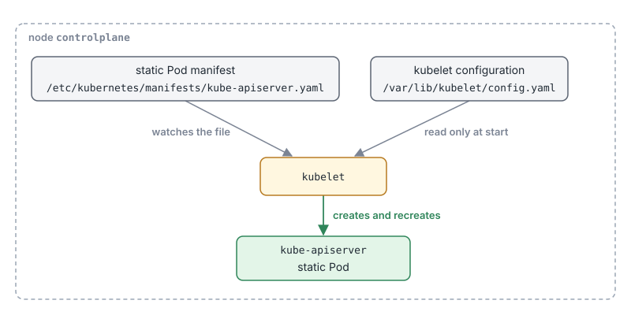
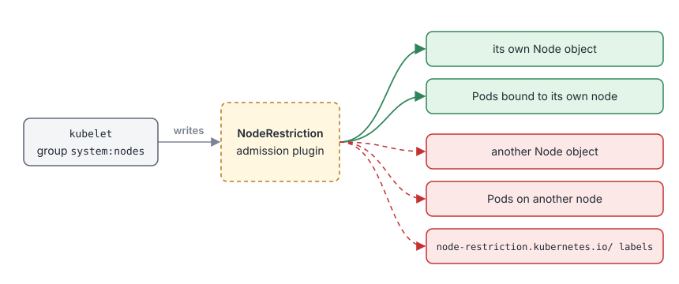
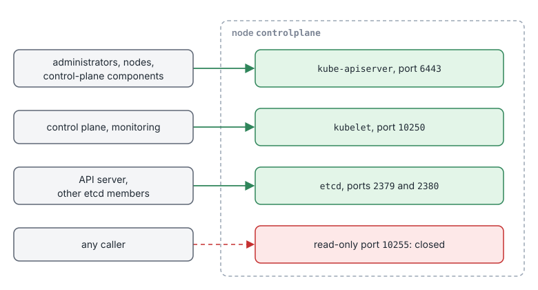

# Hardening The Endpoint And The Kubelet

A narrow identity limits what one caller can do. But the server side decides who can call at all, how callers are checked, how much a node may change, and what gets recorded. These decisions live in the settings of the API server and the kubelet.

On this page, you look at those settings. Both components are configured through files and flags on each node. In the playground, you read the live settings of both, through the API and from the files on the node `controlplane`. The page also explains how to change them, but you do not need to change the playground.

## Where the settings live

On a kubeadm cluster, `kube-apiserver` runs as a static Pod. A static Pod is a Pod that the kubelet starts directly from a manifest file on the node, without the API server asking for it. The kubelet starts the API server from `/etc/kubernetes/manifests/kube-apiserver.yaml` on the control-plane node, and the flags of the API server are in the `command` list of that manifest.

When you save a change to the file, the kubelet notices it and recreates the Pod. A wrong flag or a bad file path makes the API server fail to start, and then `kubectl` stops working too.



The drawing shows which file each component reads. The kubelet reads the static Pod manifest and runs the API server from it, and it reads its own configuration file only when it starts.

The kubelet on every node reads its settings from a configuration file and from command-line flags that the service unit sets. On kubeadm nodes, the file is `/var/lib/kubelet/config.yaml`. Restart the kubelet service after you change it.

## Read the live API server flags

You can see the flags of the running API server through the API with `kubectl`. This is read-only and needs no `sudo`.

<!-- astrona:playground:renew -->

```sh
kubectl -n kube-system get pod -l component=kube-apiserver -o jsonpath='{range .items[0].spec.containers[0].command[*]}{@}{"\n"}{end}'
```

The command prints one flag per line. This is the output in the playground:

```text
kube-apiserver
--advertise-address=10.0.2.15
--allow-privileged=true
--authorization-mode=Node,RBAC
--client-ca-file=/etc/kubernetes/pki/ca.crt
--enable-admission-plugins=NodeRestriction
--enable-bootstrap-token-auth=true
--etcd-cafile=/etc/kubernetes/pki/etcd/ca.crt
--etcd-certfile=/etc/kubernetes/pki/apiserver-etcd-client.crt
--etcd-keyfile=/etc/kubernetes/pki/apiserver-etcd-client.key
--etcd-servers=https://127.0.0.1:2379
--kubelet-client-certificate=/etc/kubernetes/pki/apiserver-kubelet-client.crt
--kubelet-client-key=/etc/kubernetes/pki/apiserver-kubelet-client.key
--kubelet-preferred-address-types=InternalIP,ExternalIP,Hostname
--proxy-client-cert-file=/etc/kubernetes/pki/front-proxy-client.crt
--proxy-client-key-file=/etc/kubernetes/pki/front-proxy-client.key
--requestheader-allowed-names=front-proxy-client
--requestheader-client-ca-file=/etc/kubernetes/pki/front-proxy-ca.crt
--requestheader-extra-headers-prefix=X-Remote-Extra-
--requestheader-group-headers=X-Remote-Group
--requestheader-username-headers=X-Remote-User
--secure-port=6443
--service-account-issuer=https://kubernetes.default.svc.cluster.local
--service-account-key-file=/etc/kubernetes/pki/sa.pub
--service-account-signing-key-file=/etc/kubernetes/pki/sa.key
--service-cluster-ip-range=10.96.0.0/12
--tls-cert-file=/etc/kubernetes/pki/apiserver.crt
--tls-private-key-file=/etc/kubernetes/pki/apiserver.key
```

The list is long, but only a few flags matter for access. Look for these:

| Flag | What it controls | Expected in a hardened cluster |
| --- | --- | --- |
| `--authorization-mode` | Authorizers asked for each request | `Node,RBAC`. It must not contain `AlwaysAllow` |
| `--anonymous-auth` | Whether unauthenticated requests are treated as `system:anonymous` | `false` if nothing needs anonymous health checks. Otherwise keep RBAC for anonymous minimal |
| `--enable-admission-plugins` | Extra admission plugins | Contains `NodeRestriction` |
| `--client-ca-file` | CA that signs client certificates | Set |
| `--tls-min-version` | Lowest TLS version offered | `VersionTLS12` or higher |
| `--profiling` | The `/debug/pprof` endpoints | `false` |
| `--audit-policy-file` and `--audit-log-path` | Audit logging | Both set when audit logging is required |

In a default kubeadm cluster, you see `--authorization-mode=Node,RBAC` and `--enable-admission-plugins=NodeRestriction`. You do not see `--anonymous-auth`, because its default is `true`. You do not see the audit flags either, because kubeadm does not turn on auditing by default. `--profiling` and `--tls-min-version` are missing as well.

A missing flag means the API server uses its default value. So the missing flags show where the defaults leave work to do.

The same flags are in the static Pod manifest on the node. The file belongs to root, so read it with `sudo`. Search it for the flags of the table:

```sh
sudo grep -E 'anonymous-auth|authorization-mode|admission-plugins|audit|profiling|tls-min' /etc/kubernetes/manifests/kube-apiserver.yaml
```

```text
    - --authorization-mode=Node,RBAC
    - --enable-admission-plugins=NodeRestriction
```

Only two of the flags are in the file. This is the file you edit when you add a flag, and the kubelet then recreates the API server Pod from it.

Anonymous access also has a middle path between on and off. The structured authentication configuration is a file that you pass to the API server with `--authentication-config`. It can allow anonymous requests only for a list of paths, such as `/livez`, `/readyz` and `/healthz`. This keeps the health checks that need no credential and refuses every other anonymous request.

## Limit what a node can do: NodeRestriction

The API server also needs rules for one special kind of caller: the kubelets. Every kubelet authenticates to the API server with a client certificate in the group `system:nodes`. If an attacker takes over a node, they can use that certificate.

Two parts of the API server limit what a kubelet can do with it:

- The **Node authorizer** limits what a kubelet may read, such as only the Secrets of the Pods that are bound to its node.
- The **NodeRestriction** admission plugin limits what a kubelet may write. A kubelet can then change only its own `Node` object and the Pods bound to its own node.

NodeRestriction also stops a kubelet from changing labels with the prefix `node-restriction.kubernetes.io/`. So an attacker on a compromised node cannot add such a label to the node to match a scheduling rule that attracts sensitive workloads. Make sure that `NodeRestriction` is in `--enable-admission-plugins` and that `Node` is in `--authorization-mode`.



The drawing shows the writes that NodeRestriction allows for one kubelet, and the writes it rejects.

## Harden the kubelet

The API server is not the only API on a node. The kubelet has its own API on port 10250. It can list Pods, read logs and run commands in containers, so it needs the same care as the API server. Three settings in the kubelet configuration file close it:

```yaml
apiVersion: kubelet.config.k8s.io/v1beta1
kind: KubeletConfiguration
authentication:
  anonymous:
    enabled: false
  webhook:
    enabled: true
  x509:
    clientCAFile: /etc/kubernetes/pki/ca.crt
authorization:
  mode: Webhook
readOnlyPort: 0
```

Each of the three settings closes one gap:

- `anonymous.enabled: false` makes the kubelet refuse requests without a credential.
- `authorization.mode: Webhook` makes the kubelet ask the API server whether the caller is allowed, in place of the unsafe `AlwaysAllow`.
- `readOnlyPort: 0` turns off the old read-only port 10255, which needs no credential.

Kubeadm sets the first two by default. After a change, run `sudo systemctl restart kubelet` on that node, because the kubelet reads the file only when it starts.

Check the file in the playground. It belongs to root, so use `sudo`:

```sh
sudo grep -n -A1 -E 'anonymous:|^authorization:|readOnlyPort' /var/lib/kubelet/config.yaml
```

```text
3:  anonymous:
4-    enabled: false
--
10:authorization:
11-  mode: Webhook
```

The file has no `readOnlyPort` line, so the kubelet uses the default `0`. But the file shows what the kubelet reads at its next start, not what it runs with now. To see the running settings, the API server can ask the kubelet for its configuration through the `/configz` endpoint. The `jq` filter keeps the four settings above:

```sh
kubectl get --raw /api/v1/nodes/controlplane/proxy/configz | jq '.kubeletconfig | {anonymous: .authentication.anonymous.enabled, webhook: .authentication.webhook.enabled, mode: .authorization.mode, readOnlyPort}'
```

```text
{
  "anonymous": false,
  "webhook": true,
  "mode": "Webhook",
  "readOnlyPort": null
}
```

The kubelet leaves out `readOnlyPort` when it is `0`, so `jq` prints `null`. The last test is a request with no credential, sent to both ports of the node's own address:

```sh
node_ip=$(kubectl get node controlplane -o jsonpath='{.status.addresses[?(@.type=="InternalIP")].address}')
curl -sk -o /dev/null -w '%{http_code}\n' https://$node_ip:10250/pods
curl -s -o /dev/null -w '%{http_code}\n' http://$node_ip:10255/pods; echo "curl exit code: $?"
```

```text
401
000
curl exit code: 7
```

Port 10250 answers `401 Unauthorized`, because the kubelet refuses anonymous requests. On port 10255, `curl` prints `000` and exits with code 7, because no process listens there. A kubelet with `anonymous.enabled: true` and `AlwaysAllow` would answer the same request with `200` and its full Pod list.

## Reduce network exposure

Authentication protects the endpoint, but there is a second layer. The fewer hosts that can reach a port, the fewer hosts that can try to break in. Use host firewalls, security groups or a private load balancer to limit each port to the hosts that need it:

- port 6443 of the API server: administrators, nodes and the control-plane components;
- port 10250 of the kubelet: the control plane and monitoring;
- ports 2379 and 2380 of etcd: the API server and the other etcd members.

Do not publish the API server on a public address unless you must. If you must, limit the source addresses that may connect.



The drawing shows each port of the control-plane node and the callers that should be able to reach it.

## Record what happens: audit logging

Even with tight access, you need to know who did what. The API server can write an audit record for each request. An audit policy file lists rules, and each rule has a level that says how much to record. The API server uses the first rule that matches a request.

| Level | What is recorded |
| --- | --- |
| `None` | Nothing |
| `Metadata` | User, time, verb, resource and response code. No request or response body |
| `Request` | Metadata and the request body |
| `RequestResponse` | Metadata, request body and response body |

Save this as `audit-policy.yaml`. It is a reference file to place on the control-plane node, for example at `/etc/kubernetes/audit-policy.yaml`. It records who touched Secrets without writing their values into the log, and it records the full body of changes to RBAC objects:

```yaml
apiVersion: audit.k8s.io/v1
kind: Policy
omitStages:
  - RequestReceived
rules:
  - level: Metadata
    resources:
      - group: ""
        resources: ["secrets"]
  - level: RequestResponse
    resources:
      - group: "rbac.authorization.k8s.io"
        resources: ["roles", "rolebindings", "clusterroles", "clusterrolebindings"]
  - level: Metadata
```

To use the policy, edit the static Pod manifest of the API server and add these flags:

- `--audit-policy-file=/etc/kubernetes/audit-policy.yaml`;
- `--audit-log-path=/var/log/kubernetes/audit.log`;
- rotation flags such as `--audit-log-maxage=30`, `--audit-log-maxbackup=10` and `--audit-log-maxsize=100`.

The API server runs in a container, so it cannot see the node's files by itself. Also add `hostPath` volumes and `volumeMounts` for the policy file, which can be mounted read-only, and for the log directory. If the volumes are missing, the flags point to paths that do not exist in the container, and the API server does not start.

## Edit the manifest carefully

Every change on this page ends with an edit to the static Pod manifest, so the edit itself needs care. Before you edit `/etc/kubernetes/manifests/kube-apiserver.yaml`, copy it to a directory outside `/etc/kubernetes/manifests`. The kubelet runs every manifest file it finds in that directory, so a backup stored there starts a second API server that conflicts with the first.

After the edit, wait for the kubelet to recreate the Pod, then check it with `kubectl -n kube-system get pod -l component=kube-apiserver`. If `kubectl` no longer answers, read the container logs on the node with `sudo crictl ps -a` and `sudo crictl logs <container-id>`. Fix the flag, and wait again.

You now know where the API server and kubelet settings live, which ones remove common risks, and how to read them on a live node. Together with narrow workload identities, these settings limit who can reach the API, what each caller can do, and what the API server records. What remains is to apply these settings yourself.

## Common pitfalls

> [!WARNING]
> - **Leaving a backup of `kube-apiserver.yaml` in `/etc/kubernetes/manifests`.** The kubelet starts it as another Pod. Keep backups elsewhere.
> - **Adding an audit flag without the matching `hostPath` volume.** The API server cannot open the file and fails to start.
> - **Logging Secrets at `Request` or `RequestResponse` level.** The values are written to the audit log. Use `Metadata` for Secrets.
> - **Assuming a kubeadm default is a hardening setting.** Anonymous authentication stays on and audit logging stays off until you change them.
> - **Opening the kubelet port 10250 to the whole network.** Limit it to the control plane and monitoring.
