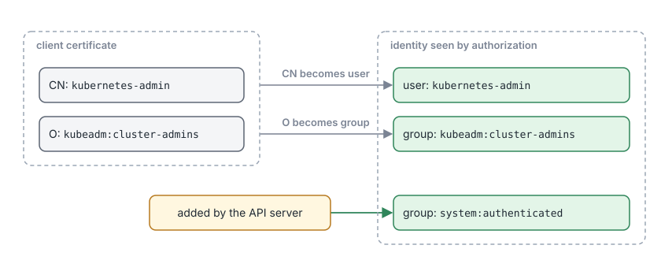

# Authentication Methods And Identities

The API server can only limit, log or revoke what a caller does if it knows who the caller is. A request that it cannot link to a caller is a request it cannot control. So the first step for every request is authentication: the API server checks the credential and turns it into an identity.

On this page, you see how that step works. You read your own identity, open a ServiceAccount token to see what it claims, and send a request with a token that is not valid, to see that the API server refuses it.

## Methods and the identity they produce

The API server holds a list of authentication methods, also called authenticators. It offers each request to them in turn, and the first method that accepts the credential decides the identity. An identity has a user name, an optional unique ID, a list of groups and optional extra fields. The next step, authorization, sees only these values.

These are the methods the API server supports:

- **Client certificates.** The API server checks the certificate against the certificate authority (CA) in `--client-ca-file`. The common name (CN) of the certificate becomes the user name, and each organization (O) entry becomes a group. The `kubectl` credentials of an administrator normally use this method. A certificate cannot be revoked before it expires, because Kubernetes has no certificate revocation list.
- **ServiceAccount tokens.** A ServiceAccount is the Kubernetes identity of a workload, and its token is a signed JSON Web Token (JWT). The API server checks the signature, the expiry and the audience. The user name is `system:serviceaccount:<namespace>:<name>`, and the groups are `system:serviceaccounts`, `system:serviceaccounts:<namespace>` and `system:authenticated`.
- **OpenID Connect (OIDC) tokens.** These are JWTs from an external identity provider. The API server maps claims of the token to a user name and groups. You configure them with `--oidc-*` flags or with a structured authentication configuration file.
- **Webhook token authentication.** The API server sends the token to an external service, and that service returns the identity.
- **A static token file.** The flag `--token-auth-file` points to a plain file that lists tokens, users and groups. The tokens never expire, and a change needs an API server restart. Do not use it in a real cluster.
- **An authenticating proxy.** A proxy in front of the API server passes the identity in request headers. The API server trusts these headers only from a proxy that presents a client certificate from a configured CA.

Whatever the method, a request can end in only three ways. The drawing below shows them.


A valid credential gives an identity. A missing credential gives an anonymous caller or a `401`, depending on one flag. A credential that no method accepts is always a `401`.

## Read your own identity

Start with your own identity. The `kubectl auth whoami` command sends a `SelfSubjectReview` to the API server. This is a request that asks the API server which identity it gave to the request itself. The answer is the identity that the authorizer sees, not the one you assume.

<!-- astrona:playground:renew -->

```sh
kubectl auth whoami
```

The output shows the user name and the groups from your client certificate, and the ID of that certificate:

```text
ATTRIBUTE                                           VALUE
Username                                            kubernetes-admin
Groups                                              [kubeadm:cluster-admins system:authenticated]
Extra: authentication.kubernetes.io/credential-id   [X509SHA256=560de0fbce577c903e099684e4520b63c41c6cf8834dc4b507501e4538f74f46]
```

The user `kubernetes-admin` comes from the common name of the certificate that `kubeadm` wrote. The group `kubeadm:cluster-admins` comes from its organization, and `kubeadm` binds that group to the `cluster-admin` ClusterRole. The group `system:authenticated` is not in the certificate. The API server adds it to every caller that is not anonymous.



The drawing shows where each value of the identity comes from. Two values come from the certificate, and the API server adds the third.

You can run the same review for another identity with impersonation. The flag `--as` makes `kubectl` send the request as the user you name:

```sh
kubectl auth whoami --as=system:serviceaccount:starfleet:default
```

This time the user name is the ServiceAccount. The groups are the three groups that every ServiceAccount token gives:

```text
ATTRIBUTE   VALUE
Username    system:serviceaccount:starfleet:default
Groups      [system:serviceaccounts system:serviceaccounts:starfleet system:authenticated]
```

## Look inside a ServiceAccount token

The identity of a ServiceAccount comes from its token, so it is worth looking inside one. A ServiceAccount token has three Base64-encoded parts, separated by dots. The middle part holds the claims, which are the statements the token makes about itself.

The next command asks the API server for a token for the `default` ServiceAccount of `starfleet` and prints its claims. The default lifetime of a requested token is one hour.

```sh
kubectl -n starfleet create token default | python3 -c "import sys,base64,json;p=sys.stdin.read().split('.')[1];print(json.dumps(json.loads(base64.urlsafe_b64decode(p+'='*(-len(p)%4))),indent=2))"
```

The command prints the claims as JSON. Your `exp`, `iat`, `jti`, `nbf` and `uid` values differ:

```text
{
  "aud": [
    "https://kubernetes.default.svc.cluster.local"
  ],
  "exp": 1794995277,
  "iat": 1794991677,
  "iss": "https://kubernetes.default.svc.cluster.local",
  "jti": "b33926a5-f8c2-45b1-8bc6-5f97c0ab3e33",
  "kubernetes.io": {
    "namespace": "starfleet",
    "serviceaccount": {
      "name": "default",
      "uid": "93b0fd45-3407-41c1-b50f-58884ff491af"
    }
  },
  "nbf": 1794991677,
  "sub": "system:serviceaccount:starfleet:default"
}
```

These are the claims that matter most:

- `iss` is the issuer, the party that created the token.
- `aud` is the audience, the service the token is meant for.
- `exp` is the expiry time, and `iat` (issued at) is the time the token was made. Here `exp` is 3600 seconds after `iat`, which is the one-hour lifetime.
- `sub` is the subject, here `system:serviceaccount:starfleet:default`.
- The `kubernetes.io` object names the namespace and the ServiceAccount.

Decoding a token does not check its signature. So a decoded claim is information, not proof. Only the API server, which holds the public key, can validate the token.

## An invalid credential is not anonymous

Now test how the API server treats a missing credential and a wrong one. For this you need a helper. It runs a Python script in a `probe` Pod and prints only the HTTP status code of a request to the API server.

The first argument of the helper is the path. The second argument picks the credential: `anon` sends no credential, `token` sends the token mounted in the Pod, and `bad` sends a token that is not valid. The certificate check stays on, so the call also verifies the API server.

```sh
call_api() {
  kubectl -n starfleet exec -i deployment/probe -- python - "$@" <<'PY'
import sys, ssl, urllib.request, urllib.error
from pathlib import Path
path, mode = sys.argv[1], sys.argv[2]
root = Path('/var/run/secrets/kubernetes.io/serviceaccount')
ctx = ssl.create_default_context(cafile=str(root / 'ca.crt'))
req = urllib.request.Request('https://kubernetes.default.svc' + path)
if mode == 'token':
    req.add_header('Authorization', 'Bearer ' + (root / 'token').read_text())
elif mode == 'bad':
    req.add_header('Authorization', 'Bearer not-a-real-token')
try:
    print(urllib.request.urlopen(req, context=ctx, timeout=5).status)
except urllib.error.HTTPError as e:
    print(e.code)
PY
}
```

Paste the function into your terminal. Then send the same request with all three modes:

```sh
call_api /version anon
call_api /version token
call_api /version bad
```

The three lines of output are:

```text
200
200
401
```

The first two requests print `200`, because every caller may read the path `/version`. The third prints `401`. A caller with no credential can be treated as anonymous. A caller that presents a credential which fails verification is rejected, even on a path that anonymous callers may read.

The API server never downgrades a bad credential to anonymous. That is why a `401` always points to the credential and never to RBAC (role-based access control), which runs only later, in authorization.

You can now name the authentication methods, read the identity that a request received, and tell a missing credential from an invalid one. One question stays open: what may a caller with no credential do? The answer depends on bindings that you control.

## Common pitfalls

> [!WARNING]
> - **Treating a decoded token as verified.** Decoding shows the claims only. The API server checks the signature.
> - **Using a static token file.** Its tokens never expire and cannot be rotated without a restart.
> - **Relying on certificates for people.** A client certificate cannot be revoked before it expires. Prefer short-lived tokens from an identity provider.
> - **Expecting a bad token to act as anonymous.** It returns `401`. Anonymous treatment is only for requests with no credential.
> - **Testing as `cluster-admin` only.** Use `--as` to see the groups and permissions of the identity that matters.
