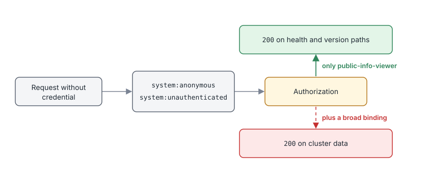
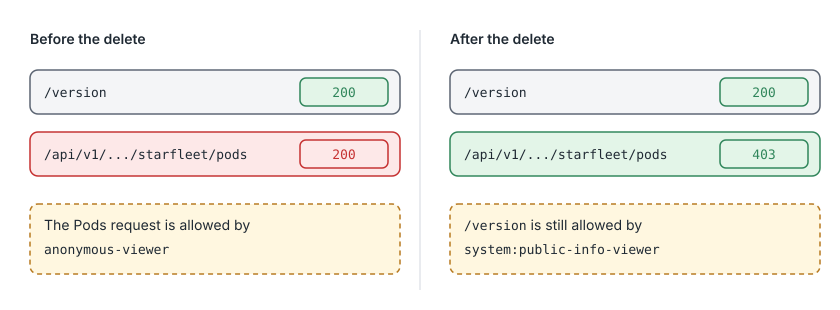

# Anonymous Access In Practice

An API server on a reachable network address receives requests from callers that no one has checked. Some of these requests carry no credential at all. Anonymous access is the setting that decides what happens to them.

On this page, you send anonymous requests to the playground cluster. You find the binding that lets them read Pods, remove it, and check that only the health and version paths stay open.

## What anonymous access is

The API server flag `--anonymous-auth` controls anonymous access, and its default is `true`. With this setting, authentication does not reject a request that has no credential. Instead, the API server gives the request the user `system:anonymous` and the group `system:unauthenticated`, and the request goes on to authorization.

So anonymous access does not bypass RBAC (role-based access control). It only gives the caller a name that a binding can match. What the caller may then do depends fully on the bindings.

A kubeadm cluster binds the ClusterRole `system:public-info-viewer` to both `system:authenticated` and `system:unauthenticated`. This role lets a caller read `/healthz`, `/livez`, `/readyz`, `/livez/*`, `/readyz/*` and `/version`. Because of it, a load balancer can check the health of the API server without a credential.

The risk is a binding that grants more than this to the anonymous names. Three subjects need attention:

- The user `system:anonymous` and the group `system:unauthenticated` reach every host that can open a connection to the API port.
- The group `system:authenticated` is wider than it sounds. It holds every user and every ServiceAccount in the cluster, including workloads that have nothing to do with the grant.



The drawing shows the path of a request without a credential. The difference between a safe cluster and an open one is the set of bindings that authorization finds for the anonymous subjects.


## Send anonymous requests

The playground starts with a binding that you have to find. First you need a way to send requests without a credential. Define this helper in your shell on the playground, if it is not defined there yet. It prints the HTTP status code of a request from a `probe` Pod, and its second argument is `anon`, `token` or `bad`.

<!-- astrona:playground:renew -->

```sh
call_api() {
  kubectl -n starfleet exec -i deployment/probe -- python - "$@" <<'PY'
import sys, ssl, urllib.request, urllib.error
from pathlib import Path
path, mode = sys.argv[1], sys.argv[2]
root = Path('/var/run/secrets/kubernetes.io/serviceaccount')
ctx = ssl.create_default_context(cafile=str(root / 'ca.crt'))
req = urllib.request.Request('https://kubernetes.default.svc' + path)
if mode == 'token':
    req.add_header('Authorization', 'Bearer ' + (root / 'token').read_text())
elif mode == 'bad':
    req.add_header('Authorization', 'Bearer not-a-real-token')
try:
    print(urllib.request.urlopen(req, context=ctx, timeout=5).status)
except urllib.error.HTTPError as e:
    print(e.code)
PY
}
```

Now send one anonymous request to a public path and one to a path with cluster data:

```sh
call_api /version anon
call_api /api/v1/namespaces/starfleet/pods anon
```

The output is two lines:

```text
200
200
```

The first `200` is expected. The second `200` is one that a hardened cluster must not return: a caller without a credential just listed the Pods of a namespace. Authorization found a rule for the anonymous subjects, so a binding exists that does not belong.

## Find the binding

You can ask the authorizer the same question without a Pod. A `SubjectAccessReview` is an API object that asks the authorizer whether a given user and groups may do one action. The API server does not store it. It writes the answer into the `status` field of its response.

Save this as `subjectaccessreview-anonymous-pods.yaml`:

```yaml
apiVersion: authorization.k8s.io/v1
kind: SubjectAccessReview
spec:
  user: system:anonymous
  groups:
  - system:unauthenticated
  resourceAttributes:
    verb: list
    resource: pods
    namespace: starfleet
```

A review is a question, not an object to keep, so `kubectl apply` cannot send it. Send it with `kubectl create`, and print only its `status`:

```sh
kubectl create -f subjectaccessreview-anonymous-pods.yaml -o jsonpath='{.status}{"\n"}'
```

The authorizer allows the request and names the binding that allowed it:

```text
{"allowed":true,"reason":"RBAC: allowed by ClusterRoleBinding \"anonymous-viewer\" of ClusterRole \"view\" to Group \"system:unauthenticated\""}
```

You may expect `kubectl auth can-i list pods -n starfleet --as=system:anonymous --as-group=system:unauthenticated` to give the same answer. On this cluster it fails with `User "system:anonymous" cannot create resource "selfsubjectaccessreviews"`. The reason is that with `--as`, `kubectl` sends its question as the impersonated identity.

The right to ask that question comes from the ClusterRoleBinding `system:basic-user`, which names only `system:authenticated`. So an anonymous caller may not ask. The `SubjectAccessReview` avoids this problem, because your own `cluster-admin` credentials send it.

The reason in the answer names one binding. To see every binding that could matter, print each ClusterRoleBinding with the role it grants and the subjects it names:

```sh
kubectl get clusterrolebindings -o jsonpath='{range .items[*]}{.metadata.name}{"\t"}{.roleRef.name}{"\t"}{.subjects[*].name}{"\n"}{end}'
```

The list has more than 50 lines. The output below is shortened to the lines that name the anonymous subjects, `system:authenticated` or the group `ops`:

```text
anonymous-viewer	view	system:unauthenticated
ops-viewer	view	ops
system:basic-user	system:basic-user	system:authenticated
system:discovery	system:discovery	system:authenticated
system:public-info-viewer	system:public-info-viewer	system:authenticated system:unauthenticated
```

Read the third column of each line, because it holds the subjects:

- `anonymous-viewer` gives the role `view` to `system:unauthenticated`. This binding does not belong.
- `ops-viewer` gives `view` to the group `ops`. This is a normal grant for a named team, and it stays.
- The built-in lines, such as `system:public-info-viewer`, belong to the cluster and stay as well.

A Role can also grant anonymous access inside one namespace. So search the RoleBindings in the same way:

```sh
kubectl get rolebindings -A -o jsonpath='{range .items[*]}{.metadata.namespace}{"\t"}{.metadata.name}{"\t"}{.roleRef.name}{"\t"}{.subjects[*].name}{"\n"}{end}'
```

The output has eleven lines. Only one of them names an anonymous subject:

```text
kube-public	kubeadm:bootstrap-signer-clusterinfo	kubeadm:bootstrap-signer-clusterinfo	system:anonymous
```

`kubeadm` created this RoleBinding. It lets anonymous callers read only the ConfigMap `cluster-info` in `kube-public`. A new node reads this ConfigMap when it joins the cluster with `kubeadm join`. It is a known, narrow grant, so remove it only if no node will join with a bootstrap token.

## Remove the binding and test again

You now know which binding is wrong, so delete it by name. Do not edit a built-in role such as `system:public-info-viewer` instead. The API server restores the default rules of its own roles when it starts.

```sh
kubectl delete clusterrolebinding anonymous-viewer
```

Repeat the two anonymous requests:

```sh
call_api /version anon
call_api /api/v1/namespaces/starfleet/pods anon
```

The output is:

```text
200
403
```

The first request still gets `200`. The second now gets `403`: the caller is still `system:anonymous`, but no rule allows it to list Pods. If you still see `200`, repeat the request after a few seconds.



The drawing compares the two states. Only the public path stays open, because `system:public-info-viewer` still allows it.

Then send the same review again:

```sh
kubectl create -f subjectaccessreview-anonymous-pods.yaml -o jsonpath='{.status}{"\n"}'
```

The answer is now `{"allowed":false}`. No authorizer allows the request, so the review has no reason.

## Switching anonymous access off

Deleting the binding closes cluster data, but the public paths stay open. The flag `--anonymous-auth=false` goes one step further. With it, a request with no credential returns `401` on every path, including `/healthz` and `/version`. That is the right setting when nothing needs a read without a credential.

There is a catch on a kubeadm cluster. The kubelet checks the API server static Pod with a liveness probe and a readiness probe, and these probes send anonymous requests to `/livez` and `/readyz`. So if you switch anonymous access off without another plan, the probes fail, and the kubelet can restart the API server.

The structured authentication configuration solves this. Its `anonymous` setting can enable anonymous access only for a list of paths, such as `/livez`, `/readyz` and `/healthz`. Every other path then gets `401`.

You now know how to prove that a cluster is open to anonymous callers and how to close it. One piece is still open: the authorizer itself. Which modes exist, how do they combine, and what can a caller with the right to impersonate do?

## Common pitfalls

> [!WARNING]
> - **Binding a role to `system:unauthenticated`, `system:anonymous` or `system:authenticated` for convenience.** Any caller that can reach the API port, or any identity in the cluster, gets the grant.
> - **Testing only from inside the cluster.** The risk is a caller outside it. Send a `SubjectAccessReview` for `system:anonymous` in `system:unauthenticated` to see the effective rights. `kubectl auth can-i --as=system:anonymous` fails, because an anonymous caller may not ask the question itself.
> - **Checking only ClusterRoleBindings.** A RoleBinding to the anonymous names opens one namespace.
> - **Editing `system:public-info-viewer`.** The API server resets built-in roles. Change the binding and the flag, not the role.
> - **Setting `--anonymous-auth=false` without checking the probes.** The API server probes can fail and the Pod restarts in a loop.
