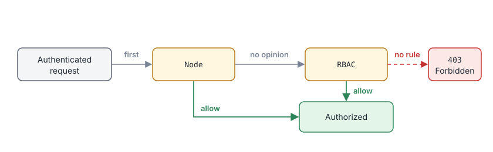
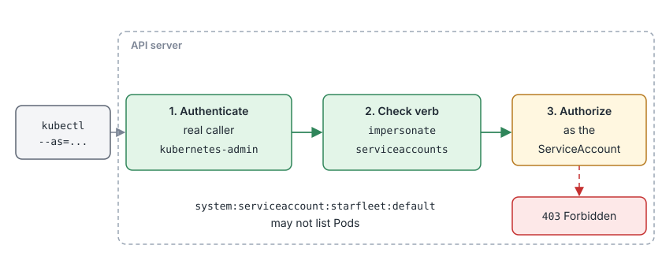

# Authorization Modes And Impersonation

Authentication names the caller. Authorization is the next step: it decides what the named caller may do. The API server can run several authorizers at once, and a single wrong one in the list can make every other rule pointless.

On this page, you read the authorization flag of the live API server and learn what each mode does. You also see how impersonation lets one identity act as another. Impersonation is a useful testing tool and, at the same time, a dangerous permission.

## Read the mode flag

The API server flag `--authorization-mode` takes a comma-separated list of authorizers. The API server asks them in the order of the list, and each one gives one of three answers:

- `allow`: the request is authorized, and no later authorizer is asked.
- `deny`: the request is refused, and no later authorizer is asked.
- no opinion: the API server asks the next authorizer.

When no authorizer allows the request, the API server refuses it with `403`. Now look at the list on the playground.

<!-- astrona:playground:renew -->

```sh
kubectl -n kube-system get pod -l component=kube-apiserver -o jsonpath='{range .items[0].spec.containers[0].command[*]}{@}{"\n"}{end}' | grep -e authorization -e anonymous
```

On a kubeadm-based cluster such as the playground, the output is one line:

```text
--authorization-mode=Node,RBAC
```

The command filters the full flag list. It prints nothing for `--anonymous-auth`, because that flag is not set, and the default `true` applies.

The live Pod only shows the flags. To change them, you edit the file the Pod comes from. The kubelet starts the API server from the static Pod manifest `/etc/kubernetes/manifests/kube-apiserver.yaml` on the node, and only root can read it:

```sh
sudo grep -e authorization -e anonymous /etc/kubernetes/manifests/kube-apiserver.yaml
```

The file holds the same flag as a list item:

```text
    - --authorization-mode=Node,RBAC
```

When you save a change to this file, the kubelet stops the old API server container and starts a new one with the new flags. During the restart, `kubectl` cannot connect for a short time.

The flag shows two modes, but the API server knows more. The next section explains each one.

## The modes

These are the authorization modes that `--authorization-mode` accepts:

- **Node** is a special-purpose authorizer for kubelets. It allows a kubelet to read the objects that Pods on its own node need, such as their Secrets and ConfigMaps, and to write the status of its node and those Pods.
- **RBAC** allows a request when a Role or ClusterRole bound to the identity lists the verb, resource and name. It has only allow rules and never answers `deny`.
- **Webhook** sends a `SubjectAccessReview` to an external service. That service can allow or deny. Use it when decisions come from a policy engine outside the cluster.
- **ABAC** reads rules from a static file and needs an API server restart for each change. Do not use it.
- **AlwaysAllow** authorizes every request that reaches it. With it, the permission model is gone, and every authenticated user and ServiceAccount can do everything. It exists for tests.
  - The API server turns anonymous authentication off when `AlwaysAllow` is in the list. Its log then says `AnonymousAuth is not allowed with the AlwaysAllow authorizer. Resetting AnonymousAuth to false`, and requests without credentials get `401`.
  - On a kubeadm cluster, this also breaks the health probes that the kubelet sends to the API server, because they are anonymous requests to `/livez` and `/readyz`. The Pod stays at `0/1` Ready.
- **AlwaysDeny** refuses every request and also exists for tests.

A hardened kubeadm cluster uses `Node,RBAC`. `Node` comes first, so that the API server decides a kubelet request cheaply, and `RBAC` handles everyone else. If `AlwaysAllow` is in the list, RBAC never gets a chance to refuse anything, because the request is already authorized.



The drawing shows the chain for `Node,RBAC`. An allow at any step authorizes the request, and reaching the end of the chain without an allow gives a `403`.


## Ask the authorizer about any identity

You do not need to send a real request to learn what the chain decides. The `kubectl auth can-i` command sends an access review to the authorizer chain and prints the answer. With `--as`, it asks about another identity. With `--list`, it prints the whole set of rules for that identity in a namespace.

```sh
kubectl auth can-i list pods -n starfleet --as=system:serviceaccount:starfleet:default
kubectl auth can-i list pods -n starfleet --as=ops-user --as-group=ops
```

The output is:

```text
no
yes
```

The first command prints `no`, because the `default` ServiceAccount has no Role. The second prints `yes`, because the group `ops` holds `view` through the ClusterRoleBinding `ops-viewer`.

The second command shows that the group is what matters. The user name `ops-user` does not need to exist anywhere, because Kubernetes has no user objects. A user is whatever name the authenticator reports.

## Impersonation

The `--as` flag you just used is impersonation. Impersonation lets a caller send a request as another identity, and `kubectl` does it with `--as`, `--as-group` and `--as-uid`. The permission behind it is the verb `impersonate` on the resources `users`, `groups`, `serviceaccounts` or `uids`.

The API server handles an impersonated request in three steps:

1. It authenticates the real caller.
2. It checks whether that caller may impersonate the requested user, group or ServiceAccount.
3. Only then does it continue with the impersonated identity, and authorization sees that identity.



The drawing shows the three steps for the request below. The impersonate check passes for the administrator, but the impersonated ServiceAccount may not list Pods.

```sh
kubectl get pods -n starfleet --as=system:serviceaccount:starfleet:default
kubectl auth can-i impersonate serviceaccounts
```

The output is:

```text
Error from server (Forbidden): pods is forbidden: User "system:serviceaccount:starfleet:default" cannot list resource "pods" in API group "" in the namespace "starfleet"
yes
```

The first command fails with a `Forbidden` error. The error names the ServiceAccount and says it cannot list Pods. It proves that your administrator rights let you impersonate, and it shows what the identity can do. The second command prints `yes`, because `cluster-admin` has every verb.

Impersonation is a strong permission. A subject that may impersonate a group such as `system:masters`, or a highly privileged ServiceAccount, can do whatever that identity can do. So follow these rules:

- Grant `impersonate` only to the administrators or services that need it.
- Name the exact `resourceNames` where possible.
- Treat a ClusterRole with `impersonate` the same way as `cluster-admin`.

Audit logs record the impersonated identity in a separate field, so you can still see the real caller.

You now know which modes decide a request, why only `Node,RBAC` belongs in the list, and how to test an identity safely. One question stays open. A caller that is authenticated and authorized still meets a last check for writes, which is admission.

## Common pitfalls

> [!WARNING]
> - **Leaving `AlwaysAllow` in `--authorization-mode`.** Every authenticated request is authorized, whatever the RBAC rules say. Check the live flag.
> - **Putting `RBAC` without `Node`.** Kubelets then depend on RBAC rules that were not designed for them.
> - **Granting `impersonate` broadly.** It lets the holder act as any identity that it names, including administrators.
> - **Reading `can-i` without `--as`.** The answer is for your own credentials, which are `cluster-admin` in the playground.
> - **Looking for user objects.** Kubernetes has no user resource. The name comes from the credential.
