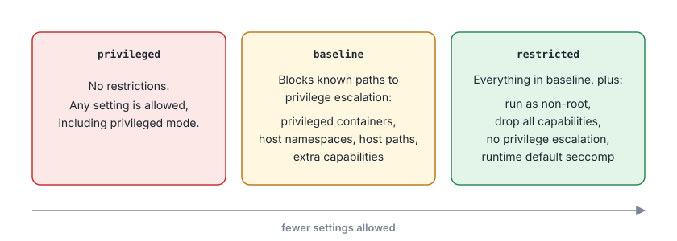
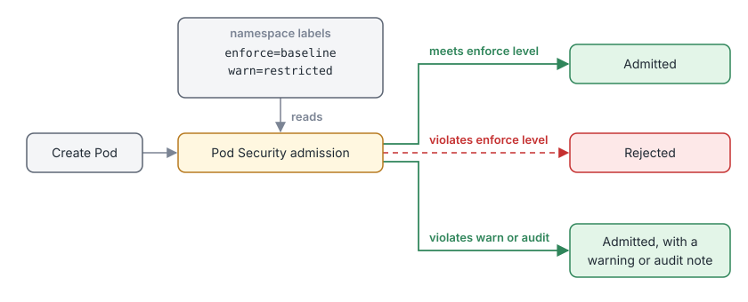
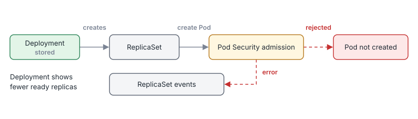

# Pod Security Admission

A Pod can ask for settings that give its container the power of the node. Examples are privileged mode, the host network and host paths, which are folders of the node mounted into the container. If any user who may create Pods can ask for these settings, one mistake or one stolen token is enough to take over a node.

Pod Security admission is the built-in answer to this problem. An admission controller is code in the Kubernetes API server that reads a write request after authorization and can reject it. Pod Security admission is an admission controller that is enabled by default. It checks every new Pod against a standard that you choose for each namespace.

## Standards and modes

Two ideas decide what Pod Security admission does: the level a Pod must meet, and what happens when it does not. The **Pod Security Standards** define three levels.

- **privileged** has no restrictions.
- **baseline** blocks the known paths to privilege escalation: privileged containers, host namespaces, host paths, extra capabilities beyond a short list and similar settings. Most workloads run under it unchanged.
- **restricted** follows current hardening practice. Containers must run as non-root, drop all capabilities, forbid privilege escalation and use a runtime default seccomp profile. A seccomp profile is a list of the system calls a container may make.



The drawing shows that each level allows less than the one before it. A Pod that meets `restricted` also meets `baseline`, but not the other way round.

The **modes** say what happens when a Pod violates the level.

- **enforce** rejects the Pod.
- **audit** lets the Pod in and adds an annotation to the audit record.
- **warn** lets the Pod in and returns a warning to the user.

A label on the namespace sets each mode, in the form `pod-security.kubernetes.io/<mode>=<level>`. An optional label `pod-security.kubernetes.io/<mode>-version` pins the version of the standard. Without it, the controller uses the latest version.

The three modes are independent of each other. So a namespace can enforce `baseline` and at the same time warn about `restricted`. This combination shows a team what a stricter level would break before anyone enforces it.



The drawing shows that only the `enforce` mode rejects a Pod. A violation of the `warn` or `audit` level still admits the Pod and only adds a message or a record.

## Before the label: any Pod is admitted

Before you add any label, see what the API server does without one. In the playground, `outpost` has no Pod Security labels, so no standard applies. Save this as `pod-privileged.yaml`. The container asks for privileged mode, the strongest request a Pod can make:

<!-- astrona:playground:renew -->

```yaml
apiVersion: v1
kind: Pod
metadata:
  name: debugger
  namespace: outpost
spec:
  containers:
    - name: debugger
      image: docker.io/library/busybox:1.37.0
      command: ["sh", "-c", "sleep 3600"]
      securityContext:
        privileged: true
```

Apply it:

```sh
kubectl apply -f pod-privileged.yaml
```

The command creates the Pod. Nothing in the API server asked whether privileged mode was acceptable. This is the default state of a namespace. Delete the Pod before you continue:

```sh
kubectl -n outpost delete pod debugger
```

## Turn on enforcement

Now one label changes the result. Label the namespace with the `baseline` level in `enforce` mode:

```sh
kubectl label namespace outpost pod-security.kubernetes.io/enforce=baseline
```

The namespace already has a Pod, `drifter`. When you add an enforce label, the admission controller checks the Pods that exist and prints a warning for each violation. It does not remove them. The `drifter` pod meets `baseline`, so the only output is the line that confirms the label. Apply the same Pod file again:

```sh
kubectl apply -f pod-privileged.yaml
```

This time the command fails with an error from the admission controller. The message says the Pod violates PodSecurity at the level `baseline`, and it names the privileged setting of the container. The check ran for `cluster-admin` as well, because admission does not care who the caller is.

## Warn about a stricter level

Enforcement is one mode. A second label adds another mode without changing enforcement. You add `warn` at the `restricted` level, then apply a plain Pod that meets `baseline` but not `restricted`. Save this as `pod-plain.yaml`:

```yaml
apiVersion: v1
kind: Pod
metadata:
  name: plain
  namespace: outpost
spec:
  containers:
    - name: plain
      image: docker.io/library/busybox:1.37.0
      command: ["sh", "-c", "sleep 3600"]
```

Apply the label and the file:

```sh
kubectl label namespace outpost pod-security.kubernetes.io/warn=restricted
kubectl apply -f pod-plain.yaml
```

The API server creates the Pod. The command also prints a warning that lists what the Pod would need to change to meet `restricted`, for example a security context that forbids privilege escalation. A warning does not stop the request. It lets you measure the effect of a stricter level before you enforce it.

## What the controller checks

The examples above created bare Pods. Most real Pods come from a workload resource, such as a Deployment, and here the controller behaves in a way that often surprises people. It checks Pods only, so it does not reject the Deployment itself.

The API server stores the Deployment. The ReplicaSet controller then tries to create the Pods, and Pod Security admission rejects them. The Deployment shows fewer ready replicas than it wants, and the reason is in the events of the ReplicaSet. When a rollout does not progress in a namespace with an enforce label, read those events first.



The drawing shows where the rejection happens and where its error message ends up.

Cluster administrators can also set defaults and exemptions in the configuration file of the controller. Exemptions can name users, runtime classes and namespaces. The exempt namespaces keep system components running, and they are also a place to look when you review the security of a cluster.

You now know how to make the API server refuse dangerous Pod settings with two labels. The built-in standards cover the common risks. The question still open is how to enforce a rule that the standards do not express.

## Common pitfalls

> [!WARNING]
> - **Assuming a label on a namespace removes Pods that already break the rule.** The existing Pods stay. The controller checks only new Pods.
> - **Looking for the error on the Deployment.** The Pod creation fails in the ReplicaSet. Read the events there.
> - **Using only `warn` or `audit` and believing the namespace is protected.** Only `enforce` rejects.
> - **Expecting `cluster-admin` to bypass the check.** Admission applies to every caller.
> - **Pinning an old `-version` label forever.** Kubernetes updates the standard in new versions. Review the pinned version from time to time.
