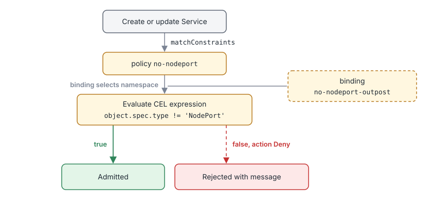
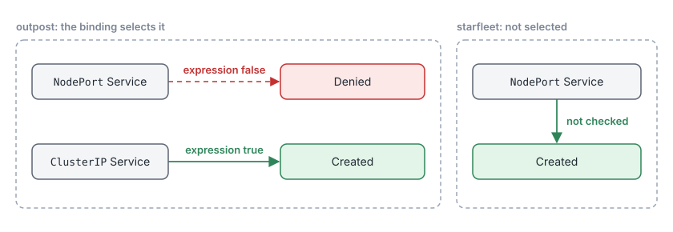

# ValidatingAdmissionPolicy With CEL

The Pod Security Standards cover Pods only. A real cluster has other rules too: no Service of type `NodePort`, no image from an unknown registry, a label on every Deployment. Such rules are checked at admission, the step in which the Kubernetes API server reads the object of a write request after authorization and can reject it.

Before the ValidatingAdmissionPolicy existed, rules like these needed an admission webhook. A webhook is a separate HTTPS service that you build, run and keep available. A ValidatingAdmissionPolicy puts the rule inside the API server as a short expression, so there is no extra service that can fail.

## Policy, binding and expression

A rule of this kind needs two objects that work together. Neither of them does anything alone.

- A **ValidatingAdmissionPolicy** says which requests it matches (`matchConstraints`) and lists one or more `validations`. A validation has a CEL expression and an optional `message`. The request is allowed when the expression evaluates to `true`.
- A **ValidatingAdmissionPolicyBinding** switches the policy on. It names the policy in `policyName`, lists the `validationActions` and can narrow the scope with `matchResources`, for example with a namespace selector.

The expressions use the Common Expression Language (CEL). CEL is a small language for expressions that return a value, such as `true` or `false`. An expression can use these variables:

- `object` is the new object.
- `oldObject` is the previous object. It is empty when the request creates an object.
- `request` holds details of the request, such as the user name and the operation.
- `params` is an optional parameter object.

For example, the expression `object.spec.type != 'NodePort'` is true for every Service whose type is not `NodePort`.

The `validationActions` of the binding choose what a failure does:

- `Deny` rejects the request.
- `Warn` admits it and returns a warning to the caller.
- `Audit` admits it and adds an annotation to the audit record.

A new rule usually starts with `Warn` and `Audit` together. This shows what the rule would reject. When the results look right, the rule moves to `Deny`.



The drawing shows that the binding decides where the policy is active. The policy alone matches requests, but nothing is enforced until a binding selects the request.

## Write a policy for Services

Now build a real rule: nobody may create a Service of type `NodePort` in `outpost`. A NodePort Service opens a port on every node, so more of the cluster is reachable from the network. Save this as `vap-no-nodeport.yaml`:

<!-- astrona:playground:renew -->

```yaml
apiVersion: admissionregistration.k8s.io/v1
kind: ValidatingAdmissionPolicy
metadata:
  name: no-nodeport
spec:
  failurePolicy: Fail
  matchConstraints:
    resourceRules:
      - apiGroups: [""]
        apiVersions: ["v1"]
        operations: ["CREATE", "UPDATE"]
        resources: ["services"]
  validations:
    - expression: "object.spec.type != 'NodePort'"
      message: "NodePort Services are not allowed in this namespace"
```

Apply it:

```sh
kubectl apply -f vap-no-nodeport.yaml
```

The field `failurePolicy: Fail` applies to the policy itself. If the API server cannot evaluate the expression, for example because of a type error, it rejects the request. The policy is not active yet, because no binding exists. Try a NodePort Service before you add the binding:

```sh
kubectl -n outpost create service nodeport demo --tcp=80:80
```

The API server creates the Service, because no binding switches the policy on. Remove it with `kubectl -n outpost delete service demo` and continue.

## Bind the policy to one namespace

The binding switches the policy on and limits it to one namespace. Save this as `vapb-no-nodeport-outpost.yaml`. The namespace selector uses the label `kubernetes.io/metadata.name`, which the API server sets on every namespace:

```yaml
apiVersion: admissionregistration.k8s.io/v1
kind: ValidatingAdmissionPolicyBinding
metadata:
  name: no-nodeport-outpost
spec:
  policyName: no-nodeport
  validationActions: ["Deny"]
  matchResources:
    namespaceSelector:
      matchLabels:
        kubernetes.io/metadata.name: outpost
```

Apply it:

```sh
kubectl apply -f vapb-no-nodeport-outpost.yaml
```

Then check the result. The binding becomes active after a short time, so if the first request is still admitted, repeat it after a few seconds:

```sh
kubectl -n outpost create service nodeport demo --tcp=80:80
kubectl -n outpost create service clusterip demo --tcp=80:80
kubectl -n starfleet create service nodeport demo --tcp=80:80
```

The three requests give three different results:

- The first request fails. The message names the policy `no-nodeport`, the binding `no-nodeport-outpost` and the text `NodePort Services are not allowed in this namespace`.
- The second request creates a ClusterIP Service, because the expression is true for it.
- The third request creates a NodePort Service in `starfleet`, because the binding selects only `outpost`.



The drawing shows that the expression decides inside `outpost`, and the binding decides that `starfleet` is not checked at all. The administrator is not exempt in any of the three cases. Clean up the two Services you created:

```sh
kubectl -n outpost delete service demo
kubectl -n starfleet delete service demo
```

## Choosing between a policy and a webhook

A policy is not the only way to write a custom rule, so it helps to know its limits. A ValidatingAdmissionPolicy runs in the API server process. It needs no network call, and it cannot be down.

It has two limits. It can only validate an object, not change it. It can read only the request and the optional parameter object. Use a webhook when the rule needs data from outside the API server, such as an image scan result, or when the rule must change the object.

You can now write a rule that the API server enforces by itself. The question still open is how an external webhook behaves, and what it does when its service fails.

## Common pitfalls

> [!WARNING]
> - **Creating the policy and forgetting the binding.** Nothing is enforced until a binding selects the request.
> - **Matching only `CREATE`.** A user can then change an existing object into a forbidden one. Match `UPDATE` as well.
> - **Writing an expression that is true by accident.** Test both the allowed and the denied object.
> - **Starting with `Deny` on a live namespace.** Start with `Warn` and `Audit`, read the results and then switch.
> - **Leaving the namespace selector out.** The policy then applies to every namespace, including `kube-system`.
