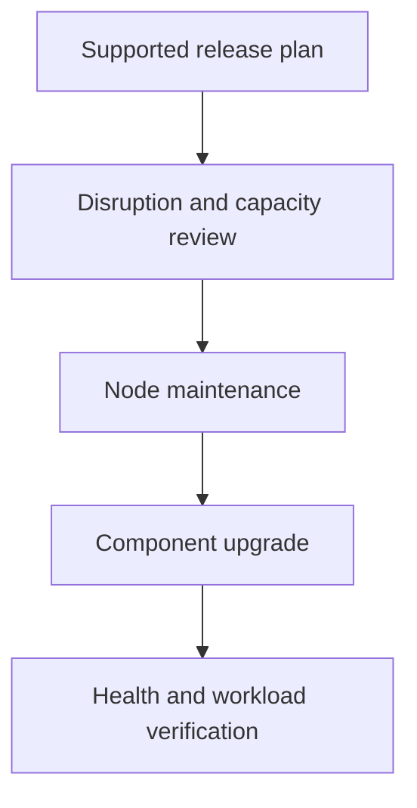

# Cluster Upgrades And Maintenance Boundaries

A node upgrade removes its ready application replicas, but the remaining nodes cannot host replacements. Version compatibility and maintenance availability are separate planning requirements.

## Learning objectives

- Explain supported component-version and upgrade order.
- Distinguish cordon, drain and disruption policy.
- Evaluate datastore snapshot scope and restore prerequisites.

## Before you start

This chapter is standalone reading material; no running cluster or installed tools are required. A Pod is the Kubernetes unit for running one or more containers, and a namespace groups namespaced objects. Treat the worked configurations as teaching examples rather than recorded observations from a provisioned environment.

## Responsible components and behavior

A cluster upgrade changes component versions while preserving the intended cluster and workload behavior. Control-plane components, node agents and clients have supported version relationships. A successful package installation on one machine does not establish that the cluster follows those relationships or that application disruption was controlled.

## Establish The Starting State

Record the current versions, topology and component health before planning a change. A cluster already missing datastore quorum or carrying a broken node has less recovery margin than a healthy one. Backup and recovery evidence should describe the state that matters, not merely whether a file with a recent name exists.

Review API compatibility and workload dependencies for the target release. An application generator can keep producing a retired API even when running objects appear healthy. Network and storage plugins also have supported version relationships. A control-plane version change does not automatically upgrade every extension safely.

The supported kubeadm upgrade process proceeds through the intended release steps and component order. Skipping arbitrary minor releases or upgrading a kubelet beyond its permitted relationship to the API server can create an unsupported state. Consult the target release's compatibility contract rather than treating all version combinations as equivalent.

## Separate Control Plane And Node Work

An upgrade plan identifies the target version and expected component changes. The initial control-plane upgrade performs the relevant cluster and local changes under kubeadm's supported process. Additional control-plane and worker nodes then follow their node-specific upgrade workflows.

Updating kubeadm does not itself mean the kubelet package and running node agent have changed. Package changes, kubeadm configuration changes and service restart are distinct steps. An observation of one binary's version should not be reported as proof that every component uses that release.

With several control-plane nodes, keeping suitable instances healthy preserves API access while one is maintained. Datastore members need special attention to quorum and their relationship with the local control-plane process. Availability depends on the whole topology rather than simply counting machines labelled control-plane.

## Cordon And Drain Have Different Effects

Cordoning marks a node unschedulable for normal new placements. It does not evict workloads already running there. Draining attempts to remove applicable workloads through its supported behavior so maintenance can proceed. DaemonSet Pods, static Pods and other workload classes have specific treatment rather than one identical removal rule.

A PodDisruptionBudget constrains voluntary disruption for selected workloads. It can prevent an eviction while doing so would violate the budget. It does not guarantee protection against every node failure or provide replacement capacity. Forceful or alternative deletion can have different effects and should not be confused with a budget-respecting eviction.

Evicting a Pod with temporary local data can lose that data when the Pod ends. Workload replicas, readiness and storage requirements influence whether a node can be maintained without unacceptable disruption. A blocked drain can indicate a valid application safety condition rather than an administrative inconvenience to ignore automatically.

## Verify And Return Capacity

After a node change, verify its reported version, readiness and relevant component conditions. Returning it to ordinary scheduling requires removing the intended unschedulable state when appropriate. Existing taints and affinity rules can still constrain placement even after uncordoning.

Application verification should include useful behavior and availability, not only control-plane process startup. An upgraded node can be ready while a particular extension or workload fails under the new release. Relate each observation to the layer that changed.

Treat maintenance as a sequence with explicit boundaries: known starting state, supported version step, controlled workload movement, component update and observed recovery. A rollback or restore plan must account for data and version compatibility; downgrading packages indiscriminately is not a universal recovery procedure.

## Work through the decision

A supported upgrade follows the release's documented component order and version-skew limits. Do not substitute a remembered order from another release. Before node maintenance, account for workloads that cannot be safely evicted, their disruption budgets and the capacity needed elsewhere.

Cordon prevents ordinary new placement, while drain requests supported eviction and cleanup under its options. Neither migrates external data or guarantees a replacement can run. DaemonSets, static Pods and local state need explicit handling. After the version change, verify component health, restore the intended scheduling state and test meaningful workloads before declaring maintenance complete.

Upgrade correctness includes supported versions and preserved application operation, rather than only a changed version label.

Upgrade correctness includes supported versions and preserved application operation, rather than only a changed version label.

## Common pitfalls

> [!WARNING]
> Cordon does not evict current workloads, and drain does not guarantee harmless disruption. Review budgets, temporary data, supported version order and actual component recovery before returning capacity.
