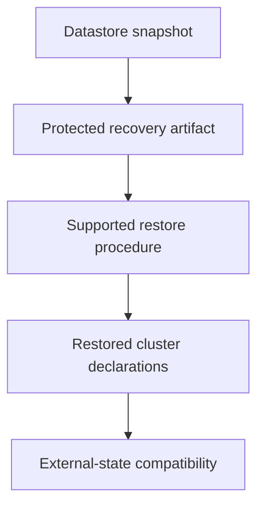

# Datastore Snapshots And The Limits Of Recovery

An etcd snapshot restores cluster objects, but the application database still contains newer writes. Cluster-state recovery and application-data recovery cover different systems.

## Learning objectives

- Explain supported component-version and upgrade order.
- Distinguish cordon, drain and disruption policy.
- Evaluate datastore snapshot scope and restore prerequisites.

## Before you start

This chapter is standalone reading material; no running cluster or installed tools are required. A Pod is the Kubernetes unit for running one or more containers, and a namespace groups namespaced objects. Treat the worked configurations as teaching examples rather than recorded observations from a provisioned environment.

## Responsible components and behavior

Etcd is the distributed key-value datastore commonly used for Kubernetes cluster state. A snapshot records datastore content for a supported recovery process. It can help recover resource definitions and cluster state, but it is not a backup of every application file, persistent volume or external database used by those resources.

## Identify What Is Being Protected

Cluster state includes the stored objects and configuration used by the application programming interface (API). Application data can reside in a separate storage system, volume or managed service. Restoring a Pod definition from datastore state does not necessarily restore the report files that its application wrote yesterday.

A recovery plan therefore identifies each protected data set and its source of truth. The datastore snapshot, certificate material, bootstrap configuration and application backups have related but distinct purposes. Protecting only one of them can leave the system unable to resume its intended operation after a major failure.

Snapshots can contain confidential cluster objects. Their storage needs access control and suitable confidentiality protection. Copying a snapshot into a publicly readable location can expose more than benign configuration. An ordinary filename is not a protection mechanism, and retention should consider both recovery needs and sensitive content.

## Understand Snapshot Evidence

A supported snapshot operation connects to an appropriate datastore endpoint using required trust and credentials. The client and datastore versions must follow the supported procedure. Using the wrong tool or endpoint can produce an artifact that is not suitable for the intended restore even if a command returns a success indication.

Validation can inspect the snapshot's integrity and relevant metadata. That is important evidence about the artifact, but it does not prove that a full recovery has been rehearsed. A restore test examines whether the selected artifact, topology and dependent configuration can produce the intended result.

Snapshot age defines a possible loss window. Changes after the snapshot can be absent from restored cluster state. Application systems may have continued changing independently, so the restored resource definitions and current external data must be reconciled deliberately. A recent snapshot can still be unsuitable if it contains a state that was already incorrect.

## Restoring Datastore State Changes Identity

A supported restore creates a data directory and membership configuration for the recovery topology. Endpoint names, peer addresses and certificates must fit that topology. Replacing an arbitrary live data directory with a copied file is not equivalent to the supported snapshot restore process.

Control-plane processes must use the restored endpoint and storage arrangement consistently. In a kubeadm static-Pod arrangement, local manifests and mounted data locations contribute to that relationship. A valid restored data directory at one path does not help a process configured to read another path.

Running Kubernetes watchers and caches also matter when recovering an earlier revision history. Supported recovery guidance can require revision bumping and compaction marking so consumers recognize the restored state appropriately. The exact options belong to the datastore tooling and version in use; they should not be replaced by a guessed generic command.

## Verify More Than Process Startup

After recovery, inspect datastore health, API access and control-plane reconciliation. Then compare expected resource state with the chosen snapshot and investigate any mismatch with surviving workloads or external services. Restored desired objects can cause controllers to create, remove or alter resources as they resume their work.

Application recovery needs its own verification. A reconstructed Deployment pointing to a missing Secret or stale backend reference can still fail. A restored claim definition does not prove that the backend volume contains the required data or can be attached under the current infrastructure.

The recovery explanation should state the snapshot identity, age, integrity evidence, target topology and remaining application data work. This separates a protected artifact from a demonstrated recovery. It also helps an administrator avoid claiming that datastore backup alone provides universal protection against application loss.

## Work through the decision

etcd persists Kubernetes control-plane state. A supported snapshot captures that datastore's recoverable content under the chosen method. It does not capture every external volume, registry image, identity-system credential or application database transaction.

Protect the snapshot because it can contain sensitive object data, and rehearse restoration against the supported release procedure. A restored control plane must also have usable trust, endpoints and component configuration. Before reconnecting workloads, evaluate whether restored declarations remain compatible with external state. Object existence after restore is evidence of one recovery layer; meaningful application operations establish another.

A datastore restore preserves one state boundary and must be coordinated with the other systems the application depends on.

A datastore restore preserves one state boundary and must be coordinated with the other systems the application depends on.

## Common pitfalls

> [!WARNING]
> A datastore snapshot protects cluster state, not every application data source. Restore through the supported version-specific process and verify membership, paths, watcher behavior and application dependencies separately.
