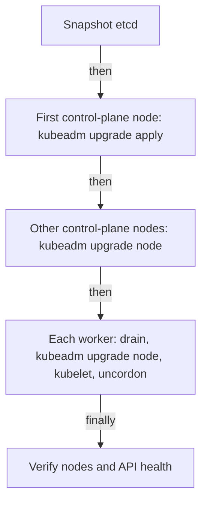

# The kubeadm Upgrade Sequence

This part is the procedure for a cluster created with `kubeadm` on Debian or Ubuntu hosts with packages from the Kubernetes package repository. The commands change real hosts, so they are shown to read and not to run in the playground. The playground nodes are containers, and they have no `apt` and no `kubeadm` command. The commands for other distributions differ in the package step only.

## The order

The procedure upgrades one minor version, for example from 1.34 to 1.35, in this order:

1. Upgrade `kubeadm` on the first control-plane node.
2. Run `kubeadm upgrade plan` and `kubeadm upgrade apply` on that node.
3. Drain the node, upgrade `kubelet` and `kubectl`, restart the kubelet, and uncordon the node.
4. Repeat for every other control-plane node, using `kubeadm upgrade node` in place of `apply`.
5. Repeat for every worker, one at a time or in small groups, using `kubeadm upgrade node`.



The diagram shows the control plane upgraded before any worker, with one `apply` and the rest `node`.

`kubeadm upgrade` changes the control-plane static Pods and the cluster configuration. It does not upgrade the `kubelet` package or `kubectl`. You do that with the package manager on each node.

## First control-plane node

The package repository for Kubernetes on `pkgs.k8s.io` has one repository for each minor version. Edit the repository line in `/etc/apt/sources.list.d/kubernetes.list` so that it names the target minor version, then refresh the package index. Find the exact package version with `apt-cache madison`. Replace `<PATCH>` below with the value from that list, such as `1.35.2-1.1`:

```sh
sudo apt-get update
apt-cache madison kubeadm
sudo apt-mark unhold kubeadm
sudo apt-get install -y kubeadm='<PATCH>'
sudo apt-mark hold kubeadm
kubeadm version
```

The packages are held so that a normal system update cannot upgrade them by accident. Check that `kubeadm version` shows the target version. Then ask kubeadm what it can do. `kubeadm upgrade plan` checks the cluster, lists the versions that you can upgrade to, and shows the component versions before and after:

```sh
sudo kubeadm upgrade plan
```

Apply the upgrade with the exact target version from the plan. The command upgrades the API server, controller manager, scheduler and `kube-proxy`, updates CoreDNS and etcd if needed, and renews the certificates that it manages unless you pass `--certificate-renewal=false`:

```sh
sudo kubeadm upgrade apply v1.35.2
```

Replace `v1.35.2` with your target. The command shows an overview and asks for confirmation, and it ends with a message that the upgrade succeeded. Then upgrade the node's own packages. Drain the node first, so that no workload runs while the kubelet restarts. Run the drain from a machine that has `kubectl` configured, for example the control-plane node itself:

```sh
kubectl drain <node-name> --ignore-daemonsets
sudo apt-mark unhold kubelet kubectl
sudo apt-get install -y kubelet='<PATCH>' kubectl='<PATCH>'
sudo apt-mark hold kubelet kubectl
sudo systemctl daemon-reload
sudo systemctl restart kubelet
kubectl uncordon <node-name>
```

The `daemon-reload` command makes systemd read the unit file that the new package may have changed, and the restart starts the new kubelet. After the uncordon, `kubectl get nodes` shows the new version for this node.

## Other control-plane nodes and workers

On each other control-plane node, install the new `kubeadm`, then run the node command instead of `apply`. It reads the cluster configuration that the first node already updated and upgrades the local static Pods:

```sh
sudo kubeadm upgrade node
```

On a worker, the sequence is the same: install the new `kubeadm`, run `sudo kubeadm upgrade node`, and then drain, upgrade `kubelet` and `kubectl`, restart the kubelet and uncordon. The difference is that a worker has no control-plane Pods, so the node command only updates the kubelet configuration. Do one worker, check `kubectl get nodes`, and continue. If the drain is blocked by a PodDisruptionBudget, fix the cause and do not force the eviction.

## When something goes wrong

`kubeadm upgrade apply` backs up the manifests of the static Pods and the etcd data in a directory under `/etc/kubernetes/tmp` before it changes them. If the upgrade fails halfway, it tries to roll back to those files. If a rollback also fails, you restore the manifests from that directory or restore etcd from your own snapshot, which is the subject of the next part. A failed `kubeadm upgrade apply` can be run again once the cause is fixed.

You now have the full sequence for a kubeadm cluster. The part that decides whether a failure is a short interruption or a long outage is the snapshot that you take before step one.

## Common pitfalls

> [!WARNING]
> - **Running `kubeadm upgrade apply` on every control-plane node.** Use it once. Other nodes use `kubeadm upgrade node`.
> - **Skipping a minor version.** `kubeadm upgrade plan` shows only the supported targets.
> - **Forgetting to upgrade the `kubelet`.** `kubeadm` does not do it, and the node keeps the old version.
> - **Skipping `systemctl daemon-reload` and the kubelet restart.** The node keeps running the old kubelet.
> - **Unholding packages and leaving them unheld.** A later system update can upgrade Kubernetes by accident. Hold them again.
> - **Upgrading all workers at once.** Applications lose capacity. Go one worker at a time.
