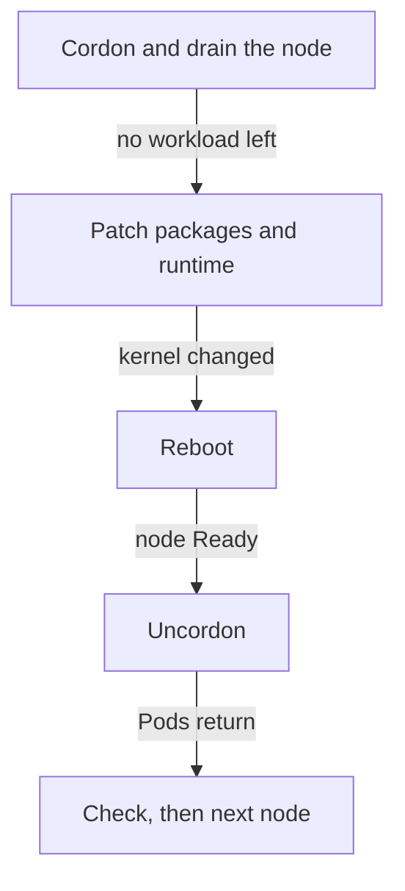

# Patch The Operating System And Container Runtime On Nodes

The `kubelet` and the control-plane components are only part of a node. Below them run the operating system, the kernel and the container runtime, and attackers use flaws in all three. A Kubernetes upgrade does not fix them. This part shows what to patch on a node, the rotation that keeps the application available, and the leftovers a maintenance window can leave behind.

## What lives on a node

A node is a host with four layers that need patches. The **operating system packages** include system libraries and tools such as `openssl`. The **kernel** is the core of the operating system; every container on the node shares it, so a kernel flaw can let a process escape its container. The **container runtime** (`containerd` in most clusters) starts and stops containers. The **Kubernetes node packages** are `kubelet`, `kubeadm` and `kubectl`.

The first three layers are patched with the distribution's tools. The last is patched with the upgrade procedure. A security policy has to cover both groups, because a cluster with a perfect Kubernetes version can still be taken over through an old kernel.

## Read what a node runs

The node object shows the operating system image, the kernel and the runtime version. Read them for every node before and after a patch, so that the change is visible:

<!-- astrona:playground:renew -->

```sh
kubectl get nodes -o custom-columns=NAME:.metadata.name,OS:.status.nodeInfo.osImage,KERNEL:.status.nodeInfo.kernelVersion,RUNTIME:.status.nodeInfo.containerRuntimeVersion
```

Compare each value with the fixed version of a record. In the playground the nodes are containers, so the kernel is the host kernel; on real machines each node has its own. The kernel version changes only after a reboot, and this is why a patched kernel can still run the old version: the package is new, but the running kernel is the one that booted.

## The rotation

The safe routine patches one node at a time, in the order of the patch waves, and it repeats the same steps for each node.



The diagram shows the order within one node. The check at the end decides whether the next node starts.

Here is each step with the component that does it. `kubectl drain` makes the API server evict the Pods, and a controller recreates them on other nodes. On Debian or Ubuntu hosts, the package manager patches the packages. These host commands are shown to read:

```sh
sudo apt-get update
sudo apt-get upgrade -y
test -f /var/run/reboot-required && echo reboot needed
sudo systemctl reboot
```

The `apt-get upgrade` command does not upgrade packages that are held, so a Kubernetes node package that you held for the upgrade procedure stays on its version. The marker file `/var/run/reboot-required` appears after a kernel or core library update on these systems. After the reboot, the kubelet starts again and the node becomes Ready. Then you uncordon it. If the runtime package changed, restart the runtime before the node returns. Drain first, so that no workload is affected by the restart.

Some teams skip in-place patching. They create a new node from a newer image, add it to the cluster, drain the old node and delete it. This is called node replacement. It gives the same result as patching and the nodes stay identical, but it needs automation to create nodes.

## Automatic reboots

Unattended security updates install patches without a person. They are good for packages, but a kernel update still needs a reboot, and an unplanned reboot takes down every Pod on the node at once. A reboot controller such as Kured solves this. It watches for the reboot marker file, takes a lock so that only one node reboots at a time, drains the node, reboots it and uncordons it. Whatever tool you use, the rules are the same: one node at a time, drained first, and a disruption budget in place.

## Practise the maintenance state

You can see the states of a window with `kubectl` only. Start with a taint, which is a key, value and effect on a node that keeps Pods away unless they tolerate it. The effect `NoSchedule` stops new Pods and keeps the running ones. Cordon the first worker and add a taint:

```sh
kubectl cordon astro-ats-032-playground-040-03-worker
kubectl taint nodes astro-ats-032-playground-040-03-worker maintenance=patching:NoSchedule
kubectl get nodes
kubectl describe node astro-ats-032-playground-040-03-worker | grep -i -A2 taints
```

The node shows `Ready,SchedulingDisabled`. Cordon also adds its own taint named `node.kubernetes.io/unschedulable`, and the description lists both taints. Now undo the work in two steps, and look at the result after the first step:

```sh
kubectl uncordon astro-ats-032-playground-040-03-worker
kubectl describe node astro-ats-032-playground-040-03-worker | grep -i -A2 taints
```

The node is schedulable again, but the taint `maintenance=patching:NoSchedule` is still there, because uncordon clears only the unschedulable flag, and the controller then removes its own taint. A new Pod that does not tolerate the taint cannot run on the node. Remove the taint with a trailing minus sign:

```sh
kubectl taint nodes astro-ats-032-playground-040-03-worker maintenance=patching:NoSchedule-
```

You can now patch a node in a way that does not break the application, and you know the two leftovers a window can leave. The next step is a check that finds them.

## Common pitfalls

> [!WARNING]
> - **Patching the kernel and not rebooting.** The package is new, but the running kernel is still the old one.
> - **Rebooting a node that was not drained.** Every Pod on it stops at once.
> - **Patching all nodes in one window step.** The application loses all capacity at the same time.
> - **Running `kubectl uncordon` and expecting the node to be normal.** A custom taint stays until you remove it.
> - **Letting a system update upgrade held Kubernetes packages.** Keep the hold and upgrade them with the upgrade procedure.
