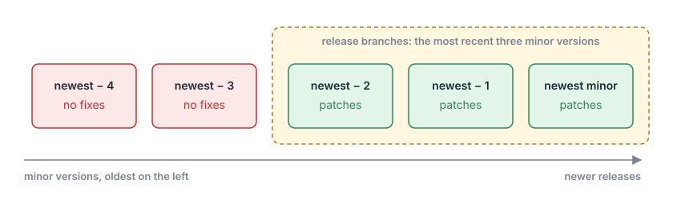
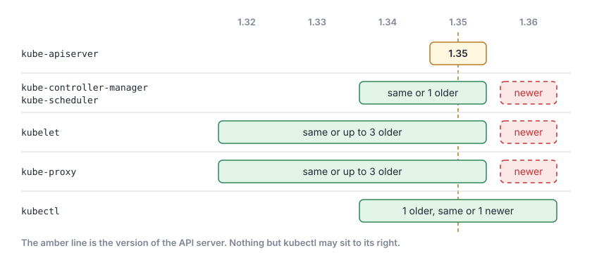

# Versions, Skew And Support

Before you change anything in a cluster, you need to know two things: which versions run today, and what the rules allow. If you skip this step, you can start an upgrade that Kubernetes does not support, or leave the cluster on a version that no longer gets security fixes.

On this page, you learn how Kubernetes numbers its versions, which releases receive fixes, and how far apart the components of one cluster may be. Then you read the versions of the live playground cluster and write a short upgrade plan.

## Version numbers and support

A Kubernetes version has the form `v1.35.2`. The middle number is the **minor** version, and the last number is the **patch** version. A new minor version comes out about three times a year. Patch releases come more often, and they carry bug fixes and security fixes.

The Kubernetes project keeps release branches for the most recent three minor versions. A minor version that falls out of that window gets no more fixes, even for a published vulnerability. The only way to protect a cluster on such a version is to upgrade it.



The drawing shows the support window: the newest minor version and the two before it get patches, and every older minor version gets nothing.

The two kinds of upgrade carry different risk:

- A **patch upgrade** stays inside one minor version, for example from `v1.35.2` to a later `v1.35` patch. It is low risk, and you should apply it quickly.
- A **minor upgrade** moves to the next minor version, for example from 1.35 to 1.36. It changes behavior, so you must plan it. Read the release notes for removed APIs and changed defaults before you start.

## Version skew

During an upgrade, the components of a cluster run different versions for a while. The difference between two component versions is called version skew. Kubernetes states which differences it supports. For a cluster at version 1.35, the rules are:

| Component | Supported relation to `kube-apiserver` |
| --- | --- |
| Other `kube-apiserver` instances in a high-availability control plane | Up to one minor version older |
| `kube-controller-manager`, `kube-scheduler`, `cloud-controller-manager` | The same version or up to one minor older. Never newer |
| `kubelet` | The same version or up to three minor versions older. Never newer |
| `kube-proxy` | The same version or up to three minor versions older, and not newer than the kubelet on the same node |
| `kubectl` | One minor version older or newer |



The drawing places each rule on a line of minor versions. Green cells are supported versions, and red dashed cells are versions that the rules do not allow.

These rules set the upgrade order. The API server goes first. The controller manager, the scheduler and the other control-plane components follow, and the kubelets come last. The API server must never be older than a component that talks to it.

The kubelet may run up to three minor versions older than the API server. That allowance gives you time to upgrade the nodes in groups. Skipping a minor version of the control plane is not supported. To go from 1.33 to 1.35, upgrade to 1.34 first and then to 1.35.

## Read the versions of a live cluster

The rules only help if you know what runs. Open a shell on the playground with `astrona ssh astro-ats-032-playground-040-01`. Start with the client and the server: `kubectl version` prints the version of `kubectl` itself and the version that the API server reports.

<!-- astrona:playground:renew -->

```sh
kubectl version
```

The playground printed:

```text
Client Version: v1.35.10
Kustomize Version: v5.7.1
Server Version: v1.35.10
```

The client and the server run the same version, which is inside the allowed skew of one minor version. Kustomize is a tool built into `kubectl`, and its version is not a Kubernetes version. The server version is the version of the API server.

The kubelet on each node can still run a different version, so list the nodes next:

```sh
kubectl get nodes -o wide
```

```text
NAME           STATUS   ROLES           AGE   VERSION    INTERNAL-IP   EXTERNAL-IP   OS-IMAGE             KERNEL-VERSION      CONTAINER-RUNTIME
controlplane   Ready    control-plane   57s   v1.35.10   10.0.2.15     <none>        Ubuntu 24.04.5 LTS   6.8.0-149-generic   containerd://2.2.1
```

The `VERSION` column shows the version of the kubelet on that node, and the last column shows the container runtime. The playground has one node. In a cluster with many nodes, all nodes show the same value when no upgrade is in progress.

The control-plane components run as Pods in the `kube-system` namespace. The tag of each container image is the version of that component, so you can print the images:

```sh
kubectl -n kube-system get pods -o custom-columns=NAME:.metadata.name,IMAGE:.spec.containers[*].image
```

```text
NAME                                   IMAGE
coredns-7d764666f9-kgspt               registry.k8s.io/coredns/coredns:v1.13.1
coredns-7d764666f9-mjqbv               registry.k8s.io/coredns/coredns:v1.13.1
etcd-controlplane                      registry.k8s.io/etcd:3.6.6-0
kube-apiserver-controlplane            registry.k8s.io/kube-apiserver:v1.35.10
kube-controller-manager-controlplane   registry.k8s.io/kube-controller-manager:v1.35.10
kube-proxy-plpdt                       registry.k8s.io/kube-proxy:v1.35.10
kube-scheduler-controlplane            registry.k8s.io/kube-scheduler:v1.35.10
```

The Pods `kube-apiserver`, `kube-controller-manager`, `kube-scheduler` and `kube-proxy` all show `v1.35.10`. The `etcd` image (`3.6.6-0`) and the `coredns` image (`v1.13.1`) have their own version numbers, and these are not Kubernetes versions. The names of your Pods end in other random letters.

On a kubeadm cluster, the `kubeadm` tool has a version too. Run `kubeadm version` on the node to print it, and here it is `v1.35.10`. Before an upgrade, `kubeadm upgrade plan` lists the versions that you can upgrade to.

## Plan the upgrade

Now you know what runs, so you can plan. Write down four things before you start:

1. The current version of every component and the target version. The target is the next minor version, or the newest patch of the current minor version.
2. The maintenance window and the order of the nodes. Upgrade the control plane first, then the workers one at a time or in small groups.
3. The workloads that must not lose availability, and their PodDisruptionBudgets. A PodDisruptionBudget is an object that limits how many Pods of an application may be down at the same time.
4. The way back: a fresh etcd snapshot and a copy of the cluster configuration.

You now know how to find the versions that run, which versions may differ from each other, and in which order the components move. The open question is how to take a node out of service without losing the application that runs on it.

## Common pitfalls

> [!WARNING]
> - **Skipping a minor version.** The control plane supports upgrades of one minor version at a time.
> - **Upgrading a kubelet before the API server.** The kubelet may not be newer than the API server.
> - **Treating the `etcd` or `coredns` image tag as the Kubernetes version.** These images have their own version numbers.
> - **Running a client more than one minor version away from the server.** Some calls fail or behave in unexpected ways.
> - **Staying on a minor version that is out of the support window.** It no longer receives fixes for new vulnerabilities.
