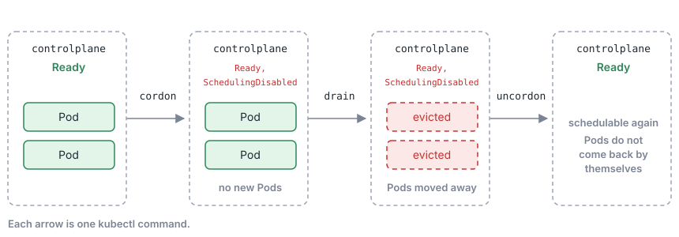
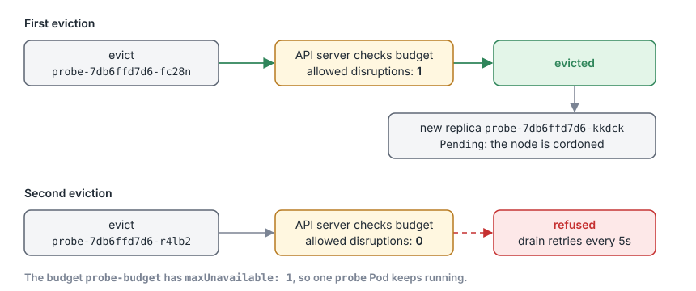

# Cordon, Drain And Disruption Budgets

You cannot upgrade a node while workloads run on it. The kubelet restarts during the upgrade, and in some upgrades the whole node restarts. Every Pod on that node would stop without warning.

On this page, you learn how to stop new Pods from landing on a node, how to move the existing Pods away, and how to keep the application available while you do it. A PodDisruptionBudget sets the limit that this move must respect.

## Cordon, drain and uncordon

Three `kubectl` commands handle a node during maintenance. Each one does a different job:

- `kubectl cordon <node>` marks the node unschedulable. The scheduler places no new Pods on it. Running Pods stay where they are.
- `kubectl drain <node>` cordons the node and then evicts its Pods. An eviction is a request to the API server to delete a Pod in a way that respects PodDisruptionBudgets. When a controller, such as a Deployment, owns the Pod, the controller creates a new Pod on another node.
- `kubectl uncordon <node>` makes the node schedulable again. Pods that moved away do not come back by themselves.



The drawing shows the state of the node after each command. Only `kubectl drain` removes Pods; the other two commands only change whether the scheduler may use the node.

A drain stops when it finds Pods that it cannot move safely. Three cases matter:

- **DaemonSet Pods.** The drain refuses them unless you add `--ignore-daemonsets`, because the DaemonSet controller would put the Pod back at once.
- **Bare Pods.** A bare Pod is a Pod that no controller owns. The drain refuses it, because nothing would recreate it. The `--force` flag deletes bare Pods anyway, and they are lost.
- **Pods with local `emptyDir` data.** The drain refuses them unless you add `--delete-emptydir-data`, because that data is deleted with the Pod.

## The PodDisruptionBudget

A drain on its own can still take an application down if it evicts all replicas at the same time. A **PodDisruptionBudget** (PDB) prevents that. It sets how many Pods of an application may be unavailable during a voluntary disruption, such as a drain. It selects the Pods with a label selector and uses one of two fields:

- `minAvailable` is the number or percentage of Pods that must stay available.
- `maxUnavailable` is the number or percentage of Pods that may be down at the same time.

When a drain evicts a Pod, the API server checks the budget first. If the eviction would break the budget, the API server refuses it with a message about the disruption budget. `kubectl drain` then retries until the budget allows the eviction or the timeout ends. A PDB protects only against voluntary disruptions, so it does not help when a node crashes.

A budget can also block a drain forever. A PDB with `minAvailable: 2` on a Deployment with two replicas allows no eviction at all, so the drain never completes.

## Drain the playground node

Now try it on the playground. The playground has one node, `controlplane`, and every Pod runs on it. On a cluster with several nodes, a drain moves Pods to the other nodes. Here there is no other node, so the scheduler has nowhere to put an evicted Pod, and the new Pod stays `Pending`. That makes the effect of a drain and of a budget easy to see.

<!-- astrona:playground:renew -->

The Deployment `probe` has two replicas. Save this as `pdb-probe-budget.yaml`. It allows one replica to be down at a time:

```yaml
apiVersion: policy/v1
kind: PodDisruptionBudget
metadata:
  name: probe-budget
  namespace: starfleet
spec:
  maxUnavailable: 1
  selector:
    matchLabels:
      app: probe
```

Apply it:

```sh
kubectl apply -f pdb-probe-budget.yaml
```

Then check the result:

```sh
kubectl -n starfleet get pdb probe-budget
```

```text
NAME           MIN AVAILABLE   MAX UNAVAILABLE   ALLOWED DISRUPTIONS   AGE
probe-budget   N/A             1                 1                     0s
```

`ALLOWED DISRUPTIONS` is `1`, because both replicas are ready and the budget lets one of them go. Now drain the node. The `--ignore-daemonsets` flag lets the drain skip the DaemonSet Pod of `kube-proxy`, and the timeout limits how long the command waits:

```sh
kubectl drain controlplane --ignore-daemonsets --timeout=60s
```

The playground printed the lines below. The command then printed the same error again in a short form, which is left out here:

```text
node/controlplane cordoned
error: unable to drain node "controlplane" due to error: cannot delete cannot delete Pods that declare no controller (use --force to override): outpost/drifter, starfleet/shuttle, continuing command...
```

`kubectl drain` cordoned the node first and then stopped before it evicted anything. It found the bare Pods `shuttle` and `drifter`, which no controller would recreate. The cordon stays in place: `kubectl get nodes` now shows `controlplane` with the status `Ready,SchedulingDisabled`.

The bare Pods block the whole drain. To see what the budget does, limit the drain to the `probe` Pods with `--pod-selector`. The drain then evicts only the Pods with that label:

```sh
kubectl drain controlplane --ignore-daemonsets --pod-selector app=probe --timeout=60s
```

The output is shortened here. The retry line repeated every 5 seconds until the timeout:

```text
node/controlplane already cordoned
evicting pod starfleet/probe-7db6ffd7d6-r4lb2
evicting pod starfleet/probe-7db6ffd7d6-fc28n
error when evicting pods/"probe-7db6ffd7d6-r4lb2" -n "starfleet" (will retry after 5s): Cannot evict pod as it would violate the pod's disruption budget.
pod/probe-7db6ffd7d6-fc28n evicted
...
error: unable to drain node "controlplane" due to error: error when evicting pods/"probe-7db6ffd7d6-r4lb2" -n "starfleet": global timeout reached: 1m0s, continuing command...
```

The API server accepted the first eviction, because the budget allowed one disruption. The Deployment controller then created a new replica, but the scheduler could not place it on the cordoned node. With one replica not ready, the budget allowed no more disruptions, so the API server refused the second eviction.



The drawing shows the two evictions in order. The budget let one `probe` Pod go and kept the other one running. Look at the Pods and the budget:

```sh
kubectl -n starfleet get pods -l app=probe -o wide
kubectl -n starfleet get pdb probe-budget
```

```text
NAME                     READY   STATUS    RESTARTS   AGE   IP           NODE           NOMINATED NODE   READINESS GATES
probe-7db6ffd7d6-kkdck   0/1     Pending   0          61s   <none>       <none>         <none>           <none>
probe-7db6ffd7d6-r4lb2   1/1     Running   0          78s   10.244.0.5   controlplane   <none>           <none>
NAME           MIN AVAILABLE   MAX UNAVAILABLE   ALLOWED DISRUPTIONS   AGE
probe-budget   N/A             1                 0                     67s
```

The new replica is `Pending` with no node, and `ALLOWED DISRUPTIONS` is now `0`. The budget kept one replica running and serving requests. On a cluster with more nodes, the new replica would start on another node and become ready, and then the budget would allow the second eviction. When the maintenance is done, return the node:

```sh
kubectl uncordon controlplane
```

`kubectl` answers `node/controlplane uncordoned`. A few seconds later, `kubectl get nodes` shows `controlplane` as `Ready` again, the `Pending` replica is `Running`, and the budget shows `ALLOWED DISRUPTIONS` of `1`. The bare Pods `shuttle` and `drifter` were never touched. Remove the budget with `kubectl -n starfleet delete pdb probe-budget` when you no longer need it.

## What a budget cannot do

A drain with a PDB protects availability only when the application has enough replicas and the cluster has room for them. One replica with `minAvailable: 1` can never be evicted. One replica without a PDB is down during the move. Without a free node, as on the playground, evicted Pods wait in `Pending`.

What makes a rolling node upgrade safe is a Deployment with replicas spread across nodes, together with a PDB. Pods that mount a volume that can attach to only one node need extra time to move, because the volume must detach first.

You can now take a node out of service, read why a drain stops, and return the node. The question still open is what changes inside the node and the control plane during the version upgrade itself.

## Common pitfalls

> [!WARNING]
> - **Draining without `--ignore-daemonsets`.** The drain stops on DaemonSet Pods.
> - **Using `--force` to get past a bare Pod.** The drain deletes the Pod, and nothing recreates it.
> - **A PDB that allows no disruption.** The drain waits forever. Use `--timeout`, and check `ALLOWED DISRUPTIONS`.
> - **Draining the only node that can run a workload.** The evicted Pods stay `Pending` until you uncordon the node or add a node.
> - **Forgetting `kubectl uncordon`.** The node stays unschedulable after the maintenance.
> - **Expecting a PDB to protect against a node failure.** It applies only to evictions.
