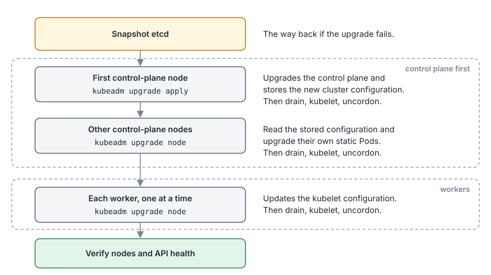
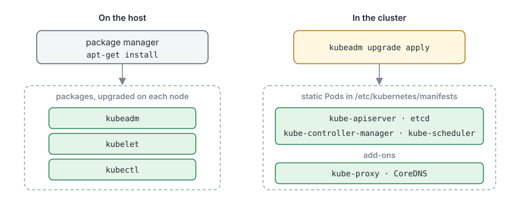

# The kubeadm Upgrade Sequence

Knowing the version rules and how to empty a node is not enough. At some point, someone has to change the versions. On a cluster that `kubeadm` created, you do that with `kubeadm` and with the package manager of each host, in a fixed order. If you mix up the order, a component can end up newer than the API server, and the cluster leaves the supported version rules.

On this page, you run the whole procedure on the playground, from Kubernetes 1.35 to 1.36. The playground runs Ubuntu and installs packages from a Kubernetes package repository. On other Linux distributions, only the package commands differ.

## The order

The procedure upgrades one minor version at a time, for example from 1.35 to 1.36. It runs in this order:

1. Upgrade `kubeadm` on the first control-plane node.
2. Run `kubeadm upgrade plan` and `kubeadm upgrade apply` on that node.
3. Drain the node, upgrade `kubelet` and `kubectl`, restart the kubelet, and uncordon the node.
4. Repeat for every other control-plane node, using `kubeadm upgrade node` in place of `apply`.
5. Repeat for every worker, one at a time or in small groups, using `kubeadm upgrade node`.



The drawing shows that the control plane is upgraded before any worker. Only the first control-plane node runs `kubeadm upgrade apply`; every other node runs `kubeadm upgrade node`.

Two different tools do the work, and it is important to know which one changes what. `kubeadm upgrade` changes the control-plane static Pods and the cluster configuration. A static Pod is a Pod that the kubelet starts from a manifest file in `/etc/kubernetes/manifests` on the node, not from the API server.

`kubeadm upgrade` does not upgrade the `kubelet` package or `kubectl`. You do that with the package manager on each node.



The drawing splits the work between the two tools. The package manager changes the programs on the host, and `kubeadm upgrade apply` changes what runs in the cluster.

In a real upgrade, you also save an etcd snapshot before the first command. The playground holds no data that you need, so the steps here start with the package repository.

## Upgrade kubeadm

The first tool to upgrade is `kubeadm` itself, because the new `kubeadm` knows how to install the new control plane. The Kubernetes package repository has one repository for each minor version, and the minor version is part of its address. On the playground, the repository is a local copy under `/opt/kubernetes-apt`, so it works without the internet.

Open a shell with `astrona ssh astro-ats-032-playground-040-01`, and change the repository line from `v1.35` to `v1.36`:

<!-- astrona:playground:renew -->

```sh
cat /etc/apt/sources.list.d/kubernetes.list
sudo sed -i 's#/v1.35/#/v1.36/#' /etc/apt/sources.list.d/kubernetes.list
cat /etc/apt/sources.list.d/kubernetes.list
```

```text
deb [signed-by=/etc/apt/keyrings/astrona-kubernetes-local.gpg] file:/opt/kubernetes-apt/v1.35/deb/ /
deb [signed-by=/etc/apt/keyrings/astrona-kubernetes-local.gpg] file:/opt/kubernetes-apt/v1.36/deb/ /
```

The first line is the old repository, and the second line is the new one. On a host that uses the public repository, the line names `pkgs.k8s.io` in place of the local path, and you change the minor version in the same way.

Next, `apt-get update` reads the package list of the new repository, and `apt-cache madison` lists the exact package versions that the repository offers:

```sh
sudo apt-get update
apt-cache madison kubeadm
```

The `apt-get update` output is long. The line for the Kubernetes repository and the result of `madison` were:

```text
Get:1 file:/opt/kubernetes-apt/v1.36/deb  InRelease [1523 B]
...
   kubeadm | 1.36.6-1.1 | file:/opt/kubernetes-apt/v1.36/deb  Packages
```

The package version is `1.36.6-1.1`. The packages are on hold, which means that `apt` does not upgrade them during a normal system update. Release the hold on `kubeadm`, install the exact version, and hold it again:

```sh
sudo apt-mark unhold kubeadm
sudo apt-get install -y kubeadm=1.36.6-1.1
sudo apt-mark hold kubeadm
kubeadm version -o short
```

The install output is shortened here to the lines from `apt-mark` and `kubeadm`:

```text
Canceled hold on kubeadm.
...
kubeadm set on hold.
v1.36.6
```

The new `kubeadm` is in place. It has not changed the cluster yet: the control plane still runs 1.35.

## Plan and apply on the control-plane node

Before kubeadm changes anything, ask it what it would do. `kubeadm upgrade plan` checks the health of the cluster and reads the kubeadm configuration that is stored in the cluster. Then it lists the versions before and after the upgrade:

```sh
sudo kubeadm upgrade plan
```

The output is shortened to the version tables:

```text
[upgrade/versions] Cluster version: 1.35.10
[upgrade/versions] kubeadm version: v1.36.6
...
Components that must be upgraded manually after you have upgraded the control plane with 'kubeadm upgrade apply':
COMPONENT   NODE           CURRENT    TARGET
kubelet     controlplane   v1.35.10   v1.36.6

Upgrade to the latest stable version:

COMPONENT                 NODE           CURRENT    TARGET
kube-apiserver            controlplane   v1.35.10   v1.36.6
kube-controller-manager   controlplane   v1.35.10   v1.36.6
kube-scheduler            controlplane   v1.35.10   v1.36.6
kube-proxy                               1.35.10    v1.36.6
CoreDNS                                  v1.13.1    v1.14.2
etcd                      controlplane   3.6.6-0    3.6.8-0

You can now apply the upgrade by executing the following command:

	kubeadm upgrade apply v1.36.6
```

The first table says that you must upgrade the kubelet by hand. The second table lists what `kubeadm upgrade apply` changes: the control-plane static Pods, `kube-proxy`, CoreDNS and etcd.

Run the command that the plan gives. Without `--yes`, kubeadm asks you to confirm with `y`. The flag answers for you:

```sh
sudo kubeadm upgrade apply v1.36.6 --yes
```

The command took about two and a half minutes on the playground. The output is shortened to a few lines:

```text
[upgrade/staticpods] Moving new manifest to "/etc/kubernetes/manifests/etcd.yaml" and backing up old manifest to "/etc/kubernetes/tmp/kubeadm-backup-manifests-2026-11-18-08-51-40/etcd.yaml"
...
[upgrade/staticpods] Component "kube-apiserver" upgraded successfully!
...
[addons] Applied essential addon: CoreDNS
[addons] Applied essential addon: kube-proxy

[upgrade] SUCCESS! A control plane node of your cluster was upgraded to "v1.36.6".

[upgrade] Now please proceed with upgrading the rest of the nodes by following the right order.
```

For each component, kubeadm wrote a new static Pod manifest, kept the old one as a backup, and waited until the kubelet had restarted the Pod. kubeadm also renewed the certificates that it manages. Pass `--certificate-renewal=false` if you do not want that.

## Upgrade the kubelet

The control plane now runs 1.36, but the kubelet of the node is still at 1.35. The kubelet restarts during its upgrade, so drain the node first. A drain refuses bare Pods, which are Pods that no controller owns. On the playground, `shuttle` and `drifter` are bare Pods that you do not need. Delete them, then drain the node:

```sh
kubectl -n starfleet delete pod shuttle
kubectl -n outpost delete pod drifter
kubectl drain controlplane --ignore-daemonsets --timeout=120s
```

```text
pod "shuttle" deleted from starfleet namespace
pod "drifter" deleted from outpost namespace
node/controlplane cordoned
Warning: ignoring DaemonSet-managed Pods: kube-system/kube-proxy-b9lx7
evicting pod starfleet/probe-7db6ffd7d6-r4lb2
evicting pod kube-system/coredns-589f44dc88-j8j2t
evicting pod kube-system/coredns-589f44dc88-hjknb
evicting pod starfleet/probe-7db6ffd7d6-kkdck
pod/coredns-589f44dc88-j8j2t evicted
pod/coredns-589f44dc88-hjknb evicted
pod/probe-7db6ffd7d6-r4lb2 evicted
pod/probe-7db6ffd7d6-kkdck evicted
node/controlplane drained
```

On a real cluster, you move a bare Pod that you need to another node before the drain, because a deleted bare Pod does not come back. The playground has no other node, so the new `probe` and `coredns` Pods wait as `Pending`.

Now upgrade the two packages, make systemd read the unit files again, restart the kubelet, and uncordon the node:

```sh
sudo apt-mark unhold kubelet kubectl
sudo apt-get install -y kubelet=1.36.6-1.1 kubectl=1.36.6-1.1
sudo apt-mark hold kubelet kubectl
sudo systemctl daemon-reload
sudo systemctl restart kubelet
kubectl uncordon controlplane
```

The install output is left out here. The other commands printed:

```text
Canceled hold on kubelet.
Canceled hold on kubectl.
kubelet set on hold.
kubectl set on hold.
node/controlplane uncordoned
```

`systemctl daemon-reload` makes systemd read the unit files that the new package may have changed. `systemctl restart kubelet` stops the old kubelet and starts the new one. Now check the node, the package holds and the versions:

```sh
kubectl get nodes
apt-mark showhold
kubectl version
```

```text
NAME           STATUS   ROLES           AGE     VERSION
controlplane   Ready    control-plane   7m35s   v1.36.6
falco
kubeadm
kubectl
kubelet
Client Version: v1.36.6
Kustomize Version: v5.8.1
Server Version: v1.36.6
```

The node runs kubelet `v1.36.6`, the API server is `v1.36.6`, and the three Kubernetes packages are on hold again. The fourth held package, `falco`, is a runtime security tool that watches system calls. The image holds it at its version, and the upgrade does not touch it.

The `probe` and `coredns` Pods stayed `Pending` for about a minute after the uncordon, while the control-plane Pods restarted, and then they ran. Check with `kubectl get pods -A` until all Pods are `Running`.

## Other control-plane nodes and workers

The playground has one node, so its upgrade is complete. On a cluster with more nodes, the work continues node by node. The first control-plane node has already updated the cluster configuration, so the other nodes only need to follow it.

On each other control-plane node, install the new `kubeadm` in the same way, and then run `sudo kubeadm upgrade node` in place of `apply`. `kubeadm upgrade node` reads the configuration that the first node stored, and it upgrades the local static Pods of that node. Then drain the node, upgrade `kubelet` and `kubectl`, restart the kubelet and uncordon the node, as on the first node.

On a worker, the steps are the same. A worker has no control-plane static Pods, so `kubeadm upgrade node` only updates its kubelet configuration. Run `kubectl drain` and `kubectl uncordon` for a worker from a machine where `kubectl` works, such as the control-plane node.

Do one worker, check `kubectl get nodes`, and then continue with the next one. If a PodDisruptionBudget blocks a drain, fix the cause and do not force the eviction.

## When something goes wrong

An upgrade can fail halfway, so it helps to know what kubeadm keeps. `kubeadm upgrade apply` saves backups under `/etc/kubernetes/tmp` before it changes anything. On the playground, `sudo ls /etc/kubernetes/tmp` showed three directories:

- `kubeadm-backup-etcd-2026-11-18-08-51-40` with a copy of the etcd data;
- `kubeadm-backup-manifests-2026-11-18-08-51-40` with the old static Pod manifests;
- `kubeadm-kubelet-config-2026-11-18-08-54-08` with the old kubelet configuration.

If the upgrade of a component fails, kubeadm tries to roll back that component from these files. If the rollback also fails, you copy the manifests back by hand or restore etcd from your own snapshot. You can run a failed `kubeadm upgrade apply` again once you have fixed the cause.

You have now run the full sequence on a kubeadm control-plane node, and you know how it continues on the other nodes. The question still open is the snapshot: how do you save etcd before the first step, so that a failure is a short interruption and not a lost cluster?

## Common pitfalls

> [!WARNING]
> - **Running `kubeadm upgrade apply` on every control-plane node.** Use it once. Other nodes use `kubeadm upgrade node`.
> - **Forgetting to change the package repository.** Each repository holds one minor version, so `apt-cache madison` shows no newer minor version.
> - **Skipping a minor version.** `kubeadm upgrade plan` shows only the supported targets.
> - **Forgetting to upgrade the `kubelet`.** `kubeadm` does not do it, and the node keeps the old version.
> - **Skipping `systemctl daemon-reload` and the kubelet restart.** The node keeps running the old kubelet.
> - **Unholding packages and leaving them unheld.** A later system update can upgrade Kubernetes by accident. Hold them again.
> - **Upgrading all workers at once.** Applications lose capacity. Upgrade one worker at a time.
