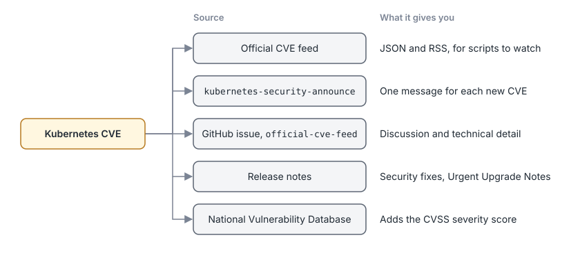
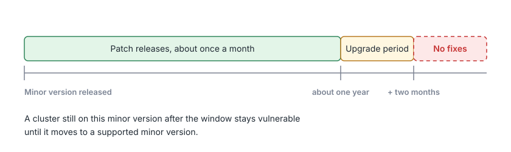
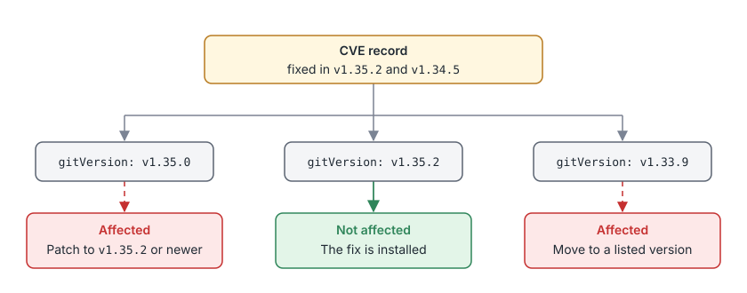

# Where Vulnerabilities Are Published

A cluster is only as safe as the newest fix you have installed. When the Kubernetes project learns about a flaw, it fixes the flaw in a patch release and announces it. Nobody installs that fix in your cluster for you.

On this page, you see where the announcements appear and what a record contains. Then you compare a record with the version that runs in the playground.

## The sources

Kubernetes has several public sources, and each one answers a different question:

- **The official CVE feed.** The Kubernetes website publishes a machine-readable list of every CVE (Common Vulnerabilities and Exposures record) that affects Kubernetes components. It is available as JSON and as an RSS feed, so a script or a feed reader can watch it. This is the source to automate.
- **The security announcements mailing list.** The Product Security Committee is the group that handles reports of flaws. It sends a message to the list `kubernetes-security-announce` for each new CVE. The message names the affected components and the fixed versions.
- **The GitHub issue for the CVE.** Each CVE also has an issue in the Kubernetes repository with the label `official-cve-feed`. The issue holds the discussion and the technical detail.
- **The release notes and the changelog.** Every release has notes. They list security fixes, API removals and deprecations. They also have a section named "Urgent Upgrade Notes" for changes that can break a cluster during an upgrade.
- **The National Vulnerability Database.** This is the general public database of CVEs for all software. It adds the severity score and links the CVE to the products.



The drawing shows the five sources for one Kubernetes CVE and what each one gives you.

These sources cover Kubernetes itself, but a cluster has more parts. A flaw in the container runtime, the operating system or an add-on has its own source, such as the security advisories of that project or the security tracker of the Linux distribution. Each component of the cluster needs a source that you watch.

## What a CVE record tells you

Once you have found a record, you need to read it. A record answers five questions:

- Which component is affected, such as the kubelet, `kube-apiserver` or `ingress-nginx`?
- Which versions contain the flaw?
- Which versions contain the fix?
- How severe is the flaw?
- What must an attacker have to use it?

The severity is the **CVSS** (Common Vulnerability Scoring System) base score, a number from 0.0 to 10.0. A score from 9.0 is Critical, 7.0 to 8.9 is High, 4.0 to 6.9 is Medium, and a lower score is Low.

The vector string behind the score lists the conditions of an attack. It says whether the attacker needs network access or local access, whether the attacker needs credentials, and whether a user must do something. Read the vector, not only the number. A High flaw that needs local access to a node and a `cluster-admin` credential matters less than a Medium flaw that any anonymous client can reach over the network.

## Patch releases and the support window

The record tells you which version holds the fix. That fix reaches you as a patch release. The patch version is the last number in `v1.35.2`. A patch release contains bug fixes and security fixes but no new features, so it is the lowest-risk kind of upgrade. The project issues patch releases for each supported minor version about once a month, and it issues an extra release outside that schedule for a serious flaw.

A fix only helps if your minor version still receives it. Each minor version receives patches for about one year. A two-month period to upgrade follows. After that, the version gets no more fixes, even for a published CVE.



The drawing shows the life of one minor version. A cluster that is still on that version after the window stays vulnerable until it moves to a supported minor version. So you always ask two questions: is there a newer patch in my minor version, and is my minor version still supported at all?

## Compare the cluster with a record

To compare a record with your cluster, you need the exact version of the running API server. The first command prints the version of the client and of the server. The second command asks the API server for its own version document.

<!-- astrona:playground:renew -->

```sh
kubectl version
kubectl get --raw /version
```

The second command prints a JSON document. The field `gitVersion` is the server version, in the form `v1.35.0`. The document also holds the Go version and the build date.

Compare `gitVersion` with the "fixed in" list of a record. Say the record puts the fix in `v1.35.2` and `v1.34.5`. A cluster on `v1.35.0` is then affected, and a patch upgrade to `v1.35.2` or newer fixes it. A cluster on `v1.33.9` is affected too, but it must first move to a version that is in the list.



The drawing shows the three cases side by side for the same record.

The same comparison applies to each component, not only to the API server. The kubelet version of a node is not always the API server version, because the supported version skew lets nodes run older kubelets. So you match a flaw in the kubelet against every node.

## Automate the watch

Reading announcements by hand fails the first time someone is on holiday. A better design uses the CVE feed as the input of a job. The job reads the feed and filters it by component name and by the version in your inventory. When a record matches, the job opens a ticket. The inventory of your cluster is the second input of that job.

You now know where records come from and how to read one. A record is only useful when you can say exactly what your own cluster runs, and that is the open question.

## Common pitfalls

> [!WARNING]
> - **Reading only the severity number.** The attack vector decides whether the flaw is reachable in your cluster.
> - **Checking the API server version alone.** Match a flaw in the kubelet, the runtime or an add-on against the version of that component.
> - **Believing the minor version is supported because it still works.** After the support window, it receives no fixes.
> - **Watching only one source.** Flaws in the runtime, the operating system and add-ons are published elsewhere.
> - **Skipping the release notes.** The Urgent Upgrade Notes list changes that can break the upgrade itself.
